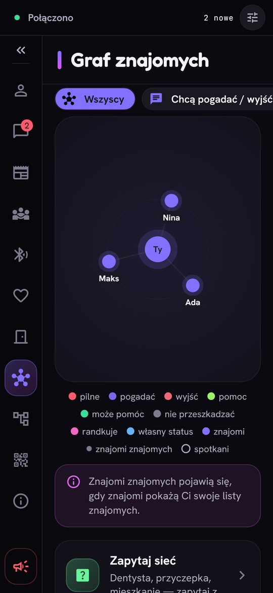
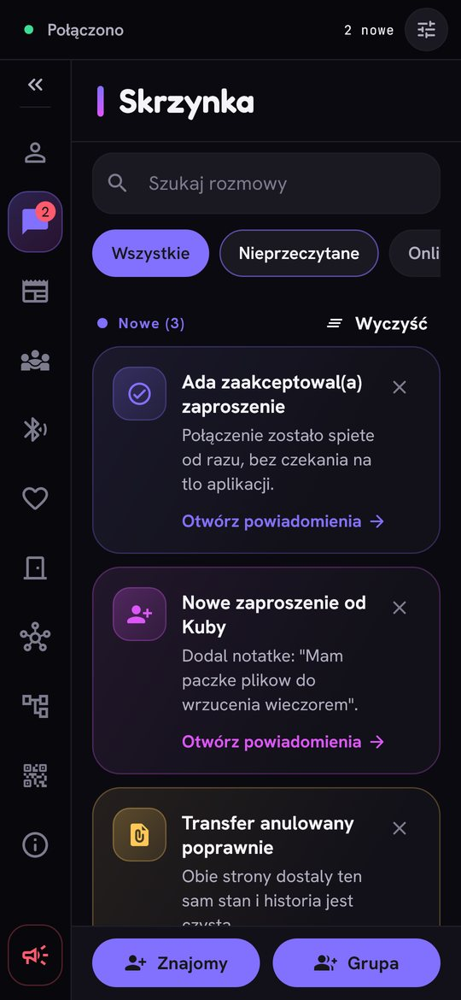
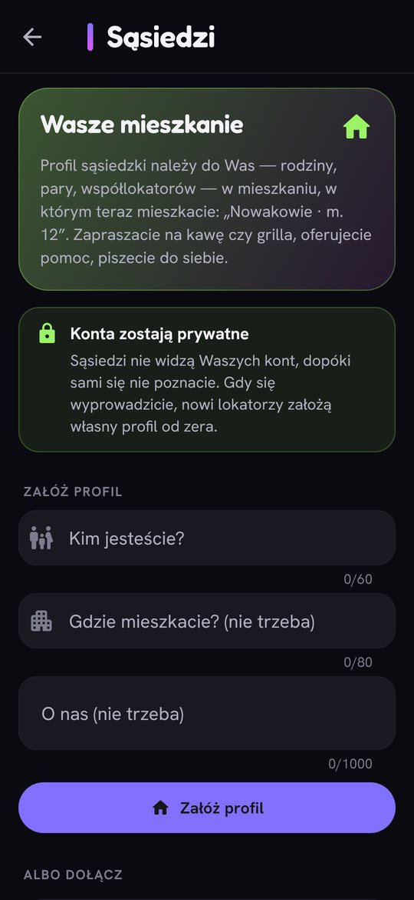
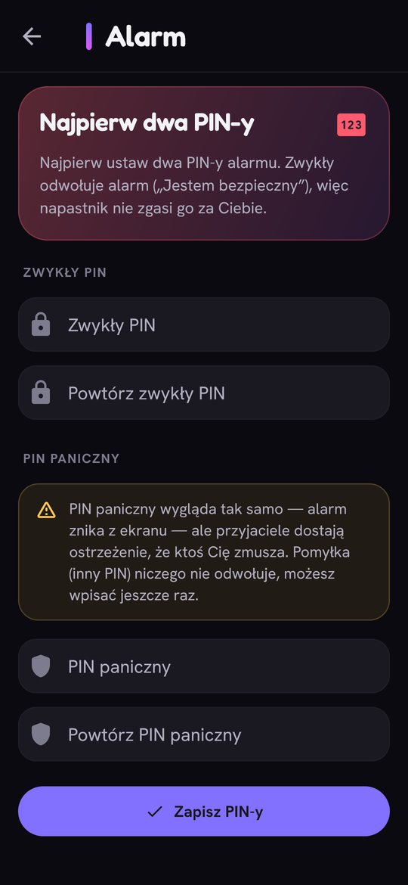

🇵🇱 [Polska wersja](README.pl.md)

<p align="center">
  
</p>

<h1 align="center">Zen</h1>

<p align="center">
  <b>A network of people who know each other.</b><br>
  A messenger and social network with no servers, no ads and no algorithm.
</p>

<p align="center">
  <a href="https://github.com/robertostrowskijagoda/Zen/releases/latest/download/Zen.apk"><b>⬇ Download for Android</b></a>
  &nbsp;·&nbsp;
  <a href="https://github.com/robertostrowskijagoda/Zen/releases/latest/download/Zen-Windows.zip"><b>⬇ Download for Windows</b></a>
  &nbsp;·&nbsp;
  <a href="#iphone"><b>📱 iPhone</b></a>
  &nbsp;·&nbsp;
  <a href="#mac-linux"><b>💻 Mac, Linux</b></a>
  &nbsp;·&nbsp;
  <a href="https://robertostrowskijagoda.github.io/Zen/"><b>📲 Open in the app</b></a>
  &nbsp;·&nbsp;
  <a href="#support-zen"><b>💜 Support</b></a>
</p>

> **Did someone show you a QR code?** The code opens an invitation page: if you
> have Zen, the page opens it right away with the invitation; if you don't, it
> shows the download buttons. After installing, come back to that page and tap
> **Open in Zen** (or in Zen: **Invite → I have someone's code** and scan the
> code again).
>
> **Already have Zen on Android?** Turn this on once in Zen: **Invite → Zen codes
> straight into the app → Open supported links**. From then on a code scanned
> with the ordinary camera opens straight in Zen.

<p align="center">
  
  
  
  
</p>

## What it is

Zen is a messenger and network for people who know each other — but without a
company in the middle. There is no server that sees everything, no ads and no
algorithm deciding what you see. Messages, photos and posts go straight between
your friends' phones and computers, encrypted, and your data stays on your device.
(One exception: the GIF search uses an outside company, klipy.com — details in
"Privacy and security".)

Zen also aims to change how people decide shared matters: the **pyramid** is built
from small cells of people who know each other in person — votes, trust and a
common purse flow from the bottom up, with no headquarters that could be bribed or
shut down.

## What it can do

- **Conversations** — chats, groups, voice notes, audio and video calls, encrypted from sender to recipient; screen sharing; a board tab in groups; GIFs from the klipy.com search (an outside company).
- **Feed** — posts with photos, videos and audio recordings, only for the people you choose; you decide per profile field who sees it.
- **Live meetings** — a "right now" status (a walk, coffee, *I urgently need help*), events, dinners through friends, a weekend plan.
- **Friend graph** — who knows whom, including friends of friends; introductions through a mutual friend; zoom and clusters.
- **Neighbours** — people from your building (a code on the door); **dating** through mutual friends, with an on-demand location for a friend watching over your date.
- **Alarm** — call your closest people with one move, with your location and confirmation of who saw it.
- **People nearby** — over Bluetooth, even without internet, with per-friend keys so nobody can fake another friend's presence.
- **Offline mailboxes** — photos, videos and files for a friend who is offline wait at their mailboxes (your mutual friends), encrypted, and arrive when they return.
- **Pyramid** — grassroots voting, delegated trust, a common purse and points.
- **Account safety** — account recovery through trusted friends or a paper backup of the key; friendship levels (weak friend / friend / close friend) that decide who sees your friend list, statuses and group invitations; an 18+ gate for dating and the pyramid.
- **"Why is it not working?"** — a built-in diagnostic screen (network, background work, notifications, battery, clock, free space).
- **21 languages** — Zen speaks the language of your phone or computer (English if it doesn't know it); change it in **Settings → Language**.
- **Phone and computer** — Android (arm64, armv7, x86_64), iPhone, Windows (x64, ARM64), Linux (x64, arm64) and Mac; one account on several devices.

## How to install

### Android

1. On your phone open this page and tap **Download for Android**.
2. When the file has downloaded, tap it (or open **Downloads**).
3. The phone will ask whether to allow the browser to install apps — tap
   **Settings**, turn on **Allow from this source** and go back.
4. Tap **Install**. If a warning about an unknown app appears,
   choose **More details → Install anyway** (this is normal outside a store).
5. Open Zen and set a password.

One universal `Zen.apk` covers 64-bit phones (arm64-v8a), older 32-bit phones
(armeabi-v7a) and x86_64 devices (Chromebooks, emulators).

**From 2027** Google requires apps from outside the store to come from verified
developers. If your phone says the developer is not verified:

1. **Settings → About phone** → tap **Build number** 7 times
   (this turns on Developer options).
2. **Settings → System → Developer options** → turn on **Apps from
   unverified developers** and confirm with your screen lock.
3. Restart the phone and **wait 24 hours** (this is Google's protection
   against scammers who push people into a quick installation).
4. Go back to the same option, choose **permanently** and install Zen as above.

Option names may differ a little depending on the phone. You do this once.

### Windows

Download **Zen-Windows.zip**, unpack it and run `zen.exe`. If Windows shows
"Windows protected your PC", click **More info → Run anyway**.

On a Windows ARM computer (Surface Pro X, Copilot+ PCs) you can also use the
experimental native build
[Zen-Windows-arm64.zip](https://github.com/robertostrowskijagoda/Zen/releases/latest/download/Zen-Windows-arm64.zip);
the x64 build runs there too, under emulation.

### iPhone

Zen also runs on iPhone. It isn't in the App Store (that needs a paid Apple account), so you install it yourself — for free, with your own Apple ID.

**1. Download** [Zen-unsigned.ipa](https://github.com/robertostrowskijagoda/Zen/releases/latest/download/Zen-unsigned.ipa) from [Releases](https://github.com/robertostrowskijagoda/Zen/releases/latest). The file is not signed — the installer signs it.

**2. Install in one of these ways:**

- **SideStore (recommended)** — with a free Apple ID, then everything on the phone.
  1. Once, on a Windows computer: connect the iPhone with a cable and install SideStore with **iloader** (you sign in with your Apple ID).
  2. On the iPhone install **LocalDevVPN** from the App Store and turn it on — SideStore needs it to install and refresh.
  3. In SideStore: **My Apps → +** and choose `Zen-unsigned.ipa`.
  4. If the iPhone asks: **Settings → General → VPN & Device Management** → trust your Apple ID, and from iOS 16 turn on **Developer Mode** (Settings → Privacy & Security).
- **AltStore Classic** — with a computer: install **AltServer** on Windows (with iTunes and iCloud from Apple's site, not the Microsoft Store), use it to put AltStore on the iPhone, and then in AltStore: **My Apps → +** → `Zen-unsigned.ipa`.

**Remember:**
- Apps from a free Apple ID work for **7 days** — once a week refresh Zen in SideStore/AltStore (**Refresh All**). Your data stays.
- A free account allows at most **3** such apps at a time (SideStore or AltStore counts too).
- New version: download the new `Zen-unsigned.ipa` and install it the same way — your data stays.

**What Zen can't do on iPhone** (iOS doesn't allow it):
- it doesn't run in the background — messages and calls arrive only while Zen is open; there are no push notifications,
- it doesn't broadcast over Bluetooth in the background like Android, so "People nearby" is Android-only,
- it has to be refreshed every 7 days.

**Won't work or not recommended:**
- **TrollStore** — only iOS up to 17.0,
- **AltStore PAL** and installing from a web page — they require a developer with a paid account,
- "signers" using enterprise certificates — Apple revokes them regularly, and you hand your app to strangers. **Don't use them.**

### Mac, Linux

New — the Linux and Mac builds are made by GitHub Actions together with the
other release files; they are not signed and have not yet been checked on many
real computers, so they may have bugs.

**Linux:** download [Zen-Linux-x64.tar.gz](https://github.com/robertostrowskijagoda/Zen/releases/latest/download/Zen-Linux-x64.tar.gz)
(or [Zen-Linux-arm64.tar.gz](https://github.com/robertostrowskijagoda/Zen/releases/latest/download/Zen-Linux-arm64.tar.gz)
for Raspberry Pi 4/5 and other ARM computers with a 64-bit system), unpack it
and run `Zen/zen`; `Zen/install-desktop-entry.sh` adds Zen to the menu
and makes it open `zen://` links. On Debian, Ubuntu and Mint it is simpler:
[Zen-Linux-x64.deb](https://github.com/robertostrowskijagoda/Zen/releases/latest/download/Zen-Linux-x64.deb)
(or `Zen-Linux-arm64.deb`) and `sudo apt install ./Zen-Linux-x64.deb`.
Needed: GNOME Keyring or KWallet (the encryption key lives there), for the tray
icon `libayatana-appindicator3-1`, and for voice notes and videos GStreamer
with plugins (`gstreamer1.0-plugins-good`, `gstreamer1.0-libav`).

**Mac** (macOS 12 or newer, Apple Silicon and Intel): download
[Zen-macOS.zip](https://github.com/robertostrowskijagoda/Zen/releases/latest/download/Zen-macOS.zip),
unpack it and move `Zen.app` to Applications. On first launch macOS will say it
can't verify the developer: **System Settings → Privacy & Security → Open
Anyway** (or in Terminal
`xattr -dr com.apple.quarantine /Applications/Zen.app`). After an update macOS
may ask for keychain access — choose **Always Allow**.

On a computer there is no Bluetooth ("People nearby"), call recording or
camera.

### From a friend

Someone already has Zen? In the app: **Invite → Friend has no Zen?** — it will send you the app
over Quick Share, Bluetooth or Wi-Fi, even without internet.

## Isn't it a virus? How to check

1. **Download from one place** — only from this page (the address must start with
   `github.com/robertostrowskijagoda/`) or from a friend who has Zen.
2. **Check the file for free** — before installing, upload it to
   [virustotal.com](https://www.virustotal.com): dozens of antivirus programs
   will check it at once.
3. **The phone checks too** — Android scans the app on installation.
4. **The code is open** — anyone can review what Zen does. Every official release
   is signed with the same key, so the phone won't install a fake "over"
   the real Zen. The key fingerprint (SHA-256):

   ```
   (will appear with the first signed release)
   ```

## Why Zen is not on Google Play or the App Store

- **Independence.** A store can remove an app or demand changes at any time.
  Zen is meant to be independent — also of big companies and of politics.
- **No fees, no rework.** Stores demand fees (the App Store — every year),
  agreement to their rules and a separate version of the app (without "Pass it on"
  and updates from friends), while Zen is made by one person, for free. A version
  for the stores is planned (`docs/RELEASES.md`, point 6); the `store` flavor
  for Google Play and Galaxy Store can already be built.
- **Privacy.** Nobody, not even a store, knows you have Zen.

## Privacy and security

- There is no cloud account or phone number — your code is your address.
- The legal texts are in English: the [privacy policy](docs/PRIVACY.md), the
  [terms of use](docs/TERMS.md) and, for the technically minded, the
  [protocol specification](docs/PROTOCOL.md). Dating, the pyramid and the wallet
  are 18+.
- **Photos, videos and files from others are checked.** Zen unpacks and re-saves
  every photo before showing it, so a "poisoned" photo never reaches the phone.
  A video or recording must be a real video or recording, otherwise it stays an
  ordinary file. Zen never opens files by itself, and warns before saving a
  program (e.g. `.exe`, `.apk`).
- **GIFs go through an outside company.** The GIF search uses
  klipy.com: that company sees the phrase you type and your IP address. A GIF
  a friend sent you is also fetched from klipy.com (and then klipy.com sees your
  IP address), and GIFs do not go through the photo checks described above.
  If you don't want that — don't use GIFs.
- A friend's name comes from their profile — nobody can pose as "Mum" with a
  name given in an invitation. Your own nickname (visible only to you)
  appears under the name.
- Messages are encrypted from sender to recipient, and everything on the device — with your password.
- **You decide who sees what.** Friendship levels (weak friend / friend / close
  friend) and per-field profile visibility control who sees your friend list,
  statuses and posts, and who may invite you to groups. Media downloads over
  Wi-Fi only by default.
- **Offline mailboxes** hold encrypted messages and attachments for friends who
  are offline; they see only ciphertext, and attachment space per sender is limited.
- **Recovering the account through trusted friends:** you choose a circle of up to 6 people, each
  gets an encrypted piece of the key. If you lose your phone, your password and the help of
  2 of them (after 24 hours) is enough, and without the password — 4 of them (after 7 days). One person
  alone sees nothing. You can also keep a **paper backup** of the key.
- When you share your screen in a call, system notifications are shown without
  their content and a red bar reminds you that everything is visible.

## What it runs on

Zen has no servers of its own. Devices connect through
[**Yggdrasil**](https://yggdrasil-network.github.io/) — an open, encrypted mesh network
in which every device has its own address and traffic goes directly or through other
devices that don't see the content. Zen adds its own encryption on top.
Those devices (including the public nodes Zen starts from) do see
your IP address and your address in the network, that is, your invitation code — they
don't see what you write. On top of that, the GIF search uses an outside company,
klipy.com (above).
The app is written in Flutter (Android, iPhone, Windows, Linux, macOS),
and the network bridge in Go. The texts come in 21 languages; the language is chosen
automatically or in Settings → Language.

### Your own bridge (for advanced users)

Zen on a computer helps others connect by itself when the router allows it. You can
also set up a permanent bridge without Zen — an ordinary Yggdrasil node that runs
around the clock and helps everyone (it can't see the content of messages):

1. A computer that is always on and has a public IP address: a VPS server or a home
   computer / Raspberry Pi with a port forwarded in the router.
2. Install Yggdrasil following the
   [instructions on the project's site](https://yggdrasil-network.github.io/installation.html)
   (Linux, Windows, macOS, routers). The config file is created by `yggdrasil -genconf`.
3. In the [configuration](https://yggdrasil-network.github.io/configuration.html)
   put e.g. `tls://0.0.0.0:443` in `Listen`, and a few public nodes in `Peers`.
   Restart the service and open that port in the firewall.
4. Add your node to the
   [list of public nodes](https://github.com/yggdrasil-network/public-peers)
   (pull request). Zen takes its nodes from that list, so later versions of Zen will
   connect through your bridge too.

### Building from source

You always need [Flutter](https://docs.flutter.dev/get-started/install)
3.47.1 and [Go](https://go.dev/dl/) in the version from `native/yggdrasil_bridge/go.mod`.
The Go network bridge builds itself on `flutter build` and `flutter run` — only
when its sources changed (details: `docs/RELEASES.md`, point 3.1).

| System | You need | Command |
|---|---|---|
| Android (one APK: arm64-v8a, armeabi-v7a, x86_64) | Android Studio (SDK and NDK), JDK 17 | `flutter build apk --release` |
| Android for a store (Google Play, Galaxy Store; no self-update) | as above | `flutter build appbundle --release --flavor store` |
| Windows | Visual Studio 2022 ("Desktop development with C++"), gcc for Go (e.g. Strawberry Perl) | `flutter build windows --release` |
| Windows on ARM (on an ARM64 computer) | as above, with ARM64 tools; for Go [llvm-mingw](https://github.com/mstorsjo/llvm-mingw) instead of gcc | `flutter build windows --release` |
| Linux | packages below | `flutter build linux --release` |
| macOS | Xcode with command line tools, CocoaPods | `flutter build macos --release` |
| iPhone (on a Mac) | Xcode, CocoaPods | `flutter build ios --release --no-codesign` |

**Linux** (Ubuntu, Debian):

```
sudo apt install clang cmake ninja-build pkg-config libgtk-3-dev liblzma-dev \
  libstdc++-12-dev libsecret-1-dev libayatana-appindicator3-dev \
  libgstreamer1.0-dev libgstreamer-plugins-base1.0-dev
```

The finished Zen is in `build/linux/x64/release/bundle/` (the `zen` file with the folders
`lib/` and `data/`; on ARM64 `build/linux/arm64/…`). The `.deb` package is made by
`linux/packaging/build_deb.sh`. To work it needs a key service (GNOME Keyring or
KWallet — the encryption key lives there), for the tray icon
`libayatana-appindicator3-1` (in GNOME also the AppIndicator extensions) and for
playback GStreamer with plugins.

**macOS:** the app is `build/macos/Build/Products/Release/Zen.app` (Apple
Silicon and Intel, macOS 12 or newer). It is not sandboxed (App Sandbox) —
it runs system tools, e.g. `route` and `adb`; the reason is described
in `macos/Runner/Release.entitlements`.

More documentation: `docs/PLAN.md` (the plan), `docs/STATUS.md` (state, known
bugs, security audits), `docs/RELEASES.md` (releases and distribution),
`docs/TESTING.md` (testing on many clients), `docs/PROTOCOL.md` (the protocol),
`docs/DPIA.md` (draft data protection impact assessment). Reporting a
vulnerability: [SECURITY.md](SECURITY.md). History of changes: [CHANGELOG.md](CHANGELOG.md).

## Support Zen

Zen is free and ad-free — it is kept going only by voluntary donations.
It is made by one person, with no company and no investors.

**[☕ Buy me a coffee at buycoffee.to/zen](https://buycoffee.to/zen)** — this is the only
official Zen fundraiser; the same link is in the app (About → Support Zen).

### About the author

My name is Robert Ostrowski-Jagoda and I'm a programmer. At the moment I'm writing this,
I'm working as a taxi driver, because there was no work for me. I made this app
for free, but I also want to have a house and a Lamborghini — please, throw me at least
$5. There are no ads in the app, it's free, and I don't earn anything from it directly.
If you have a job for me, let me know — you can find me on LinkedIn, among other places.

## License

Zen is under the [PolyForm Strict 1.0.0](https://polyformproject.org/licenses/strict/1.0.0) license
with additional permissions from the author — the full terms are in [LICENSE](LICENSE). In short:

| You may | You may not |
|---|---|
| use Zen for any purpose — privately, in a company, at school, in a government office — for free and without asking permission | sell Zen or take money for distributing it |
| install it on any number of devices, including for employees | bundle Zen into paid products or services |
| read the code, study its security and publish the results | add ads, payments or your own fundraisers |
| report bugs and send pull requests | remove the author or their fundraiser |
| build Zen from unmodified code and hand out official releases (the same SHA-256 sum) | publish modified versions or forks |

Copyright stays with the author; only the author can grant exceptions.
