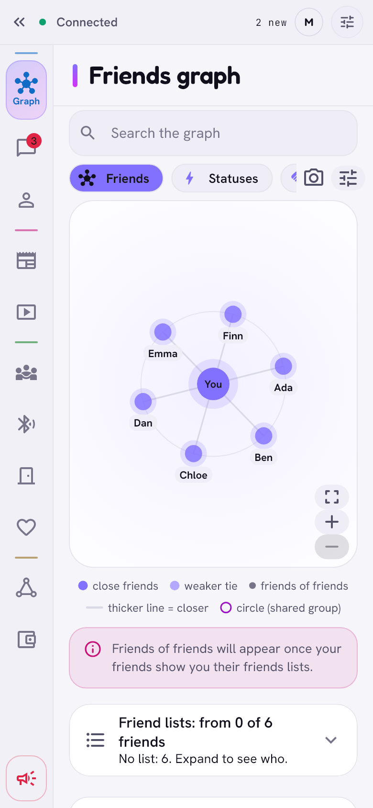
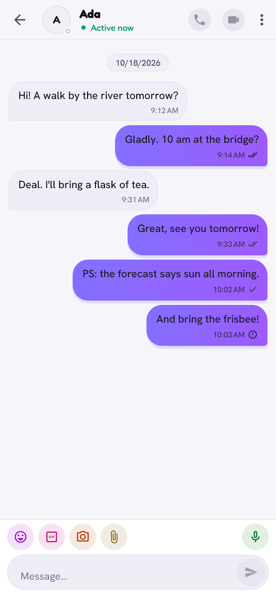
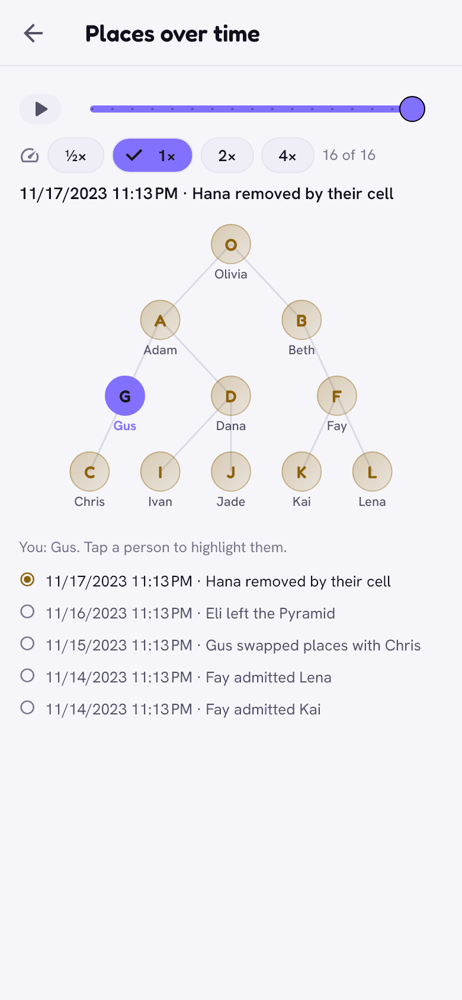

<p align="center">
  
</p>

<h1 align="center">Zen</h1>

<p align="center">
  <b>A network of people who know each other.</b><br>
  A messenger and social network with no servers, no ads and no algorithm,
  encrypted end to end and resistant to quantum computers.
</p>

<p align="center">
  <a href="https://github.com/robertostrowskijagoda/Zen/actions/workflows/ci.yml"></a>
  <a href="https://github.com/robertostrowskijagoda/Zen/actions/workflows/release.yml"></a>
  <a href="https://github.com/robertostrowskijagoda/Zen/releases/latest"></a>
  <a href="https://github.com/robertostrowskijagoda/Zen/commits/main"></a>
  <br>
  <a href="docs/SECURITY_MODEL.md"></a>
  <a href="#platforms"></a>
  <a href="#building-from-source"></a>
  <a href="native/yggdrasil_bridge/go.mod"></a>
  <a href="#license"></a>
</p>

<p align="center">
  <a href="https://github.com/robertostrowskijagoda/Zen/releases/latest/download/Zen-arm64-v8a.apk"><b>⬇ Android</b></a>
  &nbsp;·&nbsp;
  <a href="https://github.com/robertostrowskijagoda/Zen/releases/latest/download/Zen-Windows.zip"><b>⬇ Windows</b></a>
  &nbsp;·&nbsp;
  <a href="#iphone"><b>📱 iPhone</b></a>
  &nbsp;·&nbsp;
  <a href="#mac-linux"><b>💻 Mac, Linux</b></a>
  &nbsp;·&nbsp;
  <a href="docs/guide/README.md"><b>📖 User guide</b></a>
  &nbsp;·&nbsp;
  <a href="https://discord.gg/g4vHvpKV37"><b>💬 Discord</b></a>
  &nbsp;·&nbsp;
  <a href="#support-zen"><b>💜 Support</b></a>
</p>

<p align="center">
  <picture>
    <source media="(prefers-color-scheme: dark)" srcset="docs/images/graph-dark.png">
    
  </picture>
  <picture>
    <source media="(prefers-color-scheme: dark)" srcset="docs/images/chat-dark.png">
    
  </picture>
  <picture>
    <source media="(prefers-color-scheme: dark)" srcset="docs/images/pyramid-tree-dark.png">
    
  </picture>
  <picture>
    <source media="(prefers-color-scheme: dark)" srcset="docs/images/themes-dark.png">
    
  </picture>
</p>

> **Did someone show you a QR code?** The code opens an invitation page: if you
> have Zen, the page opens it right away with the invitation; if you don't, it
> shows the download buttons. After installing, come back to that page and tap
> **Open in Zen** (or in Zen: **Settings → Invite → I have someone's code**
> and scan the code again).
>
> **Already have Zen on Android?** Turn this on once in Zen: **Settings → Invite
> → Zen codes straight into the app → Open supported links**. From then on a code scanned
> with the ordinary camera opens straight in Zen.

## What it is

Zen is a messenger and network for people who know each other, without a
company in the middle. There is no server that sees everything, no ads and no
algorithm deciding what you see. Messages, photos and posts go straight
between your friends' phones and computers, encrypted, and your data stays on
your device.

Zen also tries a new way of deciding shared matters: the **pyramid**, built
from small cells of people who know each other in person, where votes, trust
and a common purse flow from the bottom up, with no headquarters that could be
bribed or shut down.

Using Zen to break the law is forbidden by the [Terms of use](docs/TERMS.md).

## Post-quantum

A quantum computer able to break today's public-key cryptography does not
exist yet, but traffic recorded today could be decrypted once it does. Zen is
built for that: **its key exchanges are hybrid ML-KEM-768 + X25519 and its
lasting signatures hybrid Ed25519 + ML-DSA-65** (NIST FIPS 203 and 204), with
the few exceptions listed below. A hybrid stays safe as long as either half
holds.

| Protected | How |
|---|---|
| Every signal between two devices: messages, sync, call set-up | a session per device pair, ML-KEM-768 + X25519, ChaCha20-Poly1305, no plaintext mode |
| Offline mailboxes and the locked phone's inbox | sealed once more for the recipient's hybrid key |
| Device identity | device keys pinned per address and bound to it by a hybrid signature |
| Everything signed and kept: posts, profiles, devices, pyramid records, ballots, anonymous vote requests and votes, releases | Ed25519 + ML-DSA-65, valid only when both verify |
| Calls | AES-128-GCM frames with per-call hybrid keys, inside a 256-bit ChaCha20-Poly1305 post-quantum relay layer |
| Neighbours' doors, Bluetooth hellos, local link handshakes and pair secrets, dating boxes, food pickup addresses | ML-KEM-768 + X25519 |
| Event tickets | hash-based (HMAC-SHA256), no signatures needed |
| Links to public peers | TLS 1.3 with X25519MLKEM768 |
| Data on your device | AES-256-GCM, a key from your password (Argon2id) |

**Still classical, honestly:** the Yggdrasil node key and address (Ed25519,
the mesh protocol itself; it routes, but no longer proves who you are), the
ring signature that registers a voting card between cellmates (requests and
votes themselves are signed post-quantum by those cards), the pair secret
that lets devices recognise each other on local links until they first meet
over the mesh, and the 128-bit AES key inside call frames (wrapped in the 256-bit layer).
Why, and what an attacker could do: [Security model](docs/SECURITY_MODEL.md).

## What it can do

- 💬 **[Chats and calls](docs/guide/chats-and-delivery.md):** one-to-one
  and group chats with photos, videos, files, voice notes and GIFs,
  reactions, replies, editing, forwarding and delete for everyone; a board
  for every group; drag and drop and paste on computers; audio and video
  calls with screen sharing. Messages for offline friends wait sealed in
  their friends' mailboxes (devices that stay online come first), and the
  icons tell you exactly where a message is.
- 🕸️ **[Friends and the graph](docs/guide/friends-and-graph.md):** friendship
  levels that decide who sees what; a graph of who knows whom with a
  timeline, bridges between your groups of friends, *who's worth meeting*,
  full screen.
- 📰 **[Feed and videos](docs/guide/feed-and-videos.md):** posts only for the
  people you choose, and a short-video section, ordered on your own phone.
- 🍲 **[Meeting people](docs/guide/meeting-people.md):** *right now*
  statuses, events through friends with offline tickets, dinner circles,
  sharing food, people nearby over Bluetooth, and an **alarm** that works
  from a locked Android phone.
- 🚪 **[Neighbours](docs/guide/neighbours.md):** a QR code on your door; a
  knock rings every phone of the household, and waits with friends when
  nobody is home.
- ❤️ **[Dating](docs/guide/dating.md):** through friends, up to three steps
  away, with a private match test that tells nobody else anything.
- 🔺 **[The pyramid](docs/guide/pyramid.md):** cells of three, promotion one
  level at a time, anonymous cell votes, referendums, a court with appeals, a
  common wallet with a hard issuance limit, and an animated history.
- 🚦 **[Introductions and gates](docs/guide/introductions-and-gates.md):**
  reach people further away through friends, free or for points, with a route
  planner.
- 📡 **[Offline links](docs/guide/offline-links.md):** same Wi-Fi, Wi-Fi
  Direct and Bluetooth: Zen without the internet.
- 🎨 **[Themes](docs/guide/themes.md):** 27 looks in five groups, from
  Classic to Brass & Steam, each in a light and a dark version.
- 👥 **[Several accounts](docs/guide/getting-started.md#several-accounts-on-one-device)**
  on one device, hidden ones included. Getting an account back: a second
  device of the account, a **full account copy** (an encrypted file), a
  **key copy** (paper or file), or a **recovery circle** of 4 to 6 friends
  you pick, who also keep an encrypted **copy with friends** of your
  friends, groups and conversation texts.
- ⚙️ **[Settings, public peers](docs/guide/settings-and-peers.md)** and
  **[self-updates](docs/guide/updates.md)**, *Why isn't it working?*
  diagnostics, and **21 languages**.

## Platforms

| System | Builds | Notes |
|---|---|---|
| Android | `Zen-arm64-v8a.apk` (most phones), `Zen-armeabi-v7a.apk` (older 32-bit phones), `Zen-x86_64.apk` (Chromebooks, emulators) | full feature set, background receiving while locked |
| iPhone | `Zen-unsigned.ipa` (iOS 15+) | sideloaded; receives only while open |
| Windows | `Zen-Windows.zip` (x64), `Zen-Windows-arm64.zip` | the Visual C++ runtime is inside the ZIP |
| Linux | `.tar.gz`, `.deb` (x64, arm64), `.flatpak` (x64) | Ubuntu 22.04+, Debian 12+, Mint 21+ (glibc 2.35+); other systems: Flatpak |
| macOS | `Zen-macOS.zip` (12+, Apple Silicon and Intel) | |

One account can run on several devices. Everything is on
[GitHub Releases](https://github.com/robertostrowskijagoda/Zen/releases/latest)
(in Zen: **Settings → Zen on GitHub**).

**Battery.** There is no push server, so a phone keeps its own few links to
the network. To keep that cheap, an Android phone keeps 4 links to public
peers (swapped when one stops answering), sends presence pings only to
friends and only while Zen is on the screen, and **after 5 minutes in the
background only receives** (no pings, scans or sync), with or without the
lock; it wakes for short, timed moments instead of holding the processor or
Wi-Fi awake. While the phone sleeps (Doze), mail from mailboxes can come a
few minutes late. A computer on battery stops being a bridge for others and
keeps only 4 public peers; plugged in, everything comes back. Animations
run at a low frame rate and stop when the window is not visible or the
system asks to reduce motion.

## How to install

**The simplest way: [the install page](https://robertostrowskijagoda.github.io/Zen/install/)**
picks your system by itself and shows the few steps for it (English and
Polish). In Zen: **Settings → Invite → Friend doesn't have Zen? → How to install Zen
on another phone / computer** shows the same steps and a QR code to that page.

### Android

1. On your phone open this page and tap **⬇ Android** at the top (the file
   for almost every phone; the other files are below).
2. When the file has downloaded, tap it (or open **Downloads**).
3. The phone will ask whether to allow the browser to install apps — tap
   **Settings**, turn on **Allow from this source** and go back.
4. Tap **Install**. If a warning about an unknown app appears,
   choose **More details → Install anyway** (this is normal outside a store).
5. Open Zen and set a password.

There is one APK per processor type: almost every phone needs
[Zen-arm64-v8a.apk](https://github.com/robertostrowskijagoda/Zen/releases/latest/download/Zen-arm64-v8a.apk);
older 32-bit phones need
[Zen-armeabi-v7a.apk](https://github.com/robertostrowskijagoda/Zen/releases/latest/download/Zen-armeabi-v7a.apk),
and Chromebooks and emulators
[Zen-x86_64.apk](https://github.com/robertostrowskijagoda/Zen/releases/latest/download/Zen-x86_64.apk).
If installing the first file fails on an older phone, take the 32-bit one. Zen updates
itself from GitHub with the right file; if you use [Obtainium](https://obtainium.imranr.dev/),
you can add `https://github.com/robertostrowskijagoda/Zen` there instead (one
tap on the install page).

**From 2027** Google requires apps from outside the store to come from verified
developers. If your phone says the developer is not verified:

1. **Settings → About phone** → tap **Build number** 7 times
   (this turns on Developer options).
2. **Settings → System → Developer options** → turn on **Apps from
   unverified developers** and confirm with your screen lock.
3. Restart the phone and **wait 24 hours** (this is Google's protection
   against scammers who push people into a quick installation).
4. Go back to the same option, choose **permanently** and install Zen as above.

Option names may differ a little depending on the phone. You do this once.

### Windows

Download **Zen-Windows.zip**, unpack the whole ZIP (it holds a folder
`Zen`) and run `Zen\zen.exe`. Keep that folder whole and put nothing else in
it: Zen updates itself in place only there. Nothing else needs installing:
the Microsoft Visual C++ runtime Zen needs is in the folder, next to
`zen.exe`. If Windows shows "Windows protected your PC", click
**More info → Run anyway**.

If Windows 11 says *Smart App Control blocked an app that may be unsafe*,
there is no *Run anyway*: Zen is not code-signed yet. Either use Zen on
another device, or turn Smart App Control off (**Windows Security → App &
browser control → Smart App Control settings → Off**). That lowers
protection for the whole computer; on Windows 11 before the April 2026
update it can only be turned on again by reinstalling Windows.

An antivirus program may also flag an unsigned new file by mistake: compare
the file's SHA-256 with `SHA256SUMS` of the release (below) and report the
false alarm to the antivirus maker.

On a Windows ARM computer (Surface Pro X, Copilot+ PCs) you can also use the
experimental native build
[Zen-Windows-arm64.zip](https://github.com/robertostrowskijagoda/Zen/releases/latest/download/Zen-Windows-arm64.zip);
the x64 build runs there too, under emulation.

### iPhone

Apps from outside the App Store go through **SideStore**: once you need a
computer (Windows, Mac or Linux), a USB cable and your Apple ID; after that
SideStore installs Zen's updates on the phone. Step by step, with
pictures: **[install page → iPhone](https://robertostrowskijagoda.github.io/Zen/install/#iphone)**.

1. On the iPhone install the free **LocalDevVPN** app from the App Store.
2. On the computer get **iloader** ([SideStore guide](https://docs.sidestore.io/docs/installation/install)), connect the iPhone by cable, sign in with your Apple ID and choose **Install SideStore**.
3. On the iPhone: **Settings → Privacy & Security → Developer Mode** on, and **Settings → General → VPN & Device Management** → trust your Apple ID.
4. Connect LocalDevVPN, open SideStore and sign in.
5. Add the Zen source — one tap on the install page, or **Sources → +** and
   `https://robertostrowskijagoda.github.io/Zen/apps.json` — then **Install** Zen.

**Once a week:** with a free Apple ID the signature of Zen **expires after 7
days**, and then the iPhone won't open Zen until it is refreshed. Once a
week turn on LocalDevVPN, open SideStore and tap **Refresh** next to Zen (or
*Refresh All*); your data stays. Zen shows a reminder in Chats 2 days
before the date. A free Apple ID allows 3
such apps at a time (SideStore counts) and 10 installs a week. The source
always points to the latest release's
[Zen-unsigned.ipa](https://github.com/robertostrowskijagoda/Zen/releases/latest/download/Zen-unsigned.ipa),
which SideStore signs with your own Apple ID; AltStore Classic and other
signers take the same file.

**What Zen can't do on iPhone** (iOS doesn't allow it): it doesn't run in
the background. Messages and calls arrive only while Zen is open (no push
notifications); until then they wait with the sender or in the mailboxes
your friends' devices keep for you. Messages you write also go out only
while Zen is open. It works best when one friend has Zen on a computer (in
the tray) or on Android: that device keeps the mail for the whole group of
friends while the iPhones sleep. There is no Nearby (offline links with
friends use Apple's Multipeer while Zen is open).

**Won't work:** AltStore PAL (EU) installs only apps notarized by Apple
(Zen isn't there yet); TrollStore works only up to iOS 17.0; "signers" with
enterprise certificates get revoked and hand your app to strangers —
**don't use them**.

### Mac, Linux

The Linux and Mac builds are made by GitHub Actions together with the
other release files; they are not signed and have not yet been checked on many
real computers, so they may have bugs.

**Linux:** download [Zen-Linux-x64.tar.gz](https://github.com/robertostrowskijagoda/Zen/releases/latest/download/Zen-Linux-x64.tar.gz)
(or [Zen-Linux-arm64.tar.gz](https://github.com/robertostrowskijagoda/Zen/releases/latest/download/Zen-Linux-arm64.tar.gz)
for Raspberry Pi 4/5 and other ARM computers with a 64-bit system), unpack it
and run `Zen/zen`; `Zen/install-desktop-entry.sh` adds Zen to the menu
and makes it open `zen://` links. On Debian, Ubuntu and Mint it is simpler:
[Zen-Linux-x64.deb](https://github.com/robertostrowskijagoda/Zen/releases/latest/download/Zen-Linux-x64.deb)
(or `Zen-Linux-arm64.deb`) and `sudo apt install ./Zen-Linux-x64.deb`. For x64
there is also a Flatpak,
[Zen-Linux-x64.flatpak](https://github.com/robertostrowskijagoda/Zen/releases/latest/download/Zen-Linux-x64.flatpak)
(`flatpak install --user ./Zen-Linux-x64.flatpak`; not on Flathub). The
Flatpak does not update itself: install the new file from the release page
the same way (Zen tells you when there is one).
**Which systems:** the `.tar.gz` and `.deb` run on Ubuntu 22.04, Debian 12,
Linux Mint 21 or newer, and on other distributions with glibc 2.35 or newer
(the builds are made on Ubuntu 22.04 and checked for that); on older
systems use the Flatpak (x64).
Needed: GNOME Keyring or KWallet (the encryption key lives there), for the tray
icon `libayatana-appindicator3-1`, and for voice notes and videos GStreamer
with plugins (`gstreamer1.0-plugins-good`, `gstreamer1.0-libav`).

**Mac** (macOS 12 or newer, Apple Silicon and Intel): download
[Zen-macOS.zip](https://github.com/robertostrowskijagoda/Zen/releases/latest/download/Zen-macOS.zip),
unpack it and move `Zen.app` to Applications. On first launch macOS will say it
can't verify the developer: choose **Done**, then **System Settings → Privacy
& Security → Open Anyway**, your password, **Open Anyway** (right-click →
Open no longer works since macOS 15; or in Terminal
`xattr -dr com.apple.quarantine /Applications/Zen.app`). After an update macOS
may ask for keychain access — choose **Always Allow**.

On a computer the camera works (videos and QR codes), and so does Nearby when
the computer has Bluetooth LE (a Mac only looks around, it cannot be seen).
Calls can be recorded on every system (after everyone in the call is told).
Offline links (Wi-Fi Direct on
Windows, Bluetooth) work. Linux records and shrinks videos with GStreamer and
encoders built into Zen.

### From a friend

Someone already has Zen? In the app: **Settings → Invite → Friend doesn't have
Zen?** — it will send you the app
over Quick Share, Bluetooth or Wi-Fi, even without internet.

## Isn't it a virus? How to check

1. **Download from one place** — only from this page (the address must start with
   `github.com/robertostrowskijagoda/`; in Zen: **Settings → Zen on GitHub**)
   or from a friend who has Zen.
2. **Check the file for free** — before installing, upload it to
   [virustotal.com](https://www.virustotal.com): dozens of antivirus programs
   will check it at once.
3. **The phone checks too** — Android scans the app on installation.
4. **The code is open** — anyone can review what Zen does. Every official release
   is signed with the same key, so the phone won't install a fake "over"
   the real Zen. The key fingerprint (SHA-256):

   ```
   (published here and in every release description once release signing is set up)
   ```

## Why Zen is not on Google Play or the App Store

- **Independence.** A store can remove an app or demand changes at any time.
  Zen is meant to be independent — also of big companies and of politics.
- **No fees, no rework.** Stores demand fees (the App Store — every year) and
  agreement to their rules, while Zen is made by one person, for free.
- **A store build exists anyway.** The `appStoreOnly` flavor for Google Play
  and Galaxy Store can already be built. It is the same app with three
  differences the stores force: it does not update itself, does not hand
  its APK to others (it shares a link instead) and has no launcher disguise.
  It is not published yet ([docs/RELEASES.md](docs/RELEASES.md), point 6).
- **Privacy.** Nobody, not even a store, knows you have Zen.

## Privacy and security

- **No account, no phone number.** Your QR code is your address. Several
  accounts can live on one device, and an account you keep off the list
  can't be seen by anyone who picks the device up.
- **Encryption, honestly:** see [Post-quantum](#post-quantum) above and the
  [security model](docs/SECURITY_MODEL.md) for the threat model, the
  classical exceptions and the limits.
- **On the device** everything is encrypted with your password (AES-256-GCM,
  Argon2id), biometric unlock uses keys held by the security hardware, and
  sensitive screens (like the wallet) are protected from screenshots. Zen
  detects debuggers and hooking tools and then refuses to move money.
- **Passwords with one meaning each.** The **app password** unlocks Zen on
  this device. The **account password** protects your account key when you
  recover through the circle (it may be the same as the app password). An
  **emergency wipe password**, typed on the lock screen instead of the app
  password, silently erases the data. The alarm's **duress PIN** ends an
  alarm on the screen but warns your friends that you may be forced; it
  erases nothing.
- **Recovery circle.** You pick 4 to 6 friends (close friends and friends
  are suggested, casual friends are not); each gets a piece of your key that
  alone reveals nothing, and Zen shows who holds one and who has confirmed.
  Save the list (names and their invitation codes) with your key copy. On a
  new phone you type their codes; their devices get a help request, they
  check it is really you and tap **Help**. With your account password two
  of them are enough after 24 hours, without it four after 7 days; your old
  devices get an alarm meanwhile and can stop it.
- **Locked phone.** On Android the background service works without your
  password: it holds a separate background key and only small kits (alarm,
  Nearby, doors); what arrives while locked is stored sealed until you
  unlock.
- **You decide who sees what:** friendship levels and per-field profile
  visibility control who sees your friend list, statuses and posts, and who
  may invite you to groups.
- **Files from others are checked:** every photo is unpacked and saved again
  before it is shown; a video or recording must really be one; Zen never
  opens files by itself and warns before saving a program.
- **GIF search goes through an outside company**, KLIPY: it sees what you
  search for, the GIF you pick and your IP address. The GIF then goes to
  your friend as an ordinary encrypted picture, so the friend never contacts
  KLIPY. **Settings → Messages and calls → GIFs** turns the search off; GIFs
  from your keyboard and GIF files keep working.
- **Location** comes from the system's own service (never Google Play
  services) and goes only where a feature says (an alarm, a date-safety
  request).
- **Updates:** Zen asks GitHub for the newest release 20 seconds after start
  and every 12 hours (GitHub sees your IP address; when GitHub limits
  requests, Zen waits as long as it asks), and checks a download
  against `SHA256SUMS` and, on Android, Zen's signing certificate
  ([details](docs/guide/updates.md)).
- The legal texts: [privacy policy](docs/PRIVACY.md) and
  [terms of use](docs/TERMS.md). Using Zen to break the law is forbidden by
  the terms of use. Zen asks no one for their age, except the pyramid, which
  asks for the birth year at entry.

Found a vulnerability? Please report it privately: [SECURITY.md](SECURITY.md).

## What it runs on

Zen has no servers of its own. Devices connect through
[**Yggdrasil**](https://yggdrasil-network.github.io/) — an open, encrypted mesh network
in which every device has its own address and traffic goes directly or through other
devices that don't see the content. Zen adds its own (post-quantum) encryption on top.
Those devices (including the public nodes Zen starts from) do see
your IP address and your address in the network, that is, your invitation code — they
don't see what you write. On top of that, the GIF search uses an outside company,
KLIPY (above). The libraries Zen is built on: [docs/DEPENDENCIES.md](docs/DEPENDENCIES.md).
The app is written in Flutter (Android, iPhone, Windows, Linux, macOS),
and the network bridge in Go. The texts come in 21 languages; the language is chosen
automatically or in Settings → Language.

### Your own bridge (for advanced users)

Zen on a computer helps others connect by itself when the router allows it. You can
also set up a permanent bridge without Zen — an ordinary Yggdrasil node that runs
around the clock and helps everyone (it can't see the content of messages):

1. A computer that is always on and has a public IP address: a VPS server or a home
   computer / Raspberry Pi with a port forwarded in the router.
2. Install Yggdrasil following the
   [instructions on the project's site](https://yggdrasil-network.github.io/installation.html)
   (Linux, Windows, macOS, routers). The config file is created by `yggdrasil -genconf`.
3. In the [configuration](https://yggdrasil-network.github.io/configuration.html)
   put e.g. `tls://0.0.0.0:443` in `Listen`, and a few public nodes in `Peers`.
   Restart the service and open that port in the firewall.
4. Add your node to the
   [list of public nodes](https://github.com/yggdrasil-network/public-peers)
   (pull request). Zen takes its nodes from that list, so later versions of Zen will
   connect through your bridge too.

### Building from source

You always need [Flutter](https://docs.flutter.dev/get-started/install)
3.47.1 and [Go](https://go.dev/dl/) in the version from `native/yggdrasil_bridge/go.mod`
(its `toolchain` line; any Go from 1.21 on downloads that version by itself).
The Go network bridge builds itself on `flutter build` and `flutter run` — only
when its sources changed (details: `docs/RELEASES.md`, point 3.1).

| System | You need | Command |
|---|---|---|
| Android (one APK per ABI: arm64-v8a, armeabi-v7a, x86_64) | Android Studio (SDK and NDK), JDK 17 | `flutter build apk --release --split-per-abi` |
| Android for a store only (Google Play, Galaxy Store; the same app without self-update, APK handing and launcher disguise; the build writes `Zen-APP-STORE-ONLY-do-not-install-manually.aab` and `.apk` to `build/app/outputs/app-store-only/`; never install this build by hand) | as above | `flutter build appbundle --release --flavor appStoreOnly` |
| Windows | Visual Studio 2022 ("Desktop development with C++"), gcc for Go (e.g. Strawberry Perl) | `flutter build windows --release` |
| Windows on ARM (on an ARM64 computer) | as above, with ARM64 tools; for Go [llvm-mingw](https://github.com/mstorsjo/llvm-mingw) instead of gcc | `flutter build windows --release` |
| Linux | packages below | `flutter build linux --release` |
| macOS | Xcode with command line tools, CocoaPods | `flutter build macos --release` |
| iPhone (on a Mac) | Xcode, CocoaPods | `flutter build ios --release --no-codesign` |

**Linux** (Ubuntu, Debian):

```
sudo apt install clang cmake ninja-build pkg-config libgtk-3-dev liblzma-dev \
  libstdc++-12-dev libsecret-1-dev libayatana-appindicator3-dev \
  libgstreamer1.0-dev libgstreamer-plugins-base1.0-dev libpulse-dev
```

The finished Zen is in `build/linux/x64/release/bundle/` (the `zen` file with the folders
`lib/` and `data/`; on ARM64 `build/linux/arm64/…`). The `.deb` package is made by
`linux/packaging/build_deb.sh`, the Flatpak by `linux/packaging/com.roj.zen.yml`
(see `docs/RELEASES.md`). To work it needs a key service (GNOME Keyring or
KWallet — the encryption key lives there), for the tray icon
`libayatana-appindicator3-1` (in GNOME also the AppIndicator extensions) and for
playback GStreamer with plugins.

**macOS:** the app is `build/macos/Build/Products/Release/Zen.app` (Apple
Silicon and Intel, macOS 12 or newer). It is not sandboxed (App Sandbox) —
it runs system tools, e.g. `route` and `adb`; the reason is described
in `macos/Runner/Release.entitlements`.

## Documentation

| | |
|---|---|
| [User guide](docs/guide/README.md) | how every part of Zen works, with pictures |
| [Security model](docs/SECURITY_MODEL.md) | threats, encryption, post-quantum and classical parts, hardening, limits |
| [Dependencies](docs/DEPENDENCIES.md) | libraries, platform APIs and their licences |
| [Protocol](docs/PROTOCOL.md) | frames and records on the wire |
| [Releases](docs/RELEASES.md) | signing, publishing, distribution |
| [Testing](docs/TESTING.md) | the simulator, several clients, visual tours, CI |
| [SECURITY.md](SECURITY.md) | reporting a vulnerability |
| [CHANGELOG.md](CHANGELOG.md) | history of changes |

## Community

Questions, help with installing, ideas, or just talk with other people who
use Zen: **[Zen on Discord](https://discord.gg/g4vHvpKV37)**. Bugs and
feature requests go to [GitHub Issues](https://github.com/robertostrowskijagoda/Zen/issues);
vulnerabilities privately, as in [SECURITY.md](SECURITY.md).

## Support Zen

Zen is free and ad-free — it is kept going only by voluntary donations.
It is made by one person, with no company and no investors.

**[☕ Buy me a coffee at buycoffee.to/zen](https://buycoffee.to/zen)** — this is the only
official Zen fundraiser; the same link is in the app (About → Support Zen).
Donations are voluntary gifts and buy no rights or features. The license
does not force anyone to keep this link; a modified version must only not
show any other address as a way to support the author ([NOTICE](NOTICE),
section 2).

### About the author

My name is Robert Ostrowski-Jagoda and I'm a programmer. At the moment I'm writing this,
I'm working as a taxi driver, because there was no work for me. I made this app
for free, but I also want to have a house and a Lamborghini — please, throw me at least
$5. There are no ads in the app, it's free, and I don't earn anything from it directly.
If you have a job for me, let me know — you can find me on LinkedIn, among other places.

## License

Zen is free software under the [GNU General Public License v3.0](LICENSE)
(`SPDX-License-Identifier: GPL-3.0-only`) with additional terms under GPL
section 7 in [NOTICE](NOTICE). Copyright © 2026 Robert Ostrowski-Jagoda; the
copyright stays with the author. In short:

| You may | If you share Zen or a modified version, you must |
|---|---|
| use Zen for any purpose, privately or in a company, on any number of devices | make the source code available, under the same GPL-3.0 terms, to everyone you give a copy or a modified version to |
| read, study, change and build the code | keep the author attribution "Zen by Robert Ostrowski-Jagoda" (in a modified version: "Based on Zen by Robert Ostrowski-Jagoda") among the legal notices in the About screen |
| share copies, also modified ones, also for a fee | mark a modified version as modified and never present it as the original, an official release or endorsed by the author |
| | give a modified version a name and icon that are clearly different from Zen's and another Android application ID (the license grants no trademark rights to the name "Zen" or the logo) |

The additional terms are only of the kinds section 7 of the GPL allows
(author attribution, marking modified versions, no trademark rights). The
donation link is **not** a condition: unmodified copies show it because it
is part of the app, and a modified version may keep, change or remove it,
but must not show any other address as a way to support the author
(NOTICE, section 2). Builds that software repositories and distributions
(F-Droid, IzzyOnDroid, Flathub, Linux distributions) make from the source
of a release, changed only to build, package and meet their policies, may
keep the name and icon (NOTICE, section 5). The full license text is in
[LICENSE](LICENSE); libraries keep their own licenses (in the app: About →
Licenses and thanks → Licenses; list of components in
[THIRD_PARTY_NOTICES.md](THIRD_PARTY_NOTICES.md), what each is used for in
[docs/DEPENDENCIES.md](docs/DEPENDENCIES.md)). Contributions are accepted
under the contributor licence grant in [CONTRIBUTING.md](CONTRIBUTING.md),
which does not change the license anyone receives Zen under.

**F-Droid and IzzyOnDroid** (not set up yet;
[docs/RELEASES.md](docs/RELEASES.md), section 6.1): the license fits their
rules, and Zen uses no Google Play services, Firebase or other proprietary
libraries and no tracker. Still to do: an F-Droid build recipe (Flutter +
the Go bridge, built as the store variant without the GitHub self-update),
and F-Droid will probably mark the optional GIF search (KLIPY, a
proprietary service) with the "NonFreeNet" anti-feature.
