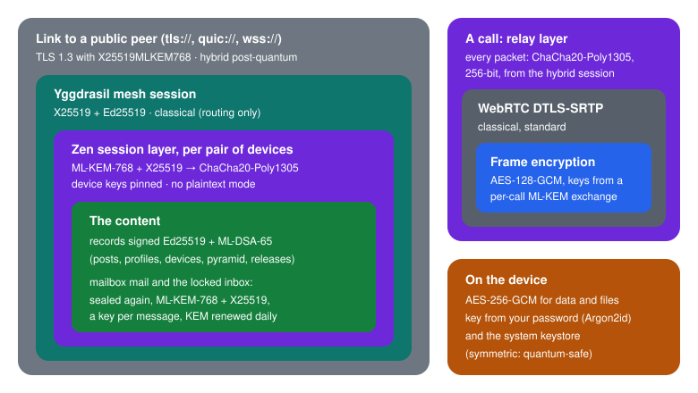

# Security model

How Zen protects what you say and keep, against whom, and where the honest
limits are. For reporting a vulnerability see [SECURITY.md](../SECURITY.md);
for the exact frames and records, the [protocol specification](PROTOCOL.md)
(sections 1.5, 2.5.1 and 4).

## In one paragraph

Zen has no servers. Devices talk over the Yggdrasil mesh, whose own
encryption is classical, and Zen puts its **own post-quantum layer** on top:
every signal between two devices, every mailbox message, the locked inbox,
door traffic, Bluetooth hellos and local link handshakes are sealed with a
**hybrid ML-KEM-768 + X25519** key exchange, and everything Zen signs to keep
or pass on carries a **hybrid Ed25519 + ML-DSA-65** signature that is valid
only when both halves verify. Call media sits inside a 256-bit post-quantum
relay layer. On the device, data is encrypted with AES-256-GCM under a key
protected by your password (Argon2id) and the system keystore. A few pieces
stay classical, for reasons explained below.

## Threat model

**Zen is built to protect you from:**

| Who | What they could try | What stops them |
|---|---|---|
| Someone watching the network (operator, Wi-Fi, a state) | read messages, record them for later | end-to-end encryption; the post-quantum layer defeats "record now, decrypt later" |
| Public peers and relaying nodes | read or change traffic they pass | the session layer (AEAD, authenticated) |
| Friends who keep your mail (mailboxes, mailbox doors) | read what they hold | sealed boxes; they see ciphertext and counters |
| Someone impersonating a friend's address | inject or read messages | device keys pinned per address and bound to the hybrid identity |
| A future quantum computer | break X25519 / Ed25519 | ML-KEM-768 and ML-DSA-65 in every hybrid; the secret holds while either half holds |
| A thief with your device, locked | read your data | AES-256-GCM, password via Argon2id, hardware-held keys, throttled attempts |
| Someone who picks up your unlocked device or forces you to open it | find other accounts | hidden accounts and decoy folders, the emergency wipe password |
| A forged update | install malware as "Zen" | `SHA256SUMS` signed by the release signing key (one key is pinned; friend-to-friend updates stay off until a second one is), the Android signing certificate |
| A modified Zen of another person | forge pyramid or ledger records, money | every phone checks every signed record and every order by the same rules; a past era of the pyramid's treasurers is sealed by the next one (what treasurers can still do together: "Honest limits") |
| Tools inside Zen's own process (debugger, Frida, hooks) | sign what you never asked for | detection; money and the pyramid power key are blocked while detected |

**Out of scope, honestly:**

- An attacker who controls your operating system (root you allowed, a
  compromised OS, a keylogger). Zen detects and warns, it cannot win.
- **Metadata**: who talks to whom and when is visible to observers of the
  mesh routing, and to the friends who relay or keep mail for you.
- What friends do with what you show them (screenshots, retelling).
- Denial of service: anyone on the path can drop traffic.
- Outside services you choose to use: GIF search (KLIPY; it can be switched
  off in Settings → Messages and calls → GIFs), GitHub for updates,
  OpenStreetMap when you open a shared location.

## The layers

  

### Key exchange: hybrid ML-KEM-768 + X25519

Zen uses **MLKEM768-X25519** ("X-Wing") through HPKE (RFC 9180), from Go's
standard library (`crypto/hpke`, `crypto/mlkem`) in the network bridge,
on every platform. The shared secret stays safe as long as either ML-KEM-768
or X25519 holds. It protects:

| What | How |
|---|---|
| Every signal between two devices (messages, calls set-up, sync, everything) | a session per pair of devices: the KEM secret and a challenge encapsulated to the sender's device key give the keys (HKDF); ChaCha20-Poly1305 per frame, replay window; there is no plaintext mode |
| Mailbox mail and the locked inbox (Android, iPhone) | sealed again for the recipient's hybrid key (plus ephemeral and static X25519 for sender authentication); one encapsulation per recipient key per day, a fresh key for every envelope |
| Neighbours' doors | every door runs the same session layer; a sealed knock also has a second layer from the sticker's token (knock) or the knocker's hybrid key (answer) |
| Nearby (Bluetooth) hellos and answers | a one-time ML-KEM-768 + X25519 key per hello, sent in chunks over GATT |
| Local link handshakes (Wi-Fi, Wi-Fi Direct, Bluetooth) | both sides add a one-time ML-KEM-768 to the link key; handshake version 3: both sides open with a fresh nonce and a selector names the sender and the other side's nonce, so a recorded hello answers nothing played back later or elsewhere (a 1.16.5 device links with this version only over the internet until it updates); hellos are padded to one of a few sizes; an advert holds the tags of eight devices in turns |
| The pair secret of local links between friends' and own devices (adverts, handshake authentication) | each device sends 32 random bytes inside the sealed session above (`local_pair`, address checked against the proven device list); once both confirm, the secret is HKDF of the X25519 pair secret and both contributions, re-made after a reinstall |
| Call keys | a fresh exchange in every call's offer and answer |
| Dating: questions, answers, profiles, "Yes", messages, matchmaking | a fresh encapsulation for every box, so boxes cannot be linked; the weekly lantern is a SHA-256 commitment to a one-time hybrid key, and the match test is a sealed offer (no Diffie–Hellman) |
| Food sharing pickup address, Table for six address | sealed for the accepted person's one-time hybrid key; a go-between sees only ciphertext |
| Pyramid private transfers | each order sealed (ML-KEM-768 + X25519, AES-GCM) for each treasurer separately; other members receive nothing |
| Housemate join | the flat key goes sealed for the new phone's hybrid key, only after the phone that showed the one-time code confirms |

### Signatures: hybrid Ed25519 + ML-DSA-65

Everything Zen signs to keep or pass on carries both signatures and is valid
only when **both** verify: account and device records, posts and other
ledger entries, pyramid records, the ledger hello, attestations, dating
profiles and recommendations, release manifests and `SHA256SUMS.sig`.
ML-DSA-65 (FIPS 204) is Go's own implementation (copied unchanged until Go
publishes `crypto/mldsa`). The ML-DSA key is derived from the same 32-byte
seed as the Ed25519 key, so backups and recovery restore both.

### Device keys and pinning

The Yggdrasil address of a device is an Ed25519 key, which a quantum
computer could break. So Zen does not rely on it for identity:

- Each device has a post-quantum **device key**, derived from its Ed25519
  seed (which a quantum computer cannot recover from the public key).
- A session counts as "from this address" only if the sender proves it holds
  that device key.
- **Who is known.** The app names to the session layer the addresses it
  knows: its friends' devices and this account's own devices. Only they use
  the budget of key exchanges kept for known peers and keep their places in
  the tables. Nothing a stranger does makes it known: being answered, being
  written to, or being named in a friend's record or list. Everybody else
  (a member of a group who is not a friend included) shares a smaller
  budget of its own (on a phone 4 key exchanges a second, bursts of 20), so
  however many addresses strangers make, they spend that budget, not the
  one friends' sessions need.
- The device key is **pinned** to the address and kept across restarts. A
  record signed with another key for a pinned address is rejected. A pin
  is *firm* once its device proved it holds the key (a session with it
  opened here), or *vouched* (a hello signed by the device's hybrid key
  came over a session with that key). A key seen only in a signed record,
  with no session after it, is pinned *loose*: loose pins have a quarter
  of the table (4,096 of 16,384) to themselves and go once unseen for 14
  days. Records, however many come, never push out a firm or vouched pin,
  and a first contact is pinned once its session opens even while
  strangers use up the new pins. Pins kept by 1.16.4 come back loose and
  go after three days unless the device confirms them with a record or a
  session of the same key.
- The ledger hello signs the address **together with** the device key's
  fingerprint (hybrid signature), so an address is bound to the hybrid
  identity. A hello that contradicts the session it came over, and a
  record that contradicts a key vouched for (refused), show a warning in
  the chat with that address.
- What others say about an address is only their word: the keys in a
  friend's friend list and in a friend's device records (their other
  devices) are **hints**. A hint never pins, never replaces or pushes out a
  pin, never ends a session and never makes anyone known; the first record
  the device itself signs decides. A hint that contradicts a pin is only
  counted in the log, with no warning (a friend could accuse anyone that
  way). Hints are kept by the friend who gave them and go when that friend
  is removed. So a friend cannot cut you off from anyone with lists of
  made-up keys.
- A device the account cut off (lost or stolen) is cut off at friends too,
  once the revocation reaches them: its address gets no ledger traffic, no
  keys and no chat (messages go to the account's other devices, the chat
  shows a warning), and the audience keys it could read are rotated.
  Revocations are kept only for accounts the device knows: at most the
  account's devices + 4 (up to 32), 2 per device and 512 in all.
  **What cutting a device off does not do:** it does not take the account
  key off that device. If the device was unlocked, and the key was not
  protected by an account password (or whoever holds it knows the
  password), it can make itself a new device of the account after the
  cut-off. The account's own devices then ask the person before they give
  that new device anything, and say so ("Odłącz" explains it and what to do
  next); **friends, who cannot tell, still accept it as the person's own**.
  The way out is a new account (Settings, Accounts on this device, Add
  account), inviting friends again, and wiping the old one. With an account
  password set, the account key travels wrapped under it, on every device
  (below), so a stolen unlocked phone does not hold it in the clear.
- A hello from a stranger that only names a certificate is dropped without
  an answer, so nobody can probe whom you know.

### Call media

1. **Frame encryption**: every audio and video frame is sealed by WebRTC's
   frame encryptor with **AES-128-GCM**, keys from the call's hybrid exchange,
   per participant, rotated every 5 minutes and when someone joins or leaves.
2. **DTLS-SRTP**: WebRTC's standard transport encryption.
3. **The relay layer**: every packet (RTP, RTCP, ICE, DTLS) goes through the
   bridge's relay over the mesh and is sealed with **ChaCha20-Poly1305 under a
   256-bit key** from the two devices' hybrid session. Nothing goes unsealed.

The call screen says which protection a call has. A device without frame
encryption falls back to DTLS-SRTP inside the relay layer. Both sides
prefer VP8 for the camera and a shared screen, before every offer and
answer, a codec whose frames the frame encryptor handles (two hardware
codecs could otherwise agree on one whose sealed frames the other side
cannot open). The side that answers puts VP8 first in the other side's
description before applying it, whatever that side listed first, so an
offer that lists H.264 first no longer gets a hardware H.264 call.

### QR tickets, cell votes and the court

- **Event tickets** use no signatures at all: the organiser's tag and the
  live code are HMAC-SHA256 values from secrets only the guest's phone and
  the organiser share (hash-based, so post-quantum). The organiser's phone
  checks them offline; a code is valid for 90 seconds, once.
- **Cell votes** in the pyramid: each member's phone registers a **one-time
  hybrid key (a card)** with its cellmates; the list of cards is signed by
  the members' hybrid keys and counts only with at least as many signatures
  as cards. The anonymous **request** for a vote is signed by a card from the
  cell's request list (a roster made when someone first asks, for the
  present head and voters; it waits up to 12 hours for an absent member);
  the **vote** by a card from the vote's ballot, once. Both are hybrid
  signatures: nobody outside the cell can forge them, and inside it nobody
  learns whose card it was. Only the card registration between cellmates
  uses a classical ring signature (below).
- **The court** of the pyramid decides without names the same way: the
  judges a matter has by the rules (its ring) each register a one-time
  card for that matter with the others, the ring signs the list (the
  bench), and a verdict, a dismissal or an answer to an appeal is signed
  by exactly as many cards as the court needs, never by a judge's own key,
  so the record says that the court decided, not who nor how many agreed.
  The court's frames go through a friend outside the ring and never pass
  through the phones of the people the matter is about. The limit: a
  matter one person judges (a complaint's first instance goes to the head
  of the accused's cell) is known by its seat, and a bench with fewer cards
  than judges shows that someone was not there.

## What stays classical, and why

| What | Why | What a quantum attacker could do |
|---|---|---|
| The Yggdrasil node key and address (Ed25519) | it is the mesh protocol itself | hijack or analyse routing (denial of service, traffic analysis); not read content, not pass the device key check |
| Card registration inside a cell or a court (LSAG ring signature over Ed25519), for vote, request and court cards | there is no standard post-quantum linkable ring signature; unaudited lattice schemes were not used; the registrations travel only between cellmates (or a matter's judges), inside the post-quantum session layer | nothing from recorded traffic; only a cellmate (or judge) with a quantum computer could tell whose card is whose (in a cell of 2 to 3 anyone can guess anyway) or spoil a list (a member signs no list without its own card, so it fails rather than counts) |
| The pair secret of local links, until the two devices first reach each other over the mesh (X25519 of their keys) | the post-quantum part is exchanged inside the sealed session, which needs that one contact | until then: recognise the two devices' adverts, or sit in the middle of a *new* link; recorded links stay unreadable |
| Call frames (AES-128-GCM) | libwebrtc always derives a 128-bit key; changing it needs a fork of WebRTC on five platforms | about 64-bit strength against Grover's algorithm; still inside the 256-bit relay layer |
| Who sent mailbox mail (the static X25519 term of the envelope) | the hybrid KEM gives secrecy, not sender authentication; a one-way offline message has no cheap post-quantum sender proof (an ML-DSA signature per envelope costs 3.3 KB and battery) | knowing a friend's mailbox X25519 key, forge mailbox mail "from" that friend (chat messages); not read mail, not forge ledger entries or hellos (hybrid signed) |
| The link to a public peer over `tcp://` or `ws://` | the peer offers nothing better | see which mesh keys you talk to (Zen picks only `tls://`, `quic://`, `wss://` itself; their TLS 1.3 uses X25519MLKEM768) |

First contact with a stranger after a large quantum computer exists, with no
signed device entry naming their key, is trust on first use (a friend's
friend list or device record names it only as a hint, see above).

## On the device

- **Storage encryption.** A random 256-bit master key encrypts data and files
  (AES-256-GCM; per-purpose keys derived with HMAC-SHA256). It is wrapped by
  a key from your password: **Argon2id**, 19 MiB, 2 passes. Failed attempts
  are throttled and remembered across restarts: the fifth one in a row
  starts a wait of 30 seconds and each further one doubles it, up to 30
  minutes; the wait still left is
  kept, counted down on a clock the system time does not move, and starts
  again in full after a restart. A guess is counted **before** its
  password is checked, at the lock screen, at "Inne konto" and inside the
  app, so closing Zen during the check does not take it back; the right
  password clears the count (inside the app it takes back only its own
  attempt). Guesses at "Inne konto" have one count for the device, apart
  from the lock screen's, that no unlock clears; instead it forgives one
  wrong guess for every 24 hours without one, never during a wait. That
  time counts on Zen's own clock while it runs, and on the wall clock only
  together with time Zen really ran, so setting the clock ahead does not
  speed it up. A wrong password costs the same work whether an emergency
  wipe password is set or not, and a wrong account ID at "Inne konto" the
  same as a wrong password, with the same calls to the system's secret
  store in the same order. File names are hidden.
- **Biometric unlock** keeps a copy of the master key wrapped by a key that
  never leaves the security hardware: Android Keystore (StrongBox when
  present), the TPM on Windows (with Windows Hello), the Secure Enclave on
  macOS (Touch ID). A copy of the app's files is useless elsewhere.
- **Auto-lock "Never"** with a password keeps a plain copy of the master key
  in the system's secret store (Android Keystore, the iOS / macOS keychain,
  the Windows credential store), so Zen opens without the password even
  after a restart; the device's own screen lock is then all that guards it.
  Choosing it takes the password once; choosing any other mode, or locking
  by hand, deletes the copy at once (the lock screen appears only once it
  is gone). Only choosing "Never" again, with the password, makes a new
  copy: setting a password, unlocking or restoring settings never does.
  The password is still asked for before security settings change or
  sensitive screens open: for the lock, before any choice that locks
  later than now (a later mode, a longer delay, keeping the key after
  closing, "Never" on an additional account); a choice that locks sooner
  asks nothing, and neither does the setup of a first start, right after
  the password was set there, except for "Never" (the setup shown again
  after an update or from Ustawienia asks as the settings do). Every
  password asked inside the unlocked app (the app
  password, the account password) counts with the lock screen's failed
  attempts and is refused while its wait runs.
- **"Don't lock right after closing the app"** (with the lock after
  leaving the app) keeps the master key for a start within the lock delay
  after Zen was closed. It is kept encrypted under a new one-time key each
  time Zen leaves the screen, and only that one-time key is sealed with
  the delay: on Android by a Keystore key that opens only while the phone
  is unlocked, which checks the delay, the boot and the screen lock
  itself; on computers and the iPhone it lies in the system's secret store
  with its end on the clock since boot, and only Zen checks that end. What
  remains: until something deletes them, both entries are in the secret
  store, so on a computer any program running as the same user can read
  them, and with them the master key, while the delay runs and, if Zen is
  not started again, after it too (as with "Never"). The next start
  deletes both before the lock screen shows, used or not, the one-time key
  first; so do locking by hand, coming back to Zen, a new password,
  another lock mode or delay, and switching the option off. What 1.16.2
  kept here is not used: the first start asks for the password and
  deletes it.
- **The locked phone (Android and iPhone).** A locked Zen keeps receiving
  without the master key; see "The locked phone" below.
- **Screens.** Zen does not block screenshots, screen recording or screen
  sharing on any screen, the wallet and the account key included: since
  1.15.1, by choice, people may capture what they see (a start lifts the
  protection an older version left on the window). The system's
  recent-apps preview keeps a picture of the last screen Zen showed, also
  while Zen is locked; whoever holds the unlocked device can look at it
  there.
- **The clipboard.** Copies of secrets (the account key, a transfer code,
  a note to self, the health report) are cleared after 60 seconds, a
  password or a login from "Hasła" after 30, and at once when Zen locks
  and when the account is left or erased (where the clipboard can be read,
  only while it still holds that text). On Android they are marked as
  sensitive (13 and later hide them from the preview and keyboards), and
  since an app in the background may write the clipboard but not read it,
  and Zen locks exactly there, the clipboard is emptied from the
  background without looking (what was copied in another app after it
  goes too). If Android ends Zen before the lock or the minute, the
  secret stays until something else is copied or the system clears it. On
  Windows a secret goes only to the clipboard marked to stay out of the
  history and the cloud clipboard (a busy clipboard is tried again); when
  that fails, nothing is copied and Zen says so. On Linux, macOS and iOS
  there is no such mark: secrets go to the plain clipboard, where a
  clipboard manager or Universal Clipboard may keep them. A copy the
  system refused is never called a copy. The invitation code is the
  public address and stays.
- **Notifications** show the sender and the start of a message by default;
  the first-run setup asks, and "Without sender and content" or "Sender
  only" can be chosen globally or per conversation. A message deleted for
  everyone, disappeared, edited, deleted from this phone or cleared with
  its chat takes its notification, its entry in the notification list and
  its queued copy with it, also while Zen is locked (see "The locked
  phone") and on the account's other devices. What the system copied
  elsewhere before that (Android's notification history when it is on, a
  paired watch) Zen cannot take back.
- **Media in the clear, briefly.** Some media must exist as a plain file for
  a moment (a call recording being written, an alarm clip, a video being
  published, a file handed to the system player). They go to a private
  folder `zen-media` (one per profile): on Linux under the app's own cache
  (`~/.cache/<app>`), or `$XDG_RUNTIME_DIR` when there is none, `/tmp` only
  as a last resort; on macOS the per-user temporary folder; elsewhere the
  app's own folder. A new folder is made with mode 0700; an existing one is
  used only when it is a real directory (not a link), has no rights for
  group or others, and Zen can `chmod` it (only the owner can); otherwise a
  fresh `zen-media.XXXXXX` (`mkdtemp`) is used, and without a private
  folder nothing is written. Each file is created empty with mode 0600
  before its content goes in, under a random name. The folder is cleared at
  start, at exit on computers, and when the account is deleted. A call
  recording is deleted only after it is encrypted into the vault (in
  pieces, any length); one that could not be saved waits at most until the
  app closes. A profile photo from another device or a backup passes through
  `zen-media` and is deleted at once. Your own photo and cover are staged
  there too while the profile editor works on them, and are never written
  as plain files under the account folder; what earlier versions left in
  its `avatars` and `profile` folders is sealed if still in use and removed
  at the next start.
- **Several accounts.** Each account has its own keys, mesh node, folder,
  keystore entries and password. Folders are named by a keyed hash of the
  account ID. Every device has 2 decoy folders from the first start and
  more at later starts, up to a number of its own between 2 and 5; now and
  then one goes and a new one takes its place, and a deleted account is
  replaced by a decoy, so the number of folders stays the same. A decoy is
  written the way an account's folder is: through the same stores, at the
  moment of writing, a while apart, with every name an account can have
  (sizes of the same spread, random content) and secret-store entries of
  its own, as many as an account has; no file time is ever set. Some
  decoys are "used": while Zen runs they get something like a session now
  and then, at some moment of a run, so their files change as an
  account's in use do; the others stay as they were made, as an unused
  account's. A decoy's password file can be as large as a real one's (it
  stopped at 60 KB while a vault of a thousand logins is larger, so one
  folder listing told that an account was no decoy). Decoys of 1.16.4 and earlier are written anew at a later
  start, one at a time (the update itself changes no file). Keystore
  entries of extra accounts have hashed names. There is no list of hidden
  accounts. While an account that is not on the list is open, nothing goes
  into the device's diagnostics log (plain text), its start and the way
  back to the default account included, and a crash of the Go bridge is
  discarded instead of being written to the device's crash file (a listed
  account names that file again at its next node start; on Android the
  background service shares the process, and a node it starts meanwhile
  names it too).
  **What this promises, and what it does not:** a single listing of the
  folders (names, sizes, times) or of the keystore's entry names does not
  tell a hidden account from the decoys. Someone who can do more may tell
  which folders are in use: watching the folder over days (an account
  changes when its person uses it, a decoy at random moments of Zen's
  runs); comparing creation times (an account made after the device
  reached its number of decoys is the youngest folder, until a decoy is
  replaced; on a device updated from 1.16.4, until every old decoy had its
  turn, the old ones differ from an account); measuring volume (an account
  in real use holds far more messages and media than a decoy); reading
  the files or the keystore (full access to the device: an account's files
  open with its keys, a decoy's are random; the device's own entry lists
  the decoys); and what an account leaves outside its folder (files it
  exported or saved to Downloads). An emergency wipe password erases its
  account silently, with its place in the background list and the node
  that received for it. An account with **"Receive in background"** on (off by default
  for extra accounts) keeps its mesh node and a small receive kit under a
  separate background key, so the background service (Android) or the tray
  (computers) runs it without the password; someone with full access to the
  device (root, or on a computer any program of the same user) can then tell
  that the account exists and read its mesh address and whom it accepts
  messages from. Its notifications are generic. It rings and notifies by
  that account's own rules: every account writes its own notice kit, and a
  background runner without one (an extra account's, a computer's tray)
  stays quiet instead of guessing: no ring and no call card with
  "Połączenia" off, none with "Powiadomienia z tego konta" off, none for a
  muted chat, and a hidden account does not give itself away by ringing.
  "Odbierz" opens the account that is called.
- **The account key on every device.** With an account password set, the key
  is kept only wrapped by it, on every device of the account: a device that
  took the account by a link, a copy, a backup or the paper key used to keep
  it behind the app lock alone. The wrapped key (signed by the account key,
  with the time it was set) now travels with the account and between its
  devices, the newest password wins, and a device that took the account
  without it offers to set one. A wrong password at a backup is told apart
  from a file whose header cannot say.
- **The copy with friends.** Chosen friends keep an encrypted copy of your
  data, with no recovery circle needed: the friends who serve as your
  mailboxes, then your close friends, others only to reach two, at most
  six. It holds your profile (no photos), friends and groups
  with their levels, settings, your pyramid state (votes, private data,
  the power key of the head), your household (flat key, resident key,
  household profile and housemates' names; not the door key or the
  neighbours), your dating profile and its settings, your **passwords**
  (a switch, "Hasła w kopii u znajomych", on by default and the same on
  every device of the account; switched off, the friends' copy is replaced
  at once with one without them), your **notes to self**, and (switchable) the text of your one-to-one and
  group conversations — no photos, videos, files or disappearing
  messages; at most 10 MB, the oldest messages go first. Every section and
  every month of every conversation is split into chunks sealed with
  ChaCha20-Poly1305 under a key derived (HKDF) from the account key, so
  whoever gets the account back by any way (another device, a key copy,
  close friends) opens it, and nobody else; an unchanged chunk stays the
  same, so a refresh (at most daily, sooner after a new friend, a group
  change, a password or a note, but not more than once an hour) sends only
  what changed. Holders see your account, chunk hashes and sizes, and when
  and how much the copy changes; the passwords and the notes are padded to
  16 KB steps so their size does not tell how many there are. The list of
  chunks is signed (hybrid Ed25519 + ML-DSA-65) by your device, whose
  certificate the account key signed. A holder keeps copies of accounts
  whose key piece it holds and of its accepted friends (100 MB in all,
  60 MB of it for friends' copies, 10 MB each), drops one when neither is
  true any more, keeps only the newest it was offered, and gives a copy
  back only to a device the account certified and has not cut off (a
  signed request, made within the hour). A copy that is much smaller than
  the one kept (under half) does not replace it at once: the holder keeps
  the larger previous copy for 30 days. A copy dated ahead of the holder's
  clock, or signed by a device that was cut off, is refused and no longer
  blocks every real copy, and the owner is told when friends refuse one. After a recovery, and after a key
  copy is restored (where one friend's invitation code, typed there, gives
  a new phone someone to ask), Zen asks the holders and friends, gathers
  the copies offered for 30 seconds, takes the newest, checks it and
  restores it with progress shown; passwords and notes are merged, never
  written over what is there. A phone that is looking for its copy never
  replaces it with its own: the search does not give up (a copy from a newer
  Zen, or thirty days without finding one used to end it, and the new phone
  then made a copy of its nearly empty data, which friends kept as the
  newest), it goes on once a day, and a fresh copy from such a phone needs
  the person's word. A friend still on 1.16.4 refuses a copy
  unless it is a helper of that account's old circle, and the next friend
  is asked.
- **Recovery by close friends.** With an account password set, every
  friend you mark as close (up to 12) holds a piece of the account key by
  itself, and a new set of pieces goes out when your close friends change.
  The account key comes back with the account password and the pieces of
  2 of them (with up to 4 holders), 3 (5 to 9) or 4 (10 or more); there is
  no way back without the password. Inside, the key is sealed under the
  account password (Argon2id, 64 MiB, 2 passes); around that, each set of
  pieces seals it under a fresh random secret split among the holders, so
  pieces of different sets never combine. The account password must have
  at least 12 characters, be hard to guess and differ from the app
  password (checked when it is set; an app password changed later to the
  same is not). A holder learns that it keeps a piece of your account and
  nothing of the key. A piece is released to a new device 24 hours after
  its holder agrees to help; your old devices get an alarm and "To nie ja"
  stops it, counting only from a device the account has not cut off, but
  a holder can still release a week after a stop, and stopping again does
  not count then. "Konto jest zabezpieczone" shows only once enough holders
  confirmed their pieces, or a key copy exists. People no longer close are
  told to forget their pieces, and an honest holder deletes them, and
  those of someone no longer a friend six weeks later; a piece follows its
  holder to a new phone and into copies. A holder keeps every set until
  told to forget (it used to keep the two newest, so two changes in a row
  dropped the last complete set); older sets are forgotten only by holders
  who confirmed the new one, and a forgotten piece does not come back from
  a device that was away. A change to **fewer holders** (fewer than two
  close friends included, which used to make everyone forget at once, with
  no wait and no password) waits a week, tells the person, and goes at once
  only when confirmed with the account password. A holder silent for five
  weeks no longer counts towards "Konto jest zabezpieczone". The limits: the delays, the alarm
  and forgetting are kept by honest apps only. As many holders of one set
  as its threshold, together, get the sealed key and can guess the account
  password offline, one Argon2id run per guess; if they guess it, they
  have the account, and the copy with friends many of them already keep
  opens with it. Former holders who kept copies of their pieces against
  the app, as many as their set's threshold, can still do the same with
  the password of that time. Holders still on 1.16.4 ignore a request to
  forget and keep their pieces. Pieces handed out before 1.15.4 hold an
  `emergency` half that four helpers open without a password; helpers on
  1.15.4 or later never release it, and a new set replaces it.
- **Blocking is of the person.** One list, kept by account with every address,
  device and dating key known for the person, is read by the messenger,
  Dating, nearby, the wall, films, pebbles, introductions, mentions and
  followers, on every device of the account, and comes back from every copy
  (it used to be a list per feature, so someone blocked in the messenger
  still got your dating profile through a mutual friend, and a block in
  Dating was beaten by a new dating key). A lifted block stays as a lifted
  record (up to a bound), so a device that was away never brings it back.
  Their likes and comments are left out under friends' posts and their
  names out of the counts; a removed friend's account is remembered so that
  a block still finds it. **The honest limit:** an account costs nothing, so
  a new account, a new device key or a new dating key of the same person
  cannot be recognised; Zen refuses what it knows to be theirs, never the
  person.
- **What leaves with a file you send.** Photos, films and recordings sent in
  a chat leave without place, time and device data (EXIF and the like),
  whichever way they were picked (gallery, camera, drop, paste, recording);
  one module (`outgoing_media.dart`) cleans them as posts already were. A
  file of another kind goes unchanged, and so does one that cannot be
  cleaned (the attach sheet says so), and it may carry such data.
- **What friends keep of you.** Friends hold your ledger: `feed` (posts),
  `acts` (reactions, comments and the like), `profile`, and `private`
  (sealed to your own devices: the copy of your friends and groups, saved
  in parts above 40 KiB, so it no longer stops at about 240 friends). Your
  `own` space (settings, notes, passwords, chat copies for your other
  devices) stays on your own devices. `private` is pruned at friends:
  once copies that no longer count outweigh the current one (64 KiB of
  slack), a device starts its private log over at a checkpoint, and
  friends drop what came before once the new start has fully reached them,
  on that device's signed word only. `feed` is never pruned or folded (other people's entries refer to
  posts): a deleted post adds a deletion, and the post's own entry stays
  with the friends who hold it. What friends keep of reactions (`acts`) and
  profile (`profile`) is **folded with a bound**: every like, every like
  taken back and every older profile entry used to stay on every friend's
  phone for ever (200 taps that ended with no like cost each friend a
  megabyte). The author folds what no longer counts into a new start of the
  log that carries what still does, friends drop what came before it by the
  author's signed word, and a friend's log has a bound of its own.
- **The full account copy.** "Create a full account copy" writes the chosen parts of the
  account (always the account key) into one file, in parts of 1 GB when
  larger. It is sealed in frames of 1 MiB with AES-256-GCM under a key from
  the backup password (Argon2id, 64 MiB, 2 passes; symmetric only, so
  post-quantum safe); each frame's number and whether it is the last are
  bound to it, so frames cannot be cut, swapped or added, and every file
  inside is checked by its SHA-256. A wrong password is told apart from a
  damaged file. Another account never replaces one that holds anything: a copy, a
  backup file, a link or a key taken onto a device with a name, notes,
  passwords, posts, chats, invitations, an accepted friend, a group or a
  pyramid is refused before its files are read (one rule for every way in).
  The person adds the other account beside this one, or wipes this one on
  purpose after being offered a backup; saved passwords go along only when
  ticked. A copy made by
  a newer Zen is refused with "update first", never half-read.
- **Data from a newer Zen.** Stored files carry a format version. A file
  written by a newer version is left untouched (not overwritten, not
  replaced by a backup or a fresh identity); the app runs on defaults and
  asks you to update. Unknown fields are carried over when Zen rewrites a
  file.
- **Moving the account to another device.** The device with the account
  shows a one-time QR code: its address, a one-time X25519 key and a
  random 128-bit token. The new device answers with a commitment to its
  own one-time key and an HMAC of it under the token, so only a device
  that saw the screen can ask; the old device answers the first such
  greeting with a fresh random value, and only then does the new device
  reveal its key. Both screens show six digits from the shared key and
  that value, so whoever saw the code and greets first is bound to the
  key it committed to and cannot grind one to match the other screen.
  Nothing leaves until the person taps "Allow" on the old device. Everything after
  that (the account key, the list of contents, the files in blocks of
  192 KB, each file checked by its SHA-256) is sealed with
  ChaCha20-Poly1305 under that key, inside the post-quantum session every
  signal already travels in. Blocks wait in the encrypted store, so a
  transfer cut short goes on from where it stopped.

## Passwords

"Hasła" keeps logins and passwords for other services (at most 2000
entries, 4 MB).

- **Where they live.** Only in the account's encrypted store, under the
  master key, like the chats; each account (a hidden one too) has its
  own. Opening "Hasła" asks who you are every time (biometrics where the
  key is sealed in hardware, the app password otherwise; with no app
  password set there is nothing to ask), and locking Zen closes its
  screens and drops the
  entries from memory: while Zen is locked nothing of them is read,
  written or held. Their values never go to the log or a crash text.
- **Between your devices.** The account's devices sync them as versions
  that are never changed once written, sealed for your own devices only
  (the `own` space, which friends do not keep): an edit made on two
  devices at once keeps both passwords (the other one in the entry's
  history, marked), and a deletion removes only the versions it saw. Each
  entry keeps its last 5 versions. Whether two edits clashed is not judged
  by the devices' clocks (a password changed offline once became ordinary
  history when the other device edited twice, and was gone after six
  edits): each version names the version it was made from, and one that is
  not an ancestor of the current one is shown as a conflict and is never
  pruned. The same logins imported on two devices merge into one entry. A
  damaged row in an imported CSV costs that row only.
- **How they come back.** In every way an account comes back: another
  device of the account, the full account copy, moving the account, and
  the copy with friends (above), which a key copy or close friends open,
  unless "Hasła w kopii u znajomych" is off (a switch, on by default, the
  same on every device of the account). They are merged into what is there,
  never written over it.
- **What is not protected.** An overwritten or deleted password stays in
  each device's sealed log of account states until that log starts over,
  at most 6 hours after the change was looked at (deletions are carried
  on for 30 days, without values); in the store's two earlier generations
  of the file (`.bak`, `.bak2`, sealed) for two more saves; and in the
  copy with friends until the next copy replaces it (an hour to a day).
  While Zen is unlocked, an entry that is open or was copied is in memory
  as plain text, which the system does not let an app wipe; a copied
  password is on the clipboard for 30 seconds (see "The clipboard").
  Someone who can open the account (its password, a key copy, or enough
  close friends and the account password) has every password in it.

### Android autofill

On Android 9 and later Zen can fill logins into other apps and browsers,
once the person picks Zen as Android's autofill service (off until then).
A login form then gets one suggestion, a row of Zen's own with its icon,
"Zen" and "Odblokuj Zen", which carries no login and no password: nothing
is read from disk for it and no password exists on the Android side. The
same holds for the suggestion inside the keyboard (Android 11 and later,
built with `androidx.autofill`): it holds the icon, the two words and a
description for screen readers, and its long press opens Zen from an
immutable intent with no extras. Nothing leaves Zen before the person taps
the suggestion, is asked who they are once (below) and picks an entry; only
that entry's login and password go back, and only to the request still
open. Closing the picker, Zen locking, the time running out, going back to
the app instead of picking, or any error ends the request with nothing
filled. This version never offers to save what is typed elsewhere.

- **Which forms get it.** A form with exactly one field that says it takes
  the current password, and at most one login field before it; or the first
  page of a login in two steps: no password field of any kind and exactly
  one field that says it is the login (`username`; an e-mail field alone is
  not enough). A hint that says nothing about a field (`autocomplete="off"`
  and the words pages put there to keep browsers away) is passed over, and
  the field is read by its type and its name; a field that says it is
  something else (a new password, a one-time code, a search, a phone
  number) is never filled, and a form with two password fields (signing up,
  changing a password) gets nothing. Only the fields the form has are
  filled: the login alone on the first page of two, the password alone on
  the second.
- **One question, and the unlock that counts as it.** An unlocked Zen asks
  who the person is when a request's picker is to open, as for opening
  "Hasła", every time. When Zen was locked, asking again right after the
  lock screen would be the same question twice, so that unlock is the
  question, within these limits. The lock screen asks the Android side, as
  it starts to check a password or a fingerprint, which request is open;
  only an answer that came back before the check ended counts, so only a
  request already waiting at that moment. Only a check that opened this
  account passes; the emergency wipe password, "Nie pamiętam hasła" and
  "Inne konto" never start one, so a hidden or another account's unlock
  passes nothing, and a wrong password forgets it. The pass is for that one
  request (by its id), is taken once, whatever the answer, and only within
  a minute of when the request was seen open, the longest the Android side
  keeps a request. Locking Zen forgets it, so does any later check, and a
  host with nothing to take it up lets it go. It opens nothing else: it does
  not touch the clock of confirmations that "Hasła" and every other
  sensitive place use, so "Hasła" itself still asks every time. What it
  gives up compared with a second question: that question confirmed the
  person at the moment the picker was about to open, with the requesting
  app named on the screen; now the confirmation is the unlock made up to a
  minute earlier, on the lock screen, which does not name the app. What
  remains: the request exists only because someone tapped Zen's suggestion
  in that app a moment before, the picker still names the app and the page,
  and nothing goes to the form without an entry picked there. Someone who
  holds the phone and can unlock it could answer a second question just as
  well, since it asks for the same password or finger.
- **A login added in the picker.** With nothing saved for the page or app,
  the picker opens the ordinary entry form to add one. Its address is taken
  from the request alone, never from what the page or app wrote: the page's
  scheme, host and port as a known browser reported them, or
  `android-app://` with the package as the system reports it, shown and not
  editable, so the next request from the same page or app finds the entry
  as an exact match. While it is typed the request is kept open for up to
  five minutes from when it began (`hold`; the Android side never keeps it
  longer, and Zen locking or the person leaving still ends it). The request
  holds only the ids of the form's fields: when the form has gone, nothing
  is filled and the new entry is kept and said so. What a longer wait gives
  up: the form stays fillable for minutes instead of one. An entry added
  this way is typed by the person for that page, so a page cannot make Zen
  save a login under an address of its choosing.
- **The setup looks at browsers.** "Konfiguracja haseł" tells which of 21
  known browsers are installed, so the manifest names them under
  `<queries>` (package visibility, no permission; Zen sees whether these
  packages are installed and nothing else about the others): `com.android.chrome`,
  `com.chrome.beta`, `com.chrome.dev`, `com.chrome.canary`,
  `org.chromium.chrome`, `com.brave.browser`, `com.vivaldi.browser`,
  `com.microsoft.emmx`, `com.sec.android.app.sbrowser`, `com.opera.browser`,
  `com.kiwibrowser.browser`, `org.mozilla.firefox`,
  `org.mozilla.firefox_beta`, `org.mozilla.fenix`, `org.mozilla.focus`,
  `org.mozilla.klar`, `org.torproject.torbrowser`, `us.spotco.fennec_dos`,
  `org.mozilla.fennec_fdroid`, `org.ironfoxoss.ironfox` and
  `com.duckduckgo.mobile.android`. For the Chromium family it reads the
  browser's own provider
  (`content://<package>.AutofillThirdPartyModeContentProvider/autofill_third_party_mode`)
  for its "Autofill using another service" switch, off the main thread
  (the browser may start for it), and takes anything unexpected for
  unknown; "Otwórz ustawienia przeglądarki" starts an activity only when
  it resolves in that very package, never a chooser. What Dart names is
  checked again on the Android side (only valid package names, at most 40
  in a call). Nothing about it leaves the phone or goes to the log.

- **Matching.** The picker lists only the logins saved for the app or
  page that asked; every other entry is shown only after a warning
  ("Szukaj w hasłach"), since a password given to the wrong page is how
  phishing works. An app matches only an entry for exactly its package, as
  Android reports it, and an `android://` address also its signing
  certificate's hash, which is kept and checked (a login saved from the
  picker names the app's certificate). A page matches by its address only
  in a known browser **whose installed package is signed by that browser's
  maker** (the certificate fingerprints are pinned in `ZenAutofillTrust.kt`
  with their sources; a browser without a confirmed one is filled like any
  other app, by package alone, because browsers were once recognised by
  package name alone and an app installed under a known browser's name
  could name any page), by the same host or another host of the same
  registrable domain **of the Public Suffix List**, which ships with the
  app (`public_suffix_rules.dart`, refreshed by `tool/public_suffix_list.dart`;
  the earlier list was made by hand and incomplete, so a login saved under
  `gdynia.pl`, `trycloudflare.com` or `s3.amazonaws.com` was offered on
  anyone else's page there without the warning). Never by a part of a name:
  `evil-example.com` and `example.com.evil.net` are not `example.com`;
  hosts under a public suffix such as `co.uk` or `github.io` match only
  their own name. Hosts are compared in their ASCII form, so addresses in
  other scripts match. A page that is not https matches only entries that
  say `http://`, and a port must be the same.
- **What a malicious app can and cannot do.** Any app with a login form
  gets the "Odblokuj Zen" suggestion and learns from it only that an
  autofill service answers. It cannot name a web page to be matched as
  one (only a known browser's page counts, and only when the installed
  package carries that browser's maker's signature; any other app is
  matched by its package alone), cannot change what the suggestion carries to Zen, and
  gets nothing unless the person unlocks Zen (or confirms who they are)
  and picks an entry for it;
  the picker shows its package (and the name it gives itself) at the top.
  What it can do: ask, look like another app, and receive whatever the
  person picks for it past the warning. A browser is trusted to report
  its page truly, and once filled, a login is the other app's.

## The locked phone

A locked Zen keeps receiving: Android's background service, and on an
iPhone the same receiver whenever iOS lets Zen run (docs/IOS_BACKGROUND.md).
It never holds the master key. It works with a second, **background key**: a
random 256-bit key in the system's secret store (Android Keystore-backed
storage; on iOS the keychain with "after first unlock, this device only"),
readable without the app password. The model is: the background key may
receive, never read back.

What the background key opens (each file sealed with AES-256-GCM, bound to
its name):

| File | What it holds | Can it read messages? |
|---|---|---|
| Node config | this device's mesh identity | no stored ones; with it, frames addressed to this device can be received while it runs (that is its purpose) |
| Capability | the public half of the inbox key, the mailboxes' addresses, contacts as keyed tags (a contact can be recognised, not listed) | no |
| Notice kit | the notification level of each conversation, the names of those whose level shows the sender, by address, the muted conversations and the groups that tell only of mentions, and who speaks in each joined group as tags (the first 128 bits of SHA-256 of the group's id and the member's address) | no; it names contacts. The tags are an unkeyed hash: they list nobody, but whoever holds the kit and knows a group's id and an address can test whether that address is in that group |
| Outbox kit | this device's own pending payloads, each already sealed end to end for its recipient, and where they go | no; the device cannot open them either |
| Mailbox kit and the mail held for friends | envelopes sealed for their recipients, whom this device serves, the deposit keys that check senders' tokens | no |
| Door, Nearby and alarm kits (Android) | door keys, the household's knock-sealing key, rotating tokens, the alarm's recipients | only sealed knocks, never messages |

What it does **not** open: the sealed inbox. Every frame the receiver keeps
is sealed to the inbox key — a hybrid ML-KEM-768 + X25519 key pair derived
from the master key — with AES-256-GCM per record (one encapsulation for up
to 256 records or an hour). The receiver has only the public half, so
nothing it wrote can be read back by the receiver, by someone who copies the
files with the background key, or later with a quantum computer; only the
unlocked app opens it, merges it and deletes it. Chats, history, the friend
list, the ledger and every other store stay under the master key.

What the receiver reads in memory: a frame arrives decrypted by the mesh
session (that is how any device receives). To write a notification it reads
the sender and the text of a chat message, keeps at most its first 80
characters (only as far as the conversation's notification level allows;
a group message names its sender only when the notice kit lists them as a
member of that group, and only by the name this person gave a friend,
never by a name the sender chose),
and writes nothing else from it in the clear: the whole frame goes into the
sealed inbox at once and the plaintext is dropped. Mail held by friends'
mailboxes is sealed for this device's relay identity, which is under the
master key, so the receiver keeps it unopened and says only that something
came. The notification itself is visible on the lock screen and may stay in
the system's notification history, which is why it is short and follows the
notification level. A deletion or an edit of a message it shows, or the
message's disappearing time running out, takes it down while the phone is
still locked (for the last 64 messages noticed).

Whether a locked phone rings, shows the call card or tells of a message is
decided by the same functions the unlocked app uses, from what the
capability and the notice kit say, **by the rules of the account that
receives**: each account (an additional one receiving in the background, and
a computer's tray too) writes its own notice kit, and a runner without one
stays quiet (it used to ring and show the call card with "Połączenia" off,
with "Powiadomienia z tego konta" off and for muted chats, and a hidden
account gave itself away). "Odbierz" opens the account that is called, a
muted friend's other devices stay quiet, and groups past the kit's size no
longer go silent. One test runs the same signals through the app and
through every runner. Within an account: nothing with "Połączenia" off; a call
only from a friend, or a group call from someone who speaks in that joined
group; a group message only from someone who speaks in that group; a
mention past a mute or a mentions-only group only from a member and within
the limit per sender; muted conversations stay quiet. Whatever the locked
phone does not know counts as "no", the quiet outcome; a runner with no
notice kit at all (the app was not unlocked since the kit came in, or the
file does not open) treats every switch that can be off as off and names
nobody: nothing rings and no call, message or invitation is told about,
frames are still kept for the app, and only a friend's alarm, which no
switch turns off, still shows. A notice kit written before
1.16.5 does not say who speaks in which group: until the app is unlocked
once and writes a new one, the capability's friends and members of joined
groups count, as they did before.

**Strangers cannot keep a locked phone awake.** Every signal that reaches
the node used to hold the phone for three seconds before its sender was
looked at, and a group member who is no friend got an answer to every urgent
ping. Now the hold is taken only for friends, the account's own devices and
mailboxes; the work of other senders holds the phone at most sixty times an
hour each; a receive-only node gives senders it does not name (not friends,
own devices or contacts the locked receiver heard from) a budget before the
app is woken (30 signals an hour per /64 network, bursts of 20, and 240 an
hour from all of them together, bursts of 60; what strangers legitimately
send, a friend request, a deposit for a friend it is a mailbox of, a knock,
fits in it), and urgent pings are answered only for friends. **The ten-minute
grid without exact alarms:** the beat's wakes keep to the clock's ten-minute
grid also where Android gives no exact alarms (Android 14 and later do not by
default), by an inexact alarm asked for so that its window ends on the grid,
and a wake delivered early runs nothing early; before, such a phone kept a
phase of its own and the phone in the middle of ten locked friends woke 36 to
39 times an hour. "6 wakes an hour" is a figure for that phone in the model
of Android's alarms in `test/locked_wake_grid_sim_test.dart` (friends' phones
all locked and on the grid, other apps' wakes as the model has them), not a
measurement on a phone.

Limits: someone who takes the background key out of a running, unlocked-
since-boot phone (root, a forensic tool) can run this device's mesh identity
and receive what is sent to it from then on, learn the contacts' names in
the notice kit and the addresses of the mailboxes and of friends served,
and test whether a known address speaks in a group whose id they know.
They still cannot read the chats, the history or anything in the sealed
inbox.

## Files from others

- **Pictures.** Every received picture is decoded and saved again before it
  is shown. Before decoding, Zen reads only the header and computes the
  memory the picture would take (PNG from its bit depth and colour type,
  JPEG as 8-bit RGB, WebP and BMP as RGBA). Above 128 MiB decoded, or above
  40 megapixels, it is refused without being unpacked; anything larger than
  a small icon is decoded in a separate isolate, so a small file holding a
  huge picture cannot freeze or exhaust the app.
- **Who brought a file.** The block store remembers, for each file fetched
  for someone else's post or comment, whose entry brought it (the first
  reason wins). When an author deletes a comment, only files that are named
  by that comment, came with that author's entries and are used by nothing
  else are removed; files made on this device, received in a chat, or
  brought by another author are never touched. Refusing a file because of
  one author blocks it only for that author's entries; a chat or another
  author may still fetch it. Storage limits count only files fetched for
  posts and comments. *Remove from my device* stays final.

## Build and supply chain

- The Go bridge is built with the Go version pinned in `go.mod`'s
  `toolchain` line (1.27.4, a security release of Go; `go.mod` itself asks
  for 1.26.0 at least), and CI runs
  `govulncheck` against the bridge's modules and Go itself.
- Flutter packages come exactly from `pubspec.lock` (`--enforce-lockfile`).
- The prebuilt libwebrtc that `flutter_webrtc` downloads for Windows and
  Linux is checked against pinned SHA-256 sums in `tool/ci/libwebrtc.sha256`
  (a release build fails when a pin is missing or differs); the WebRTC-SDK
  framework of iOS and macOS against `tool/ci/webrtc_sdk.sha256`.
- On Linux the video player decodes only what Zen itself sends (H.264,
  H.265, VP8, VP9, AAC, MP3, Opus in MP4, WebM, Ogg or WAV) and refuses
  anything else before a decoder runs (`zen_media_codecs.cc`).
- On Windows Zen runs from its own `Zen` folder (`zen-app.marker`); the
  in-place update replaces only a folder that matches the marker.
- Release signing keys live only in a GitHub environment that needs the
  maintainer's approval and works only for version tags
  ([RELEASES.md](RELEASES.md), section 3).

## Memory hardening and tamper detection

- **Wiping secrets.** The Go bridge zeroes seeds and secrets after use (KEM,
  signatures, device key, link secrets), clears every answer to the app
  before freeing it, and keeps link keys in locked memory (`mlock`,
  `VirtualLock`). The app zeroes its native copies of seeds, one-time
  Bluetooth keys, KEM secrets and door seal keys.
- **Linux:** the process is not dumpable (`PR_SET_DUMPABLE=0`): no core dump,
  and another process of the same user cannot attach a debugger or read its
  memory.
- **Windows:** the heap terminates on corruption; DLLs are not loaded from
  the current directory, network shares or low-integrity files.
- **Detection:** Android (TracerPid, the Dart VM debugger, Frida in the memory
  maps and on its port, Xposed/LSPosed, emulator hints, a debuggable or
  re-signed copy), iOS and macOS (being traced, injected libraries, Frida,
  Substrate, libhooker, ElleKit, jailbreak), Windows (debuggers, Frida),
  Linux (TracerPid).
- **The response is proportionate.** Root, jailbreak or an emulator: a
  warning only, it is your device. Someone inside Zen's process (a debugger,
  Frida, hooks, an injected library, a re-signed copy): a warning, and Zen
  refuses to send transfers or use the pyramid power key, checked at least
  every minute. Even then a modified phone alone cannot create money:
  issuance is in signed records that every member's phone checks, a
  transfer counts only with the signatures of most of the treasurers of
  its time, and every phone refuses an order without the payer's full
  signature, from or to a non-member or over the daily limit of its time.
- The store build skips the re-signed-copy check, because a store may sign
  the app with its own key; every other check stays.

## Honest limits

- Nothing protects against the owner of the device with root or a debugger
  the system allows; Zen detects and limits.
- iOS offers no public way to deny debuggers (`PT_DENY_ATTACH` is private);
  on Android, non-dumpable processes come from the system for release builds.
- Metadata is not hidden: the mesh and your relaying friends see who talks to
  whom and when; mailboxes count what they hold.
- Any Yggdrasil node answers debug questions about its direct neighbours
  (this needs a change in Yggdrasil itself).
- libwebrtc logs key material at its info log level; release builds keep
  WebRTC logging off, and it must stay off. The bundled libwebrtc is M150;
  fixes from newer Chrome releases arrive only with a new WebRTC-SDK build.
- A friend who passes on comments cannot hide or rewrite someone else's:
  a comment comes with the signed part its id is the hash of, a copy that
  proves itself wins over any that does not, and without a proof the post
  author's copy wins (a copy under the same id with a blocked account or
  other words used to replace the real one); films read comments the same
  way. A pebble's "found" count takes only the author's friends and counts
  how many of *your* friends collected it: nothing proves that a finder
  stood at the sticker, so it is a count of claims, not of visits.
- Dating: the sealed match test protects only against apps that follow the
  rules (a modified app can ask without wishes and read the offer); what
  protects a profile from a particular friend is the hide list. A profile
  is switched off for everyone on a phone only when two of its owner's own
  friends reported it as a minor.
- Blocking cannot recognise a person who makes a new account (see
  "On the device").
- A comment naming files that are not its own can still make a device fetch
  them (network traffic, bounded per entry), but no longer remove them.
- Pyramid transfers are private, but not from the treasurers: every
  treasurer (the top levels) sees every transfer, like a bank. An
  operation counts once most of the n treasurers of its time (m) signed
  it; two such majorities share 2m − n treasurers (two of an even number,
  one of an odd one), so a double spend, or two releases of one split
  account number, needs that many treasurers signing both: provable
  afterwards, not preventable. A number split between orders none of
  which can count any more is freed only by a release most treasurers of
  the era sign, about an hour after they see the split. Each era is
  sealed by most of the next era's treasurers with the operations that
  counted, and an operation dated into a sealed era that its seal does not
  list counts nowhere, so former treasurers cannot create money or replace
  a past payment afterwards. Until an era is sealed (an hour or more after
  it ends) that window is open, and a majority of the next era can leave
  an operation out of a seal (visibly). Treasurers check the whole ledger
  for numbering and balance and every phone checks what it counts, so no
  majority makes money from nothing; but a phone that is not a treasurer
  keeps only the treasurers' signed statements of its balance, and a
  dishonest majority could sign a false one.
- Pyramid, what counts and what is shown (since 1.17.0): a treasurer signs
  only what its own ledger would count (an order dated before the money it
  spends, a payer's clock nine minutes slow, was signed by every treasurer,
  counted by none and shown as received); a refused order says why and is
  dated again by itself, so the account number is not left stuck. A payee
  counts a payment, and shows "waiting for confirmation" until then, only
  once the agreed statement lists it. A statement keeps a majority of
  signatures per operation and fits a signal with any number of treasurers
  (with seven it was 2.5 MB and never sent), and the list of what a
  treasurer signed is pruned once it counts or its era is sealed. A verdict
  seen outside the pyramid is shown as the word of the named friends who
  passed it on and only while a current friend stands by it (outside readers
  took a verdict from any friend and any key, so a friend could make one up
  and the accused could hide a real one with an overturning of their own;
  an overturning now takes back only its sender's word). A payment a seal
  left out, one signed against the rules and a treasurer who signed two
  seals of one era are shown in the wallet. **Known limits, not fixed in
  this version** (the pyramid is not open): the seal of an era can stall
  after a late change among the treasurers, and a back-dated change in a
  quiet pyramid can still undo a payment.
- Self-update from GitHub takes only a file whose `SHA256SUMS` carries the
  release signing key's signature (one maintainer key is pinned in
  `release.dart`) and, on Android, an APK signed by the installed copy's
  key or by a later link of its rotation lineage (as Android verifies it:
  an unrelated key, a branch off an old key and a return to an old key are
  refused). Friend-to-friend updates need two pinned keys and stay off. A
  version is announced (the notification) only once its signed checksums
  are read, and a remembered version that was withdrawn is forgotten, so a
  mistaken tag or a false answer from GitHub's unsigned API no longer
  silences the notice for every real version below it. Losing or rotating
  the signing keys is in [RELEASES.md](RELEASES.md).
- Recovery by close friends: the waiting time, the alarm and forgetting
  old pieces are kept by the holders' honest apps; as many holders of one
  set as its threshold (former ones who kept copies too) can guess the
  account password offline (see "Recovery by close friends" above).
- Unlinking a device does not change the account's own key and does not take
  it off the device: entries in `private/` sealed with it stay readable to
  the unlinked device if it gets them from somewhere. Friends stop syncing,
  sending keys and messages to it once the revocation reaches them. A
  device that held the key unwrapped and unlocked (the account password
  not set, or known to whoever holds it) can make itself a new device
  after the cut-off; the account's own devices ask before they give it
  anything, but **friends still accept it** as the account's, so the only
  remedy is a new account (see "Device keys and pinning").
- A lost device you have not cut off could still send a newer (validly
  signed) copy with friends, and the newest copy is the one restored; its
  data is yours anyway, but it could make the copy smaller. Holders also
  see when and how much your copy changes. Someone with your unlocked phone
  can change who your close friends are, and with them who holds pieces.

Found something? Please report it privately: [SECURITY.md](../SECURITY.md).
