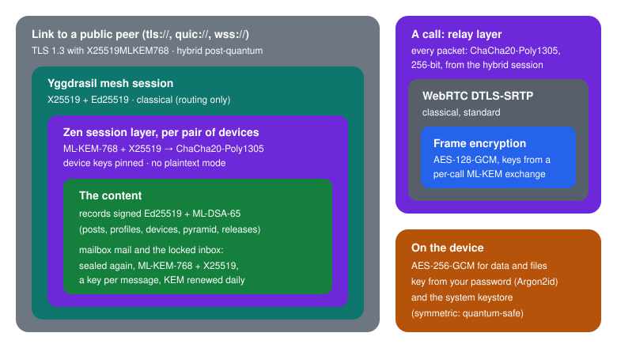

# Security model

How Zen protects what you say and keep, against whom, and where the honest
limits are. For reporting a vulnerability see [SECURITY.md](../SECURITY.md);
for the exact frames and records, the [protocol specification](PROTOCOL.md)
(sections 1.5, 2.5.1 and 4).

## In one paragraph

Zen has no servers. Devices talk over the Yggdrasil mesh, whose own
encryption is classical, and Zen puts its **own post-quantum layer** on top:
every signal between two devices, every mailbox message, the locked inbox,
door traffic, Bluetooth hellos and local link handshakes are sealed with a
**hybrid ML-KEM-768 + X25519** key exchange, and everything Zen signs to keep
or pass on carries a **hybrid Ed25519 + ML-DSA-65** signature that is valid
only when both halves verify. Call media sits inside a 256-bit post-quantum
relay layer. On the device, data is encrypted with AES-256-GCM under a key
protected by your password (Argon2id) and the system keystore. A few pieces
stay classical, for reasons explained below.

## Threat model

**Zen is built to protect you from:**

| Who | What they could try | What stops them |
|---|---|---|
| Someone watching the network (operator, Wi-Fi, a state) | read messages, record them for later | end-to-end encryption; the post-quantum layer defeats "record now, decrypt later" |
| Public peers and relaying nodes | read or change traffic they pass | the session layer (AEAD, authenticated) |
| Friends who keep your mail (mailboxes, mailbox doors) | read what they hold | sealed boxes; they see ciphertext and counters |
| Someone impersonating a friend's address | inject or read messages | device keys pinned per address and bound to the hybrid identity |
| A future quantum computer | break X25519 / Ed25519 | ML-KEM-768 and ML-DSA-65 in every hybrid; the secret holds while either half holds |
| A thief with your device, locked | read your data | AES-256-GCM, password via Argon2id, hardware-held keys, throttled attempts |
| Someone who picks up your unlocked device or forces you to open it | find other accounts | hidden accounts and decoy folders, the emergency wipe password |
| A forged update | install malware as "Zen" | `SHA256SUMS`, Android signing certificate, the hybrid signature once maintainer keys are pinned |
| A modified Zen of another person | forge pyramid or ledger records, money | every phone checks every signed record by the same rules |
| Tools inside Zen's own process (debugger, Frida, hooks) | sign what you never asked for | detection; money and the pyramid power key are blocked while detected |

**Out of scope, honestly:**

- An attacker who controls your operating system (root you allowed, a
  compromised OS, a keylogger). Zen detects and warns, it cannot win.
- **Metadata**: who talks to whom and when is visible to observers of the
  mesh routing, and to the friends who relay or keep mail for you.
- What friends do with what you show them (screenshots, retelling).
- Denial of service: anyone on the path can drop traffic.
- Outside services you choose to use: GIF search (KLIPY; it can be switched
  off in Settings → Messages and calls → GIFs), GitHub for updates,
  OpenStreetMap when you open a shared location.

## The layers

  

### Key exchange: hybrid ML-KEM-768 + X25519

Zen uses **MLKEM768-X25519** ("X-Wing") through HPKE (RFC 9180), from Go's
standard library (`crypto/hpke`, `crypto/mlkem`) in the network bridge,
on every platform. The shared secret stays safe as long as either ML-KEM-768
or X25519 holds. It protects:

| What | How |
|---|---|
| Every signal between two devices (messages, calls set-up, sync, everything) | a session per pair of devices: the KEM secret and a challenge encapsulated to the sender's device key give the keys (HKDF); ChaCha20-Poly1305 per frame, replay window; there is no plaintext mode |
| Mailbox mail and the locked inbox (Android, iPhone) | sealed again for the recipient's hybrid key (plus ephemeral and static X25519 for sender authentication); one encapsulation per recipient key per day, a fresh key for every envelope |
| Neighbours' doors | every door runs the same session layer; a sealed knock also has a second layer from the sticker's token (knock) or the knocker's hybrid key (answer) |
| Nearby (Bluetooth) hellos and answers | a one-time ML-KEM-768 + X25519 key per hello, sent in chunks over GATT |
| Local link handshakes (Wi-Fi, Wi-Fi Direct, Bluetooth) | both sides add a one-time ML-KEM-768 to the link key |
| The pair secret of local links between friends' and own devices (adverts, handshake authentication) | each device sends 32 random bytes inside the sealed session above (`local_pair`, address checked against the proven device list); once both confirm, the secret is HKDF of the X25519 pair secret and both contributions, re-made after a reinstall |
| Call keys | a fresh exchange in every call's offer and answer |
| Dating: questions, answers, profiles, "Yes", messages, matchmaking | a fresh encapsulation for every box, so boxes cannot be linked; the weekly lantern is a SHA-256 commitment to a one-time hybrid key, and the match test is a sealed offer (no Diffie–Hellman) |
| Food sharing pickup address, Table for six address | sealed for the accepted person's one-time hybrid key; a go-between sees only ciphertext |
| Pyramid private transfers | each order sealed (ML-KEM-768 + X25519, AES-GCM) for each treasurer separately; other members receive nothing |
| Housemate join | the flat key goes sealed for the new phone's hybrid key, only after the phone that showed the one-time code confirms |

### Signatures: hybrid Ed25519 + ML-DSA-65

Everything Zen signs to keep or pass on carries both signatures and is valid
only when **both** verify: account and device records, posts and other
ledger entries, pyramid records, the ledger hello, attestations, dating
profiles and recommendations, release manifests and `SHA256SUMS.sig`.
ML-DSA-65 (FIPS 204) is Go's own implementation (copied unchanged until Go
publishes `crypto/mldsa`). The ML-DSA key is derived from the same 32-byte
seed as the Ed25519 key, so backups and recovery restore both.

### Device keys and pinning

The Yggdrasil address of a device is an Ed25519 key, which a quantum
computer could break. So Zen does not rely on it for identity:

- Each device has a post-quantum **device key**, derived from its Ed25519
  seed (which a quantum computer cannot recover from the public key).
- A session counts as "from this address" only if the sender proves it holds
  that device key.
- The device key is **pinned** to the address at first contact and kept
  across restarts. A record signed with another key for the same address is
  rejected.
- The ledger hello signs the address **together with** the device key's
  fingerprint (hybrid signature), so an address is bound to the hybrid
  identity. Device entries in your log and friends' friend lists carry the
  keys too, so a friend's other devices and friends of friends are pinned
  before the first contact. A mismatch shows a warning in the chat.
- A device the account cut off (lost or stolen) is cut off at friends too,
  once the revocation reaches them: its address gets no ledger traffic, no
  keys and no chat (messages go to the account's other devices, the chat
  shows a warning), and the audience keys it could read are rotated.
  Revocations are kept only for accounts the device knows: at most the
  account's devices + 4 (up to 32), 2 per device and 512 in all.
- A hello from a stranger that only names a certificate is dropped without
  an answer, so nobody can probe whom you know.

### Call media

1. **Frame encryption**: every audio and video frame is sealed by WebRTC's
   frame encryptor with **AES-128-GCM**, keys from the call's hybrid exchange,
   per participant, rotated every 5 minutes and when someone joins or leaves.
2. **DTLS-SRTP**: WebRTC's standard transport encryption.
3. **The relay layer**: every packet (RTP, RTCP, ICE, DTLS) goes through the
   bridge's relay over the mesh and is sealed with **ChaCha20-Poly1305 under a
   256-bit key** from the two devices' hybrid session. Nothing goes unsealed.

The call screen says which protection a call has. A device without frame
encryption falls back to DTLS-SRTP inside the relay layer.

### QR tickets and cell votes

- **Event tickets** use no signatures at all: the organiser's tag and the
  live code are HMAC-SHA256 values from secrets only the guest's phone and
  the organiser share (hash-based, so post-quantum). The organiser's phone
  checks them offline; a code is valid for 90 seconds, once.
- **Cell votes** in the pyramid: each member's phone registers a **one-time
  hybrid key (a card)** with its cellmates; the list of cards is signed by
  the members' hybrid keys and counts only with at least as many signatures
  as cards. The anonymous **request** for a vote is signed by a card from the
  cell's request list (a roster made when someone first asks, for the
  present head and voters; it waits up to 12 hours for an absent member);
  the **vote** by a card from the vote's ballot, once. Both are hybrid
  signatures: nobody outside the cell can forge them, and inside it nobody
  learns whose card it was. Only the card registration between cellmates
  uses a classical ring signature (below).

## What stays classical, and why

| What | Why | What a quantum attacker could do |
|---|---|---|
| The Yggdrasil node key and address (Ed25519) | it is the mesh protocol itself | hijack or analyse routing (denial of service, traffic analysis); not read content, not pass the device key check |
| Card registration inside a cell (LSAG ring signature over Ed25519), for vote and request cards | there is no standard post-quantum linkable ring signature; unaudited lattice schemes were not used; the registrations travel only between cellmates, inside the post-quantum session layer | nothing from recorded traffic; only a cellmate with a quantum computer could tell whose card is whose (in a cell of 2 to 3 anyone can guess anyway) or spoil a list (a member signs no list without its own card, so it fails rather than counts) |
| The pair secret of local links, until the two devices first reach each other over the mesh (X25519 of their keys) | the post-quantum part is exchanged inside the sealed session, which needs that one contact | until then: recognise the two devices' adverts, or sit in the middle of a *new* link; recorded links stay unreadable |
| Call frames (AES-128-GCM) | libwebrtc always derives a 128-bit key; changing it needs a fork of WebRTC on five platforms | about 64-bit strength against Grover's algorithm; still inside the 256-bit relay layer |
| Who sent mailbox mail (the static X25519 term of the envelope) | the hybrid KEM gives secrecy, not sender authentication; a one-way offline message has no cheap post-quantum sender proof (an ML-DSA signature per envelope costs 3.3 KB and battery) | knowing a friend's mailbox X25519 key, forge mailbox mail "from" that friend (chat messages); not read mail, not forge ledger entries or hellos (hybrid signed) |
| The link to a public peer over `tcp://` or `ws://` | the peer offers nothing better | see which mesh keys you talk to (Zen picks only `tls://`, `quic://`, `wss://` itself; their TLS 1.3 uses X25519MLKEM768) |

First contact with a stranger after a large quantum computer exists, with no
friend vouching for their key, is trust on first use.

## On the device

- **Storage encryption.** A random 256-bit master key encrypts data and files
  (AES-256-GCM; per-purpose keys derived with HMAC-SHA256). It is wrapped by
  a key from your password: **Argon2id**, 19 MiB, 2 passes. Failed attempts
  are throttled and remembered across restarts. File names are hidden.
- **Biometric unlock** keeps a copy of the master key wrapped by a key that
  never leaves the security hardware: Android Keystore (StrongBox when
  present), the TPM on Windows (with Windows Hello), the Secure Enclave on
  macOS (Touch ID). A copy of the app's files is useless elsewhere.
- **Auto-lock "Never"** with a password keeps a plain copy of the master key
  in the system's secret store (Android Keystore, the iOS / macOS keychain,
  the Windows credential store), so Zen opens without the password even
  after a restart; the device's own screen lock is then all that guards it.
  Choosing it takes the password once; choosing any other mode, or locking
  by hand, deletes the copy at once (the lock screen appears only once it
  is gone). Only choosing "Never" again, with the password, makes a new
  copy: setting a password, unlocking or restoring settings never does.
  The password is still asked for before security settings change or
  sensitive screens open.
- **The locked phone (Android and iPhone).** A locked Zen keeps receiving
  without the master key; see "The locked phone" below.
- **Screens.** The wallet and other sensitive screens are protected from
  screenshots and screen recording (Android, Windows, macOS). Clipboard
  copies of secrets (the account key, a transfer code) expire after 60
  seconds; the invitation code is the public address and stays.
  Notifications show the sender and the start of a message by default; the
  first-run setup asks, and "Without sender and content" or "Sender only"
  can be chosen globally or per conversation.
- **Media in the clear, briefly.** Some media must exist as a plain file for
  a moment (a call recording being written, an alarm clip, a video being
  published, a file handed to the system player). They go to a private
  folder `zen-media` (one per profile): on Linux under the app's own cache
  (`~/.cache/<app>`), or `$XDG_RUNTIME_DIR` when there is none, `/tmp` only
  as a last resort; on macOS the per-user temporary folder; elsewhere the
  app's own folder. A new folder is made with mode 0700; an existing one is
  used only when it is a real directory (not a link), has no rights for
  group or others, and Zen can `chmod` it (only the owner can); otherwise a
  fresh `zen-media.XXXXXX` (`mkdtemp`) is used, and without a private
  folder nothing is written. Each file is created empty with mode 0600
  before its content goes in, under a random name. The folder is cleared at
  start, at exit on computers, and when the account is deleted. A call
  recording is deleted only after it is encrypted into the vault (in
  pieces, any length); one that could not be saved waits at most until the
  app closes. A profile photo from another device or a backup passes through
  `zen-media` and is deleted at once.
- **Several accounts.** Each account has its own keys, mesh node, folder,
  keystore entries and password. Folders are named by a keyed hash of the
  account ID; every device has 2 to 5 decoy folders from the first start,
  and a deleted account is replaced by a decoy, so the number of folders
  stays the same. Keystore entries of extra accounts have hashed names. There
  is no list of hidden accounts. An emergency wipe password erases its
  account silently. An account with **"Receive in background"** on (off by default
  for extra accounts) keeps its mesh node and a small receive kit under a
  separate background key, so the background service (Android) or the tray
  (computers) runs it without the password; someone with full access to the
  device (root, or on a computer any program of the same user) can then tell
  that the account exists and read its mesh address and whom it accepts
  messages from. Its notifications are generic.
- **The copy with friends.** Each person of your recovery circle
  keeps an encrypted copy of your data: profile (no photos), friends and
  groups with their levels, settings, your pyramid state and a wallet
  statement, your household (flat key, resident key, household profile and
  housemates' names; not the door key or the neighbours), your dating
  profile and its settings, and (switchable) the text of your one-to-one and
  group conversations — no photos, videos, files or disappearing messages; at most 10 MB, the oldest messages go first. Every
  section and every month of every conversation is split into chunks sealed
  with ChaCha20-Poly1305 under a key derived (HKDF) from the account key, so
  only a recovered account opens it; an unchanged chunk stays the same, so a
  refresh (at most daily, sooner after a new friend or group change) sends
  only what changed. Holders see only chunk hashes and sizes; the list of
  chunks is signed (hybrid Ed25519 + ML-DSA-65) by your device, whose
  certificate the account key signed. A holder keeps copies only of accounts
  whose recovery key it holds (100 MB in all), drops one when that key goes,
  and gives a copy back only to a device the account certified (a signed,
  fresh request). After any recovery Zen asks the circle and friends for the
  newest copy, checks it and restores it with progress shown.
- **The full account copy.** "Create a full account copy" writes the chosen parts of the
  account (always the account key) into one file, in parts of 1 GB when
  larger. It is sealed in frames of 1 MiB with AES-256-GCM under a key from
  the backup password (Argon2id, 64 MiB, 2 passes; symmetric only, so
  post-quantum safe); each frame's number and whether it is the last are
  bound to it, so frames cannot be cut, swapped or added, and every file
  inside is checked by its SHA-256. A wrong password is told apart from a
  damaged file. A copy of another account is refused before its files are
  read on a device that already holds an account with data. A copy made by
  a newer Zen is refused with "update first", never half-read.
- **Data from a newer Zen.** Stored files carry a format version. A file
  written by a newer version is left untouched (not overwritten, not
  replaced by a backup or a fresh identity); the app runs on defaults and
  asks you to update. Unknown fields are carried over when Zen rewrites a
  file.
- **Moving the account to another device.** The device with the account
  shows a one-time QR code: its address, a one-time X25519 key and a
  random 128-bit token. The new device answers with its own one-time key
  and an HMAC of it under the token, so only a device that saw the screen
  can ask; both screens show six digits from the shared key, and nothing
  leaves until the person taps "Allow" on the old device. Everything after
  that (the account key, the list of contents, the files in blocks of
  192 KB, each file checked by its SHA-256) is sealed with
  ChaCha20-Poly1305 under that key, inside the post-quantum session every
  signal already travels in. Blocks wait in the encrypted store, so a
  transfer cut short goes on from where it stopped.

## The locked phone

A locked Zen keeps receiving: Android's background service, and on an
iPhone the same receiver whenever iOS lets Zen run (docs/IOS_BACKGROUND.md).
It never holds the master key. It works with a second, **background key**: a
random 256-bit key in the system's secret store (Android Keystore-backed
storage; on iOS the keychain with "after first unlock, this device only"),
readable without the app password. The model is: the background key may
receive, never read back.

What the background key opens (each file sealed with AES-256-GCM, bound to
its name):

| File | What it holds | Can it read messages? |
|---|---|---|
| Node config | this device's mesh identity | no stored ones; with it, frames addressed to this device can be received while it runs (that is its purpose) |
| Capability | the public half of the inbox key, the mailboxes' addresses, contacts as keyed tags (a contact can be recognised, not listed) | no |
| Notice kit | the notification level of each conversation and the names of those whose level shows the sender, by address | no; it names contacts |
| Outbox kit | this device's own pending payloads, each already sealed end to end for its recipient, and where they go | no; the device cannot open them either |
| Mailbox kit and the mail held for friends | envelopes sealed for their recipients, whom this device serves, the deposit keys that check senders' tokens | no |
| Door, Nearby and alarm kits (Android) | door keys, the household's knock-sealing key, rotating tokens, the alarm's recipients | only sealed knocks, never messages |

What it does **not** open: the sealed inbox. Every frame the receiver keeps
is sealed to the inbox key — a hybrid ML-KEM-768 + X25519 key pair derived
from the master key — with AES-256-GCM per record (one encapsulation for up
to 256 records or an hour). The receiver has only the public half, so
nothing it wrote can be read back by the receiver, by someone who copies the
files with the background key, or later with a quantum computer; only the
unlocked app opens it, merges it and deletes it. Chats, history, the friend
list, the ledger and every other store stay under the master key.

What the receiver reads in memory: a frame arrives decrypted by the mesh
session (that is how any device receives). To write a notification it reads
the sender and the text of a chat message, keeps at most its first 80
characters (only as far as the conversation's notification level allows;
a group message names its sender only when the notice kit lists them as a
member of that group, and only by the name this person gave a friend,
never by a name the sender chose),
and writes nothing else from it in the clear: the whole frame goes into the
sealed inbox at once and the plaintext is dropped. Mail held by friends'
mailboxes is sealed for this device's relay identity, which is under the
master key, so the receiver keeps it unopened and says only that something
came. The notification itself is visible on the lock screen and stays in the
system's notification history, which is why it is short and follows the
notification level.

Limits: someone who takes the background key out of a running, unlocked-
since-boot phone (root, a forensic tool) can run this device's mesh identity
and receive what is sent to it from then on, and learn the contacts' names
in the notice kit and the addresses of the mailboxes and of friends served.
They still cannot read the chats, the history or anything in the sealed
inbox.

## Files from others

- **Pictures.** Every received picture is decoded and saved again before it
  is shown. Before decoding, Zen reads only the header and computes the
  memory the picture would take (PNG from its bit depth and colour type,
  JPEG as 8-bit RGB, WebP and BMP as RGBA). Above 128 MiB decoded, or above
  40 megapixels, it is refused without being unpacked; anything larger than
  a small icon is decoded in a separate isolate, so a small file holding a
  huge picture cannot freeze or exhaust the app.
- **Who brought a file.** The block store remembers, for each file fetched
  for someone else's post or comment, whose entry brought it (the first
  reason wins). When an author deletes a comment, only files that are named
  by that comment, came with that author's entries and are used by nothing
  else are removed; files made on this device, received in a chat, or
  brought by another author are never touched. Refusing a file because of
  one author blocks it only for that author's entries; a chat or another
  author may still fetch it. Storage limits count only files fetched for
  posts and comments. *Remove from my device* stays final.

## Build and supply chain

- The Go bridge is built with the Go version pinned in `go.mod`'s
  `toolchain` line (the latest 1.26 security release), and CI runs
  `govulncheck` against the bridge's modules and Go itself.
- Flutter packages come exactly from `pubspec.lock` (`--enforce-lockfile`).
- The prebuilt libwebrtc that `flutter_webrtc` downloads for Windows and
  Linux is checked against pinned SHA-256 sums in `tool/ci/libwebrtc.sha256`
  (a release build fails when a pin is missing or differs); the WebRTC-SDK
  framework of iOS and macOS against `tool/ci/webrtc_sdk.sha256`.
- On Linux the video player decodes only what Zen itself sends (H.264,
  H.265, VP8, VP9, AAC, MP3, Opus in MP4, WebM, Ogg or WAV) and refuses
  anything else before a decoder runs (`zen_media_codecs.cc`).
- On Windows Zen runs from its own `Zen` folder (`zen-app.marker`); the
  in-place update replaces only a folder that matches the marker.
- Release signing keys live only in a GitHub environment that needs the
  maintainer's approval and works only for version tags
  ([RELEASES.md](RELEASES.md), section 3).

## Memory hardening and tamper detection

- **Wiping secrets.** The Go bridge zeroes seeds and secrets after use (KEM,
  signatures, device key, link secrets), clears every answer to the app
  before freeing it, and keeps link keys in locked memory (`mlock`,
  `VirtualLock`). The app zeroes its native copies of seeds, one-time
  Bluetooth keys, KEM secrets and door seal keys.
- **Linux:** the process is not dumpable (`PR_SET_DUMPABLE=0`): no core dump,
  and another process of the same user cannot attach a debugger or read its
  memory.
- **Windows:** the heap terminates on corruption; DLLs are not loaded from
  the current directory, network shares or low-integrity files.
- **Detection:** Android (TracerPid, the Dart VM debugger, Frida in the memory
  maps and on its port, Xposed/LSPosed, emulator hints, a debuggable or
  re-signed copy), iOS and macOS (being traced, injected libraries, Frida,
  Substrate, libhooker, ElleKit, jailbreak), Windows (debuggers, Frida),
  Linux (TracerPid).
- **The response is proportionate.** Root, jailbreak or an emulator: a
  warning only, it is your device. Someone inside Zen's process (a debugger,
  Frida, hooks, an injected library, a re-signed copy): a warning, and Zen
  refuses to send transfers or use the pyramid power key, checked at least
  every minute. Even then a modified phone cannot create money: issuance is
  in signed records that every member's phone checks, and a transfer counts
  only with the signatures of a majority of the treasurers.
- The store build skips the re-signed-copy check, because a store may sign
  the app with its own key; every other check stays.

## Honest limits

- Nothing protects against the owner of the device with root or a debugger
  the system allows; Zen detects and limits.
- iOS offers no public way to deny debuggers (`PT_DENY_ATTACH` is private);
  on Android, non-dumpable processes come from the system for release builds.
- Metadata is not hidden: the mesh and your relaying friends see who talks to
  whom and when; mailboxes count what they hold.
- Any Yggdrasil node answers debug questions about its direct neighbours
  (this needs a change in Yggdrasil itself).
- libwebrtc logs key material at its info log level; release builds keep
  WebRTC logging off, and it must stay off. The bundled libwebrtc is M150;
  fixes from newer Chrome releases arrive only with a new WebRTC-SDK build.
- A comment naming files that are not its own can still make a device fetch
  them (network traffic, bounded per entry), but no longer remove them.
- Pyramid transfers are private, but not from the treasurers: every
  treasurer (the top levels) sees every transfer, like a bank. A dishonest
  majority of treasurers could sign a double spend or a false statement;
  that is provable afterwards, not preventable.
- Self-update checks the maintainers' signature only once their keys are
  pinned in the app; until then it relies on `SHA256SUMS` and, on Android,
  the signing certificate.
- The recovery circle's waiting time is kept by the helpers' honest apps.
- Unlinking a device does not change the account's own key: entries in
  `private/` sealed with it stay readable to the unlinked device if it gets
  them from somewhere. Friends stop syncing, sending keys and messages to
  it once the revocation reaches them.
- A lost device you have not cut off could still send a newer (validly
  signed) circle copy; its data is yours anyway, but it could make the copy
  smaller. Holders also see when and how much your copy changes.

Found something? Please report it privately: [SECURITY.md](../SECURITY.md).
