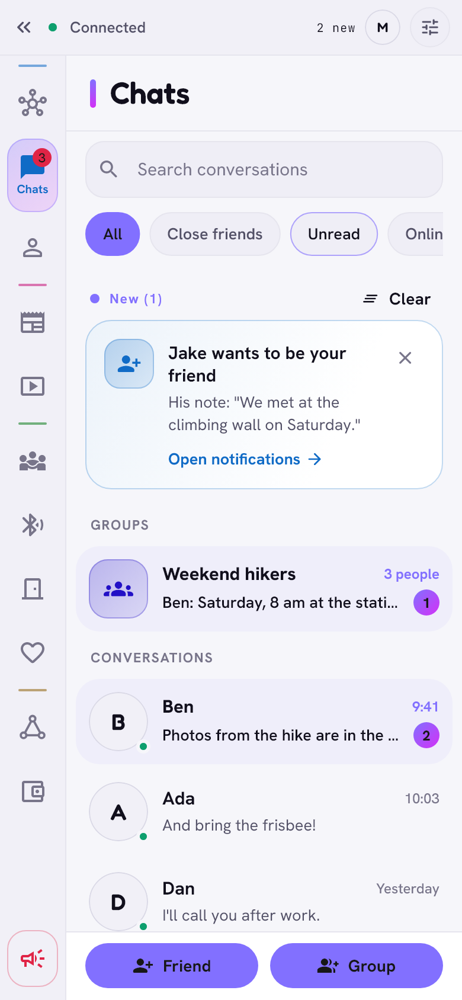

# Zen user guide

Zen is a messenger and a small social network for people who know each
other. There is no server and no company in the middle: your phone or
computer talks straight to your friends' devices, everything is encrypted
end to end, and your data stays with you.

This guide explains **what each part of Zen does and how it works**, in
plain words. Every page has the same parts: what it is, how it works, what
stays private, and the limits.

  <picture>
    <source media="(prefers-color-scheme: dark)" srcset="../images/shell-dark.png">
    
  </picture>

## Pages

| | Page | In short |
|---|---|---|
| 1 | [Getting started](getting-started.md) | Install, the first start, the password, several accounts on one device, getting your account back |
| 2 | [Friends and the graph](friends-and-graph.md) | Friendship levels, the graph and its modes, the timeline, full screen, adding friends of friends |
| 3 | [Chats, delivery and calls](chats-and-delivery.md) | Messages and groups, offline mailboxes, what the delivery icons mean, calls |
| 4 | [Feed and videos](feed-and-videos.md) | Posts for chosen people, the short-video section |
| 5 | [Meeting people](meeting-people.md) | Right now, events, dinner circles, sharing food, Nearby, the alarm, asking the network |
| 6 | [Neighbours](neighbours.md) | A code on your door, knocking, who sees what |
| 7 | [Dating](dating.md) | Dating through friends, privately, up to three steps away |
| 8 | [The pyramid](pyramid.md) | Cells of three, promotion step by step, votes, referendums, the court and appeals, the wallet |
| 9 | [Introductions and gates](introductions-and-gates.md) | Reaching people further away through friends, free or for points |
| 10 | [Offline links](offline-links.md) | Same Wi-Fi, Wi-Fi Direct, Bluetooth: Zen without the internet |
| 11 | [Themes and appearance](themes.md) | Fourteen looks, light and dark |
| 12 | [Settings and public peers](settings-and-peers.md) | Where things are, the public peers Zen connects through |
| 13 | [Updates and releases](updates.md) | How Zen updates itself and how to check a download |

More for the technically minded:

- [Security model](../SECURITY_MODEL.md): threats, what is encrypted how, what
  is still classical and why.
- [Dependencies](../DEPENDENCIES.md): the libraries Zen is built on, and their
  licences.
- [Protocol specification](../PROTOCOL.md): the frames and records on the wire.
- [Privacy policy](../PRIVACY.md) and [terms of use](../TERMS.md).

## Words used in this guide

- **Friend**: someone you added with a QR code (or through a mutual friend).
  You choose how close they are: *casual friend*, *friend* or *close friend*.
- **Device**: a phone or computer with Zen. One account can have several.
- **Mesh**: the [Yggdrasil](https://yggdrasil-network.github.io/) network.
  Every device has its own address in it; traffic goes directly or through
  other devices that cannot read it.
- **Mailbox**: a trusted friend's device that keeps sealed messages for you
  while you are offline.
- **Post-quantum**: protected also against a future quantum computer. See the
  [security model](../SECURITY_MODEL.md).

> The pictures on these pages are made from the app itself by
> `tool/ui_tour/docs_screens_test.dart` (see [Testing](../TESTING.md)).
> They follow your GitHub theme: light or dark.
