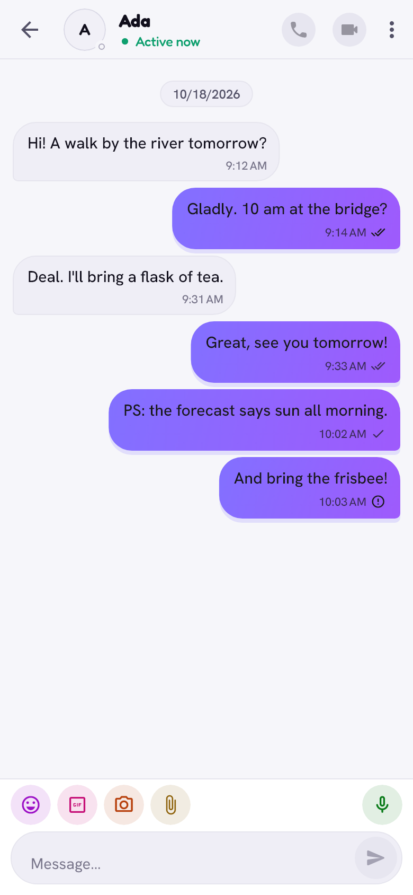
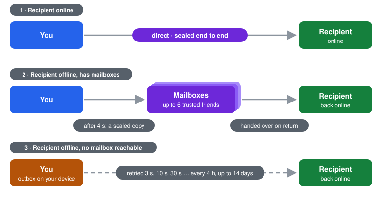

# Chats, delivery and calls

> Messages go straight from your device to your friend's. When your friend is
> offline, sealed copies wait in mailboxes on their friends' devices, or on
> your own device, until they come back.

  <picture>
    <source media="(prefers-color-scheme: dark)" srcset="../images/chat-dark.png">
    
  </picture>

## What you can do

- One-to-one chats and groups (the pyramid's cell chats too): text, photos,
  videos, files, voice notes and GIFs.
- **GIF files** picked from the gallery or from disk stay animated (up to
  8 MB, 2560 px a side and 2000 frames, with at most 200 million pixels
  over all frames); their comments and metadata are removed. A GIF that
  would not play can go as an ordinary file. Animated WebP and PNG
  pictures (a keyboard's sticker, a picture saved from another messenger)
  go as GIFs that keep playing instead of a still of their first frame. A
  GIF picked from the gallery as your profile photo or cover keeps
  playing too, and a HEIC photo is read by the phone's own decoder for the
  profile, posts and comments.
- **What leaves with a picture or a film.** Photos, films and voice or
  video recordings sent in a chat leave without place, time and device data
  (EXIF and the like), however you picked them: from the gallery or the
  camera, dropped, pasted or recorded (a film used to go as it was, and a
  HEIC photo as a file with its whole EXIF, while posts already stripped
  both). A file of another kind goes unchanged, and so does one that cannot
  be cleaned; the attach sheet says so before you send. More kinds of
  received files warn before opening.
- On a computer, **drop** files anywhere on a conversation or **paste** them
  with Ctrl+V (⌘V on a Mac): photos, GIFs, videos, files. Text in the
  clipboard pastes as text, as usual.
- **Keyboard GIFs and stickers.** On Android, GIFs and animated stickers
  from the keyboard (for example Gboard or SwiftKey) arrive animated.
  iPhone keyboards copy a GIF to the clipboard instead: use **Paste image
  from clipboard** in the chat or in the attachment sheet.
- Long-press a message to **react**, **reply**, **edit**, **forward**,
  **delete for everyone**, copy it or report it.
- Groups have a **Board** tab with their own posts: text, a photo, or both.
  A group has at most 256 people, its creator included; choosing more says
  *A group can have at most 256 people.*
- *typing…* shows while a friend writes and goes a few seconds after their
  last keystroke, and at once when they leave the chat or Zen.
- Audio and video calls, also in groups, with screen sharing.
- **The conversation does not move under your finger.** While you drag the
  list or it keeps moving after a flick, a new message, receipt, "typing…"
  line or file no longer shifts what is on the screen (it used to jump by
  the height of what came, also at the newest message). What arrived waits
  on the *to newest* button.
- Filters in the chat list: all, unread, online, close friends.

## Reactions, replies, edits, forwarding

- **Reactions.** One per person per message. Tap the same emoji again to
  take it back; picking another one replaces it. Long-press the reactions
  under a message to see who reacted with what.
- **Replies** quote the original: who wrote it and the start of its text.
  Tap the quote to jump to the original. A reply to a disappearing message
  carries none of its text, so the quote shows only while the original is
  still there.
- **Editing.** Only your own text messages, within 24 hours of sending.
  The message is marked *edited*; the earlier text is not kept. Other
  devices take an edit only from the message's author, and only up to 25
  hours after it was sent (one hour of leeway for clocks).
- **Disappearing messages.** The timer you set for a chat carries a stamp
  that orders every change on every device, whatever the clocks say, so a
  message written before the change no longer switches the timer back on
  for both phones. A copy of a message that comes again writes its file
  once.
- **Delete for everyone.** Your own messages; in a group, its creator may
  also delete anyone's message (a pyramid cell chat has no creator, so
  there only authors can). A *Message deleted* note stays in its place,
  replies lose the quoted words and the message's file is erased (a file
  still on its way stops). Be aware: whoever already read it may remember
  it, and a modified app can ignore the deletion and keep a copy.
- **No words left behind.** A message deleted for everyone, one that
  disappeared, one edited, one deleted from this phone or cleared with its
  chat takes its notification, its entry in the notification list and any
  copy still waiting to be shown with it, also while Zen is locked and on
  your other devices.
- **Forwarding** passes a text or a file to a friend or a group, marked
  *Forwarded*. Disappearing messages cannot be forwarded. Mentions in a
  forwarded message become plain names.
- **Mentions in groups.** Type **@** in a group chat and pick a member from
  the list under the field (only members of that group are offered, and a
  message can mention only members). The mention shows highlighted; tap it
  for the person's mini-profile. A mention is kept as a reference to the
  member next to the text, so it shows their current name. The person
  mentioned gets the group message's notification as a mention ("Ada
  mentioned you"), in its own notification slot, and an entry in the
  notification list that opens the chat at that message. Their phone
  checks that the sender is a member of the group; one sender's mentions
  are announced at most 5 times in 10 minutes, after that they notify like
  any other message. The group's privacy level applies as for any message
  (at *Notice only* a mention says only "New message"). Editing a
  message keeps its mentions (it adds nobody).

Reactions, edits and deletions travel like messages (queue, mailboxes) to
everyone in the chat and to your other devices, without notifications.
What a new device copies from your other devices, and the copy with
friends, keep each message as it is now: edited, deleted (only the note), with its
reactions and reply.

## Files in groups

- Up to **64 KB** a file travels inside the group message itself, so it
  waits in each member's mailboxes like any message.
- Larger files, up to **24 MB**, are sealed once with a fresh key and kept
  as content-addressed blocks. The message carries only their reference
  (with the key); each member fetches the blocks from the sender or from
  any member who already has them, so your phone does not upload a copy
  per member. Until Zen's network is running, files up to 1 MB go inside
  the message instead.
- A file that has not arrived yet is asked for again when you open the
  chat. Every file is checked like in one-to-one chats: pictures are
  unpacked and saved again before they are shown.
- A photo on the **Board** is shared the same way: the post carries its
  reference, the members fetch the photo.

## How a message travels

  

1. **Your friend is online.** The message goes straight to their device,
   sealed end to end.
2. **Your friend is offline but has mailboxes.** Every device picks up to 6
   friends whose devices keep its mail. After 4 seconds without an answer, a
   sealed copy goes to those mailboxes; they hand it over when your friend
   is back. A mailbox sees only ciphertext.
3. **No mailbox can be reached.** The message waits in the outbox on your
   device and is tried again: after 3 s, 10 s, 30 s, 2 min, 10 min, 30 min,
   1 h, 2 h, 4 h, then every 4 hours, for up to 14 days. Any sign of life
   from your friend starts over at once, and so does a change of network.

Every message is written to disk before the first attempt, so nothing is
lost if the app or the phone stops in between. A message is confirmed to
its sender only once it is in the recipient's chat or refused for good, on
every path: one lost on the way in (the app killed, a failed write, a busy
start while the friend list could not be read, a message that arrived
before its sender's acceptance, an edit that came before its message)
comes again instead of showing *Delivered* for ever. A message that could not be sent puts its text and
its quote back into the field; a group message longer than the members'
phones keep (64 K characters) is refused instead of cut. Duplicates (a direct copy and
a mailbox copy) are recognised and shown once. The outbox holds up to 32 MB
of waiting messages; when it is full, a new message is marked not sent and
you can try again once friends have picked up what waits.

**Which friends keep your mail.** A mailbox is only useful when it is
online while you are not. Each device tells its friends what kind of device
it is: a computer with Zen in the tray (online whenever it is on), an
Android phone (its background service keeps friends' mail even while Zen is
locked), an iPhone with *receive in the background* on, or an iPhone
without it (online only while Zen is open). Zen also notices how often each
friend's device actually answers when it is asked for mail or handed mail
for someone else, counted by the hour, so a phone that is off for a night
loses little. It then picks, in this order: devices that have not gone
quiet, friends before casual friends, the devices most likely to be online
(computers and Android phones before iPhones, corrected by how they really
answered), close friends before friends, then whoever was seen most
recently. One device per friend: if a friend has a computer and an iPhone,
their computer keeps your mail.

Zen changes your mailboxes rarely, because every change makes your friends
leave your mail somewhere else. A free place (a mailbox that is no longer
your friend) is filled at once. Otherwise at most one mailbox changes per
day, and never all of them at once: one that has not answered for 3 days
while your device kept asking makes way for a friend whose device answers,
and one that is online only now and then makes way for a much better one (an
iPhone for a computer or an Android phone). One computer with Zen in the
tray can be the mailbox for a whole group of friends; *Invite* says so too.

**When a mailbox stops answering.** If a mailbox has not answered for 3 days
and none of your other friends' devices is good enough to take its place
(say all of them are iPhones), or you chose your mailboxes by hand, Zen
tells you: a card on the chats list and an entry in the notifications say
*Mailbox {name} has not answered for {time} — choose another*. Tapping it
opens **Settings → Network → Offline mailboxes**, where each friend shows the kind of
device and how much of the time it was available, and an iPhone without
*receive in the background* is marked as a weak mailbox. The same page
counts *Waiting for delivery*: messages, attachments and invitations from
you that have not reached their recipient yet, each once per message and
person (receipts, statuses and the like that Zen sends by itself are not
counted), and *You keep these for friends* with how many people they are
for (a friend with two devices is one).

**What waits, and how long.** Of the things Zen sends by itself — your
profile, friend list, status, *open to meet*, nearby keys, the terms at
your gates and read receipts — only the newest waits for each friend, here
and in their mailboxes; a newer one replaces the older one. Posts pushed
to a friend who is offline wait 7 days (they also come with the next sync
of posts). A receipt for a message a friend took from a mailbox while you
were away reaches you through your own mailboxes. A device of a friend
that has been silent for a week while another of theirs answers is taken
for gone: it still gets what a person sent, but nothing Zen sends by
itself until it is heard from again. What a person did while it was away
now reaches it when it is back: a group leave, a friend removal, a
cancelled transfer, a board post, and also a voice message, a photo or a
text over 48 KB (only chat kinds counted as a person's before). A mailbox's
read receipt is no longer replaced by a newer one, and a message that can
only travel directly says so. Mail for someone who is no longer
your friend goes.

**Friends with several devices, or a new phone.** Each of your devices has
its own mailboxes and its own key, and a message to a friend goes to every
device of theirs, each copy sealed for that device and waiting in that
device's own mailboxes. Your chat counts the friend once: the message is
delivered as soon as any of their devices has it, and a group's *delivered d
of n* counts people. When a friend moves to a new phone, the new phone tells
your device its mailboxes and your messages wait there from then on; their
old phone, once silent for 3 days, stops being your mailbox and their new
phone takes its place. Mailboxes you chose by hand name friends, not
devices, so they follow a friend to their new phone, and they are the same
on all your own devices (a new phone starts with your choice). Unlinking a
lost phone (**Settings → Account and recovery → Devices**) stops everything
going there at once.

### iPhone

iOS lets Zen run in the background only briefly. On an iPhone:

- messages and calls **arrive at once only while Zen is open**. Otherwise
  iOS wakes Zen now and then for a short check of your mailboxes — when, the
  system decides: a few times a day at best, never after you swipe Zen away
  in the app switcher. Until then messages wait with the sender or in your
  mailboxes on friends' devices;
- messages you write go out while Zen is open and for about half a minute
  after you leave it; after that a message to someone offline waits on the
  iPhone (*Waiting on your iPhone, recipient offline*) until the next check
  or until you open Zen again;
- a locked Zen receives too: messages wait encrypted until you unlock, and
  their notifications show at most the start of a message;
- **Settings → Notifications and sounds → Background work** (and a step of the first-run setup) lets
  you choose how Zen is woken: **automatically by iOS** (a few times a day,
  almost no battery), a **Shortcuts automation every hour** (the action
  *Check Zen messages*; iOS may show a short banner each run) and a
  **silent sound for receiving at once** (messages and calls arrive at
  once — at a clear battery cost). It also checks the iPhone's settings Zen
  needs: Background App Refresh, Low Power Mode off, notifications, and not
  swiping Zen away ([details](../IOS_BACKGROUND.md));
- friends pick an iPhone as their mailbox only after devices that stay
  online, and their picker marks it as a weak mailbox; with *receive in the
  background* on, an iPhone tells them so and counts as a better one.

Chats show this once on an iPhone (**Got it** closes it), and *Why isn't it
working?* lists it. It works best when someone in your group of friends
has Zen on a computer or on Android.

## What the icons mean

Long-press a message to see its label; tap the icon for details, a legend
and **Retry**.

| Icon | Label | Meaning |
|---|---|---|
| clock | Sending… | the first direct attempt is under way |
| outbox | Waiting on your phone, recipient offline | only this device has a copy and keeps trying (on an iPhone: *Waiting on your iPhone*, tried again while Zen is open and at the background checks) |
| mailbox | Waiting in the recipient's mailboxes with friends (N) | N sealed copies wait in mailboxes; if you are one of them, the details say so |
| one tick | Sent | in the queue, nothing more is known yet |
| two ticks | Delivered | the recipient's device confirmed it is in their chat |
| two ticks, coloured | Read | the recipient opened the chat with it on the screen (one-to-one chats) |
| warning | Failed, retry | it expired unconfirmed; **Retry** sends it again under the same id |
| outbox | Waiting on your phone, will go when you are both online | a large file the mailboxes cannot take |

In groups the icon follows the furthest-behind member and the label says
*Delivered {d} of {n}*. **Retry** in a group goes only to those who did not
confirm.

*Read* shows under your message only when your friend opened the chat:
reading it marks only the friend's messages, all of them up to the one
read, and sends one receipt. A chat read on one device of the account is
read on its others too (groups included), with no unread count and no
notification left there, also when they were off: the read mark waits in
the queue until it is sent, and a message that arrives after its mark comes
in read. A call taken on another device of yours leaves no missed call (the
call's end sent to the callee's other devices looked like the caller
hanging up).

## Calls

A call is set up over the same encrypted channel as messages. Its audio,
video and shared screen are protected three times:

- **frame encryption** (AES-128-GCM) with keys from a fresh post-quantum
  exchange for this call, rotated every 5 minutes and whenever someone joins
  or leaves a group call;
- WebRTC's own **DTLS-SRTP**;
- every packet travels through Zen's relay over the mesh and is sealed
  again with a **256-bit post-quantum** key of the two devices.

The call screen says which protection a call has. In a group call every
participant has a separate connection to every other. The camera and a
shared screen use the VP8 codec on both sides, whatever either side lists
first (the side that answers puts VP8 first in the other's offer): two phones
with hardware codecs could agree on one whose frames the frame encryption
could not open, and the picture stayed black while the sound worked. The
other side's picture shows in every video call: the picture was bound to
the stream when the call first reported it, before the system had
registered it, so in some calls it stayed black while frames were
decoded; it is now bound once the system has the stream, and again if
decoded frames never reach the screen. The microphone, loudspeaker and
camera buttons work while the call rings, not only once it is active. These
fixes need both sides on this version; a call with an older Zen keeps the
old behaviour on that side. Switching the camera off and on during a call
keeps the call, sound and all, when one of the two phones has Zen 1.17.5 or
later; before, the call ended when the other side's camera was on. The
technical log (**Diagnostics**) shows for each call which
codecs were offered and how many video frames went out, came in and were
shown.

The picture of a video call stays sharp and steady when it moves and in
poor light, on a connection that carries about 1.5 Mbit/s each way: 1280 x
720 at 24 frames a second. A phone's camera used to slow down in poor light
to 5 or 6 frames a second, each blurred by any movement; on Android Zen now
holds the camera to its steadiest frame rate (24, or at least 15 where the
camera has nothing steadier). In poor light the picture is then a little
darker or grainier rather than slow. The picture also starts sharp instead
of taking several seconds. On a weak connection the frames keep coming at a
smaller size: a soft picture rather than a frozen one.

The screen stays on for the whole of a video call, and of a voice call on
the loudspeaker or a headset, from the first ring of a call you make to its
end, however the call was answered (in the app, on the lock screen, from the
notification) and whatever shows it (the call screen, the call bar over the
app, the small window over other apps). It goes back to the phone's usual
timeout when the call ends. A voice call held at the ear is left to the
phone's own screen timeout, as before. Before, only a call that was still
ringing kept the screen on, and on most phones a call went dark after the
screen timeout when nobody touched it.

**Busy and missed calls.** A call that comes while another one rings (in
or out) or is under way gets *busy*: the caller sees *{name} is busy*, the
call shows as missed for you, and the call already there goes on. A ring
that ends unanswered sends the person called a small notice that waits
like a message, so someone who was offline sees the missed call once when
they are back, also on a locked phone.

When you share your screen, notifications show at most who wrote, never
what, and a red bar reminds you that everything is visible. When a call is recorded,
everyone hears a signal.

**Recording** works on every system and only takes the call and your
microphone, never other apps: Android writes `.mp4` (with the other side's
video in a one-to-one video call), iPhone, iPad and Mac `.m4a`, Windows and
Linux `.wav`. On Linux it needs PulseAudio or PipeWire. A finished
recording is encrypted into Zen's storage in small pieces, however long it
is, and the plain file is deleted only after that; Zen says *saved* only
then, and offers *Retry* when saving failed.

## Blocking a person

A block is of **the person**, in every feature and on every device of your
account. One list, kept by account with every address, device and dating key
Zen knows for them, is read by the messenger, Dating, *Nearby*, the wall and
films, pebbles, introductions and mentions, and it comes back from every
copy of your account. Before, each feature kept its own: someone blocked in
the messenger still got your dating profile through a mutual friend, and a
block in Dating was beaten by a new dating key. Their likes and comments no
longer show under friends' posts (the wall, a post's page, the profile, the
bell and the system notifications leave them out) and their names leave the
counts; a removed friend's account is remembered so that a block still finds
it. The dialog says what a block covers.

**The honest limit:** an account costs nothing. Someone you blocked can make
a new account and a new dating key, and Zen cannot recognise them as the
same person; it refuses the accounts, addresses, devices and keys it knows
to be theirs, never the person.

## Privacy

- Nobody but the two (or the group) can read a message: not the mesh, not
  the mailboxes, not the public peers. See the
  [security model](../SECURITY_MODEL.md).
- Photos from others are unpacked and saved again before they are shown, so
  a "poisoned" image never reaches the system. Zen never opens files by
  itself and warns before saving a program.
- **GIF search** uses an outside company, KLIPY: it sees what you type in
  the GIF search, the GIF you pick and your IP address. The GIF then goes
  to your friend as an ordinary encrypted picture; the friend's device never
  contacts KLIPY.
  **Settings → Messages and calls → GIFs → GIF search** turns it off: the
  GIF button disappears and nothing goes to KLIPY. GIFs from your keyboard
  and GIF files are sent like photos and keep working.
- Pasted and dropped photos are saved again as a fresh JPEG without
  metadata, the same as photos picked in the app.
- A friend's name comes from their own profile; your nickname for them is
  shown under it.

## Limits

- While Zen is locked (Android), messages still waiting go out from a
  sealed copy of the queue prepared while it was unlocked (up to 300
  messages, 4 MB). What can only go directly waits until you unlock.
- A file over 1 MB to a friend whose mailboxes do not take files waits on
  your device until both of you are online.
- A group file sent as blocks arrives only while the sender or another
  member who has it is online.
- Only text messages can be edited; a Board post may have one photo.
- A comment takes up to 4 pictures or GIFs. Events, food sharing and
  neighbours take small pictures: a GIF there is made smaller (and may lose
  some frames) but keeps playing.
- Dropping files shows no highlight while you drag (the system reports only
  the drop).
- On iPhone Zen receives and sends at once only while it is open (iOS lets
  it run in the background only briefly; [above](#iphone)).
- While an Android phone sleeps (Doze), mail from the mailboxes can come a
  few minutes late.
- Read receipts exist only in one-to-one chats.
- Leaving a group removes its chat, its files and its notifications from
  **every device of your account**, not only this phone (the dialog says
  so); declining a group or **Clear history** in a group removes them from
  this phone. Two members adding someone at the same time no longer split a
  group: a newcomer takes the members' additions it missed, and a message
  from a member it does not know yet waits until it does. An invitation
  shows whether it arrived, says when it did not (it used to show as waiting
  for ever after it had expired unseen) and can be sent again. A creator who
  left the group is no longer a member: no phone takes their messages
  until they are invited again.
- **Presence.** Friends see one of three states, as a dot on the avatar
  in the chat list and in the chat header: *online* (a dot in the theme's
  "success" colour that pulses briefly when it lights up: Zen is open on
  their screen), *in the background* (a still dot in the theme's "warning"
  colour: Zen is hidden or the phone locked, but it still receives) and
  *offline* (an empty ring). The
  header also says when they last opened Zen ("5 min ago", "3 h ago",
  "2 days ago") while they are not online. An iPhone that iOS suspends
  shows as offline, not in the background, unless it keeps receiving
  (*Keep receiving in the background*). Zen tells this only by the way:
  when you open it, with its few pings while it stays open, with its
  answers to friends' pings, and "leaving" when it goes to the background;
  a locked Android phone also asks its friends every 10 minutes (see
  [Settings](settings-and-peers.md#settings)). Friends' states are complete
  the moment Zen opens: what the background service heard while Zen was
  closed is kept. A message counts as a sign that a friend is there only
  when it was written a moment before it came; one that waited in a
  mailbox does not, and writing to a friend does not mark them as seen.
  A weak acquaintance sees none of it; *Settings → Privacy and security →
  Contact and visibility → Show when I last opened the app* hides the time from everyone.

[Back to the guide](README.md)
