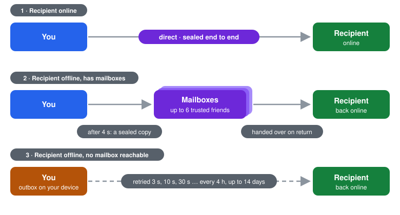

# Chats, delivery and calls

> Messages go straight from your device to your friend's. When your friend is
> offline, sealed copies wait with their trusted friends, or on your own
> device, until they come back.

  <picture>
    <source media="(prefers-color-scheme: dark)" srcset="../images/chat-dark.png">
    
  </picture>

## What you can do

- One-to-one chats and groups: text, photos, videos, files, voice notes,
  GIFs, reactions. Groups have a **Board** tab with their own posts.
- Audio and video calls, also in groups, with screen sharing.
- Filters in the chat list: all, unread, online, close friends.

## How a message travels

  

1. **Your friend is online.** The message goes straight to their device,
   sealed end to end.
2. **Your friend is offline but has mailboxes.** Every device picks up to 6
   trusted friends who keep its mail. After 4 seconds without an answer, a
   sealed copy goes to those mailboxes; they hand it over when your friend
   is back. A mailbox sees only ciphertext.
3. **No mailbox can be reached.** The message waits in the outbox on your
   device and is tried again: after 3 s, 10 s, 30 s, 2 min, 10 min, 30 min,
   1 h, 2 h, 4 h, then every 4 hours, for up to 14 days. Any sign of life
   from your friend starts over at once, and so does a change of network.

Every message is written to disk before the first attempt, so nothing is
lost if the app or the phone stops in between. Duplicates (a direct copy and
a mailbox copy) are recognised and shown once.

## What the icons mean

Long-press a message to see its label; tap the icon for details, a legend
and **Retry**.

| Icon | Label | Meaning |
|---|---|---|
| clock | Sending… | the first direct attempt is under way |
| outbox | Waiting on your phone, recipient offline | only this device has a copy and keeps trying |
| mailbox | Waiting for pickup with the recipient's trusted friends (N) | N sealed copies wait in mailboxes |
| one tick | Sent | in the queue, nothing more is known yet |
| two ticks | Delivered | the recipient's device confirmed it |
| two ticks, coloured | Read | the recipient opened it (one-to-one chats) |
| warning | Failed, retry | it expired unconfirmed; **Retry** sends it again under the same id |

In groups the icon follows the furthest-behind member and the label says
*Delivered {d} of {n}*. **Retry** in a group goes only to those who did not
confirm.

## Calls

A call is set up over the same encrypted channel as messages. Its audio,
video and shared screen are protected three times:

- **frame encryption** (AES-128-GCM) with keys from a fresh post-quantum
  exchange for this call, rotated every 5 minutes and whenever someone joins
  or leaves a group call;
- WebRTC's own **DTLS-SRTP**;
- every packet travels through Zen's relay over the mesh and is sealed
  again with a **256-bit post-quantum** key of the two devices.

The call screen says which protection a call has. In a group call every
participant has a separate connection to every other.

When you share your screen, notifications are shown without content and a
red bar reminds you that everything is visible. When a call is recorded,
everyone hears a signal.

## Privacy

- Nobody but the two (or the group) can read a message: not the mesh, not
  the mailboxes, not the public peers. See the
  [security model](../SECURITY_MODEL.md).
- Photos from others are unpacked and saved again before they are shown, so
  a "poisoned" image never reaches the system. Zen never opens files by
  itself and warns before saving a program.
- **GIFs** come from an outside company, KLIPY: it sees what you type in the
  GIF search and your IP address, and the IP address of anyone who opens a
  GIF you sent. Don't use GIFs if you mind that.
- A friend's name comes from their own profile; your nickname for them is
  shown under it.

## Limits

- While Zen is locked, the outbox is not retried (its state is under your
  key); receiving still works, and retrying resumes after you unlock.
- Large attachments that do not fit in mailboxes wait on your device until
  both of you are online.
- On iPhone Zen receives only while it is open (iOS does not allow it to run
  in the background).
- Read receipts exist only in one-to-one chats.

[Back to the guide](README.md)
