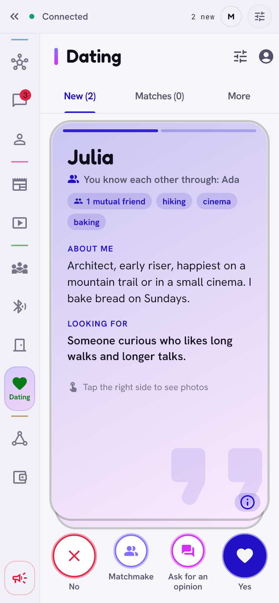

# Dating

> Meet new people through the people you know, up to three steps away. Your
> phone and theirs check privately whether you fit; nobody else learns it,
> not even the friends in between.

  <picture>
    <source media="(prefers-color-scheme: dark)" srcset="../images/dating-dark.png">
    
  </picture>

## What it is

A dating profile, off by default and separate from your Zen account: a first
name, gender, *About me*, *What I'm looking for*, up to 4 photos, interests
and friends' recommendations. You choose an **intention**: dates, new friends
(no romance), or both, and whom you are looking for in each. There is no age
field.

## How it works

1. **Lanterns.** Once a week every phone (dating on or off, so nobody stands
   out) sends its friends a "lantern": nothing but the hash of a one-time
   post-quantum key. Friends pass it on, up to **3 steps**, and also through
   open [gates](introductions-and-gates.md).
2. **A private test.** A phone that sees a lantern fetches the key, checks
   it against the hash, and asks a sealed question that carries no wishes.
   The answer is the lantern holder's offer (a few bits: whom they look for,
   and how), sealed for the asker; the asker's phone compares it with its
   own wishes. Only when you fit does it ask for the profile, naming its
   wishes as the proof. A phone with dating off, or that hides from you,
   offers nothing, which looks just like not fitting. The friends in
   between see only sealed boxes of a fixed size.
3. **Cards.** Profiles that fit show up as cards: "You know each other
   through Celina", mutual friends, recommendations. **Yes** sends back a
   signed token; **No** sends nothing. Two yeses make a pair, and the pair
   can chat.
4. **Distance that can't be faked.** Every phone that passes an answer back
   adds one to a counter, so someone far away cannot pretend to be a friend
   of a friend.

**How far you want to see:** my friends / friends of friends / 3 steps /
further through open gates. It works both ways: people beyond your reach
don't see you either.

**Friends help.**

- **Ask for an opinion** goes only to someone who knows that person: a mutual
  friend, the friend on the way, or a matchmaker; never to the person.
- **Matchmaking:** pick two friends (or people from your Dating) and
  introduce them. Their phones run the same private test; you learn nothing.
- **Recommendations:** friends vouch for you (up to 50 on a profile), signed
  with their key.
- **Safe date:** in a pair, both can agree to see your mutual friends, to ask
  them about each other. **I'm going on a date** tells a friend where and
  when; they can ask for your location, and get an alarm if you don't check
  in.

**Hiding.** Hide your profile from chosen friends or whole group chats:
*only from them*, or *from them and their circle* (nobody who reaches you
only through that person sees you). Your phone refuses those questions
itself; the list of hidden people never travels in your profile.

## Privacy

- Your profile carries a separate dating key, not your account address.
- Profiles are signed (Ed25519 + ML-DSA-65) and answers have a fixed size,
  so a go-between can't tell a real profile from a "no".
- Everything after the lantern (questions, answers, profiles, *Yes*,
  messages, matchmaking) is sealed with a fresh post-quantum key each
  (ML-KEM-768 + X25519); the lantern itself is a SHA-256 hash. The test
  needs no Diffie–Hellman, so nothing recorded today opens to a quantum
  computer later.
- **Open to meeting people** on the graph is a separate opt-in, off by
  default, with an extra confirmation. The list of people it must not reach
  goes only to your own friends, salted anew for each, so friends of friends
  cannot test addresses against it.
- **Report a minor** disables a profile on your phone at once and reports it
  to the pyramid; a phone that sees reports from two different people
  disables it too. Pyramid dating bans hide a profile as well.

## Limits

- A modified app of a dater learns, from each answer, whom the lantern's
  holder looks for (as it could with the earlier test, in three answers);
  answers per lantern and friend stay limited.
- Under *only from them*, the first phone on the way says which key a hidden
  friend told it, so a new key is noticed; a modified app that pretends to
  pass on someone else's question through a mutual friend is not.
- Who sent a sealed box is still proven with X25519 alongside the
  post-quantum secret; what matters for authenticity (profiles,
  recommendations, *Yes*, messages) is signed or MACed post-quantum.
- A modified phone on the way can shorten the distance behind itself, not
  before itself.
- Dating is closed only when the whole app is locked; it asks for no extra
  password.

[Back to the guide](README.md)
