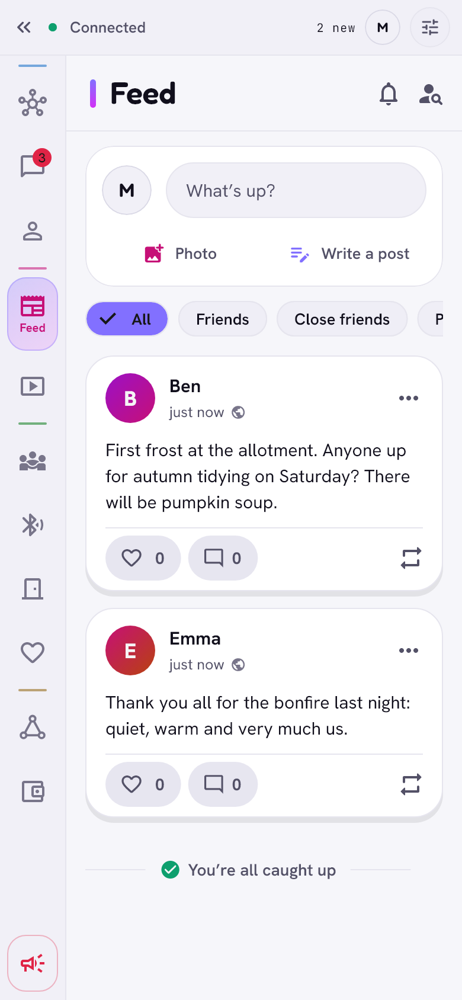
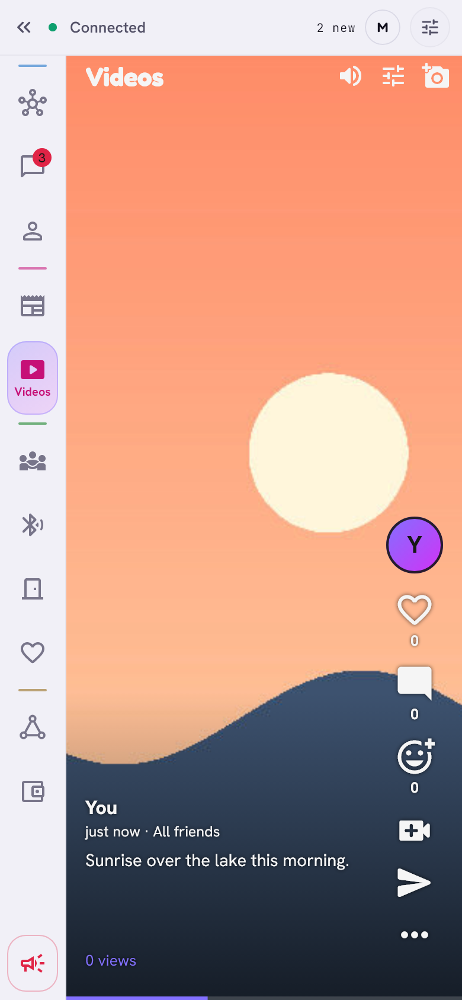

# Feed and videos

> Posts and short videos from people you know, in the order your own phone
> works out. No server, no ads, no recommendation engine.

  <picture>
    <source media="(prefers-color-scheme: dark)" srcset="../images/feed-dark.png">
    
  </picture>
  &nbsp;
  <picture>
    <source media="(prefers-color-scheme: dark)" srcset="../images/films-dark.png">
    
  </picture>

## The feed

**What it is.** Posts with text, photos, videos and audio recordings. For
every post you choose who sees it: public, all friends, friends and close
friends, or close friends only.

**How it works.**

- Every post is a signed entry in your own log. Your friends' phones fetch
  new entries from each other when they meet on the network. Anything that
  is not public is encrypted with a key of its audience, which only friends
  of a high enough level hold.
- Filters: **All · Friends · Close friends · Pyramid · Country**. *Close
  friends* shows posts of people you marked as close friends. *Pyramid* and
  *Country* show posts from [the pyramid](pyramid.md).
- Likes, reactions, comments and shares. "Liked by you, Bob and 1,284
  others" counts only what your phone has seen.
- Public posts can be **followed** by people who are not your friends.
- GIFs in a post stay animated. On a computer you can drop or paste photos,
  GIFs and videos (up to 50 MB) into the post editor and into *Add to
  gallery*.
- A comment can carry up to 4 photos or GIFs (camera, gallery, a file, GIF
  search, a keyboard GIF, or dropped and pasted on a computer); tap one to
  see it full screen. Your own comment can be deleted, with its pictures.
- You can hide comments and block people in your own threads; **Report**
  keeps the signed original as evidence and can remove the post from your
  device.

## Videos

**What it is.** A full-screen vertical player for short videos from friends
and people you follow: swipe up and down, double tap to like, emoji
reactions, comments, **Reply with a video**, **Send to chat**.

**How it works.**

- **Hold to record** (60 seconds, or 90), front or back camera, torch,
  3 or 10 s timer, or pick a file. Trim the start and end, add a description
  (up to 150 characters) and choose who sees it, as with a post.
- Before publishing, the phone shrinks the video to about 720p and at most
  20 MB, removes its metadata (place, device) and encrypts it.
- The order is computed on your phone: fresh unwatched videos from the last
  7 days first, weighted by how your friends reacted (likes, comments,
  shares, close friends count more), never the same author twice in a row;
  then older unwatched ones; then the rest. The list does not jump under
  your finger.
- A video is stored in encrypted blocks of 256 KB. Only the video on screen
  downloads in full; the next two fetch their first block, the next five
  their cover. Blocks come from the author's devices, from friends who
  passed it on, and from the author's mailboxes (which keep a friend's
  newest videos, up to 20 MB per person).
- Up to 1 GB of other people's videos is cached; watched ones go first. Your
  own are never removed.
- **Videos from friends of friends** (off by default): public videos that a
  friend liked. Their authors don't learn that you watch them.

## Privacy

- Like counts and reactions next to a video count only your friends.
- Views are visible only to the author, counted from the author's friends.
- Moderation works as on the feed: report, hide a video, pyramid bans; an
  author can delete their own video everywhere it reached.

## Limits

- **Computers.** Windows records with the webcam (no torch) and shrinks
  videos with Media Foundation. A Mac records and shrinks with the system's
  own video tools. Linux records through GStreamer and shrinks with an
  H.264 encoder (OpenH264) and an AAC encoder (vo-aacenc) built into Zen;
  it needs GStreamer (or ffmpeg) to read the input. Without either, a video
  is published as it is if it is at most 20 MB and 90 seconds, without
  trimming.
- Likes and comments of friends of friends reach the author through the
  friend who passed the video on, shown as "Ada (via Bob)".
- The feed and video lists are only as complete as what your friends'
  devices have passed on.

[Back to the guide](README.md)
