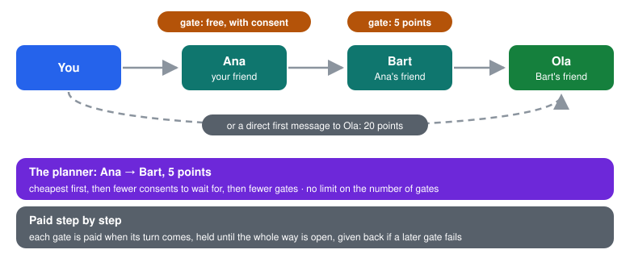

# Introductions and gates

> To reach someone you don't know, go through people who do. A friend can
> introduce you, and every friend decides on what terms they open the way:
> free, with their consent, or for pyramid points.

## Introductions

- **Ask for an introduction:** you ask a friend to introduce you to one of
  their friends (from the graph, or from *Who's worth meeting*). Your friend
  passes the request on with a word of their own, or doesn't. The other
  person decides. After a yes, both of you get an ordinary friend invitation.
  You never see refusals.
- **A letter through a mutual friend:** a single message (up to 1000
  characters) to someone you don't know. They can invite you or ignore it.
  Up to 3 a week through one go-between, who passes on at most 10 a week.
- **Bridges:** on the graph, Zen points out two friends from different
  circles and offers to introduce them with an ordinary message to both,
  which you can edit.

## Gates

A **gate** is the terms on which a friend opens the way to one of their
friends. Every gatekeeper sets just three prices, in pyramid points, each of
which may be 0 (free):

- **Close friends**,
- **Friends** (weak acquaintances included),
- **Others** (friends of friends and beyond, who reach the gatekeeper
  through an earlier gate),

plus whether they want to approve each request (by default yes for a free
gate, no for a paid one). On top of that, a gatekeeper can **open the gate
for free** for chosen people (*Open for free*, from a friend's card on the
graph or in the gate settings). There is no request mechanism for that: if
someone wants it, they ask in a chat. A gatekeeper may also allow their
terms to be passed further on, which is how your phone learns about longer
routes (those further away see the *Others* price).

  

**The planner** (graph, *Path* mode, or *How to reach* on a person) compares:

- writing straight away, when the person accepts first messages from
  strangers, at their price;
- a chain of gates of any length, as far as your phone knows the terms,
  each gate at the price that applies to you there (your tier with that
  gatekeeper, or free if they opened it for you): the cheapest first, then
  the one with fewer consents to wait for, then the one with fewer gates.

**Opening the way.** **Open the way** goes gate by gate. Each gate is paid
only when its turn comes, as an escrow payment: the gatekeeper keeps it
once you confirm the whole way opened (or by itself after 4 days), and you
get it back if a later gate fails. A step waits at most a day for a consent.
Long routes are shown shortened ("You → Ana → … 4 … → Ola"), with a progress
bar while the way is opening.

**Defaults:** gates are open for free: whoever asks is introduced at once
(the first-start setup offers *With my consent* instead, where you approve
each request). A paid gate opens as soon as it is paid.

## Message prices

In your pyramid profile you can set what a **first message** to you costs:
free, a price, or closed, separately for friends, friends of friends and
strangers. It is paid once, for the first contact; after that the sender can
write 3 messages before you answer.

## Privacy

- Gate terms are private between you and each friend, and the "free for"
  list never leaves your phone (each friend only learns their own price),
  unless you allow your *Others* price to travel further. Friends pass
  such terms on by themselves up to 6 steps (at most 40 gatekeepers per
  card, nearest first). Beyond that, **Search for further routes** (graph,
  *Path* mode, or *How to reach*) asks the gatekeepers at the edge of what
  your phone knows, along the known way and friend to friend, what lies
  behind them; each answer is one small card, nobody on the way learns who
  asked, and asking again goes a few steps further each time — so routes
  are as long as the graph goes. Gatekeepers who keep their terms to
  themselves answer nothing.
- The person at the end decides; a go-between does not learn their answer.

## Limits

- Paid gates and paid first messages work only when both sides are pyramid
  members; outside the pyramid only free gates and free first messages work.
- The planner sees only routes whose terms reached your phone.

[Back to the guide](README.md)
