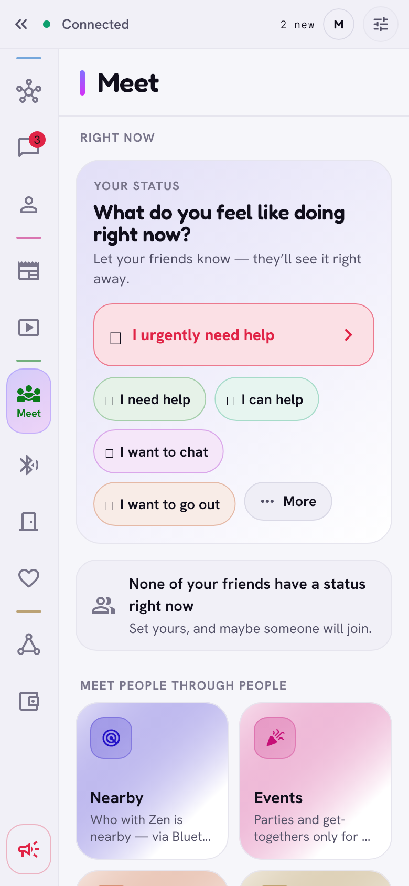

# Meeting people

> Real meetings through people you trust: what you are up to right now,
> events, dinners, sharing food, people nearby, and an alarm for when things
> go wrong.

  <picture>
    <source media="(prefers-color-scheme: dark)" srcset="../images/meet-dark.png">
    
  </picture>

The **Meet** tab has *Right now* at the top and tiles below: Nearby, Events,
Table for six, Dinner circles, Cooking today and Weekend plan. The
**Alarm** has its own red button at the bottom of the rail.

## Right now

A short status for your friends: a walk, coffee, *I urgently need help*…
Filter by all or close friends only. When a friend whose status says they
want to eat something together was near you in the last hour, Zen suggests
writing to them (worked out only on your phone).

## Events

- **Reach:** chosen people, close friends, friends, friends of friends, or
  one step further. Invitations travel on by themselves through friends;
  the organiser can check that a reply from a stranger really came that way.
- **Guests:** your friends of the organiser see the full guest list; people
  further away see first names and "you know 5", with no addresses, until
  they have a ticket.
- **+1:** a guest can ask to bring someone and vouches for them.
- **Tickets:** saying *I'll be there* gives your phone a secret. At the door
  your phone shows a QR code that changes every 20 seconds; the organiser's
  phone checks it offline, accepts it once and only within 90 seconds, so a
  screenshot stops working.
- **Afterwards:** a shared album only for those who came, **Met?**, a
  thank-you card, and *How was it?* with *Repeat in a month?* for the
  organiser.

## Table for six

Say you'd like to have dinner with new people (your city and days). Someone
who hosts picks five people from friends of friends, so that guests mostly
don't know each other, and invites them through the friend who links them.

## Dinner circles

- 4 to 8 friends cook in turn. The founder invites, everyone answers
  **Count me in** or **No, thanks**; members can invite their own friends.
  **Leave circle** reshuffles the cooking queue.
- **Who's coming:** *I'll be there / Can't make it / Maybe* for the next
  dinner. The cook sees how many people and which diets (vegetarian, vegan,
  gluten-, lactose- or nut-free) and gets a reminder the day before.
- A small chat per dinner, **Who owes whom** (whoever shopped enters the
  amount; Zen splits it, the money you settle yourselves) and *How was it?*
  after the dinner.

## Sharing food

- **Share food:** portions, a time window, eat-in or take-away, and the
  allergens are mandatory. Free, "today you, tomorrow me", pyramid points or
  a price label (Zen handles no money).
- **Cooking today, join me:** free seats at your table tonight (1 to 8), for
  close friends, friends or friends of friends. A friend of a friend asks
  through someone who must tap **I vouch**.
- **The pickup address goes only to the accepted person,** sealed with a
  fresh post-quantum key (ML-KEM-768 + X25519) from their request. The
  go-between carries only ciphertext. Each accepted request gets its own
  encrypted chat.

## Weekend plan and Ask the network

- **Weekend plan:** a loose idea ("bikes along the river, Saturday 10 am").
  When enough people say *Count me in*, it turns into an event with a group
  chat. A *shared cause* adds a list of things to bring.
- **Ask the network** (on the graph): a question to your friends, who may
  pass it one step further. Answers come back the same way, signed by the
  answering device. The *answer path* shows who passed it on and who
  answered, without content.

## Nearby (Bluetooth, Android)

- **Visible nearby** is on by default. Your phone broadcasts a random token
  that changes every 10 minutes, together with the Bluetooth address.
- **Friends recognise you;** nobody else can. Each friend gets keys that let
  them check your current token, but not compute a future one, so nobody can
  fake your presence. Strangers see a random nickname ("Green Fox") and a
  rough distance.
- **Writing to a stranger nearby:** the first message and the answer go over
  Bluetooth, sealed with a one-time hybrid key (ML-KEM-768 + X25519).
  Network addresses are exchanged only between people who answered each
  other.
- **Keep looking in the background too** (on by default): every 5 minutes an
  8-second low-power look, skipped below 15 % battery, in battery saver or
  when the phone sleeps. About 0.3 % of the radio's time.
- **Passed by:** a private log of friends you passed, built only from what
  Nearby heard, kept encrypted on the phone for 30 days (a place rounded to
  about 100 m, only if the alarm's location permission is on). Strangers are
  only counted per hour.

## Alarm

- **How:** hold the alarm button for 3 seconds (on Android also 5 presses of
  the power button, if you set it up).
- **To whom:** your close friends (all friends if you have none). It rings
  like a call, also through *Do not disturb*. Optionally a Bluetooth wave
  reaches people right next to you; friends see who it is, strangers a quiet
  note.
- **What:** your location every minute for up to an hour, optional voice
  clips, and for each recipient *sent → delivered → seen → answer*
  ("On my way", "Calling", "Can't").
- **Ending:** **I'm safe** with your PIN. A panic PIN looks the same, but
  tells your friends you may be under pressure. Also a 112 button and a
  backup SMS to up to 5 numbers.
- **From a locked Android phone:** an alarm kit, sealed with a separate
  background key, lets the background service raise the alarm without your
  password.

## Privacy

- Events, plans and tables reach only people through friends; far circles
  see no addresses.
- *Passed by*, the "eat together" suggestions and food counters never leave
  the phone.
- Location goes only where a feature says (the alarm), from the system's own
  location service, never from Google Play services.

## Limits

- Nearby, the Bluetooth wave and background looking are Android only.
- Dinner reminders are checked while Zen runs (every 15 minutes).
- A go-between in food sharing could swap the key in a stranger's request:
  the sealing protects against a curious go-between, not a malicious one.

[Back to the guide](README.md)
