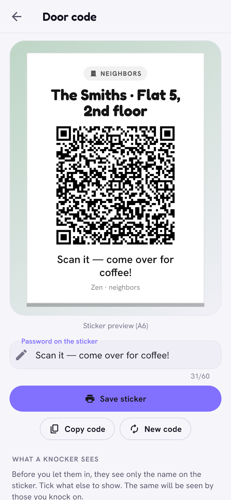

# Neighbours

> A QR code on your door. Neighbours who scan it can knock; you decide whether
> to let them in. Your personal accounts stay out of it.

  <picture>
    <source media="(prefers-color-scheme: dark)" srcset="../images/neighbours-door-dark.png">
    
  </picture>

## What it is

A profile of your **household** ("The Smiths · Flat 5"), shared by everyone
who lives there: a short *About us*, a photo, and items such as *We invite*
(coffee, a barbecue, with a date and a number of places), *We offer* (a drill
to lend) and *We need*. Neighbours you let in see it, can message you and
sign up for invitations.

## How it works

**Doors.** Each household phone runs a tiny separate network node, the
*door*, with its own random key. A door is not the address of any person.
All traffic between flats goes from door to door, sealed with the same
post-quantum session layer as the rest of Zen.

**The sticker.** **Door code** prints an A6 sticker with a QR code (or a link
for people without Zen). It holds the household key, a sticker secret, and
the addresses of doors to knock on: your household's doors and up to 6
mailbox doors kept by your friends, mixed so nobody can tell which is which.

**Knocking.**

1. A neighbour scans the sticker and taps **Knock**.
2. The knock goes to your doors, and a sealed copy to the mailbox doors, in
   case nobody is home.
3. Every phone of the household rings (on Android and computers also in the
   background), once per knock however many copies arrive.
4. **Let in** on any phone: you exchange household profiles, and the knocker
   is on everyone's *My neighbours* list. **Decline** is silence: the
   knocker never learns about it. A decision on one phone closes the knock on
   all the others.

**Nobody home.** Friends' mailbox doors keep a sealed knock for up to 7
days and hand it over when one of your phones comes back. The friend
cannot read it and does not learn who knocked, or at which flat (unless
they have seen your sticker).

**What a knocker sees.** By default only the name on the sticker: your door
stays silent until someone lets them in. In **What a knocker sees** you can
choose to show at once a photo, the first names of the household, invitations
and offers, *About us* or a short note ("The bell doesn't work, knock").
Then your door answers right away, so the knocker learns that one of your
phones is online. The knocker, too, shows only such a card; full profiles
are exchanged after **Let in**.

**Housemates.** A housemate taps **Show housemate code**: a one-time code
that works for 10 minutes and does not contain the household key. The new
phone scans it and asks to join; the housemate's phone shows its name and
device with **Join** / **Reject**. Only after **Join** does the household key
travel to the new phone, sealed to it (with a post-quantum key as well).
Each phone keeps its own resident key and its own first name in the flat
(**Your name in the flat**); messages to neighbours are signed with that
name, never with the account name.

**Leave** on one phone makes the others create a new household key, a new
sticker secret and new doors: the phone that left can no longer sign or read
anything. (Reprint the sticker.) To remove a phone that will not leave,
housemates vote; a majority of the others decides. In a household of **two**,
the other resident is asked first: **I agree** removes the phone at once,
**I disagree** keeps it, and with no answer for 7 days it is removed. Both
phones get a notification at each step.

**Invitations nearby.** **Invite people nearby (Bluetooth)** passes an
invitation with a code of its own that works for 24 hours, never the
permanent code of the sticker. Any household phone accepts knocks with it
until then; **New code** ends it at once.

**New code** changes the sticker secret and the doors; old stickers stop
working.

**Show my profile.** In a neighbour's screen a resident can reveal their own
Zen account (never the other housemates') to make friends.

## Privacy

| Who | Sees | Does not see |
|---|---|---|
| Someone with a camera | the sticker: name and place, door addresses | your accounts, names, how many live there, whether anyone is home |
| A knocker before *Let in* | the name, and only what you chose to show | your accounts, your full profile |
| A neighbour you let in | your household profile, messages signed with the writer's first name in the flat | phone addresses and accounts (until *Show my profile*) |
| Someone who got an invitation nearby | the same as a knocker, for 24 hours | the permanent sticker code |
| A friend keeping a mailbox door | ciphertext and counters | who knocks, which flat (unless they saw the sticker) |

## Limits

- On a locked Android phone, a knock gives a notification without the
  name ("Someone is knocking. Unlock Zen to let them in or decline").
- iPhone has no background service: knocks wait with friends and with other
  household phones, and show up when you open Zen.
- If all household phones are off and nobody keeps your mailbox doors, a
  knock expires after a day on the knocker's side.
- The sticker lists only the housemates whose doors were known when it was
  printed (up to 8).
- A mailbox door accepts 10 knocks a week (4 a day, 2 from one knocker).
- A housemate code works once and for 10 minutes; the phone that showed it
  has to be on to confirm.

[Back to the guide](README.md)
