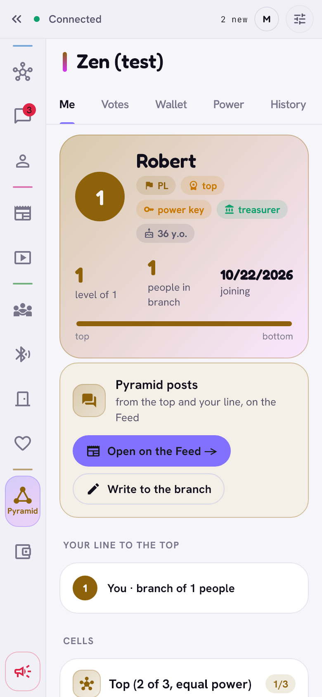
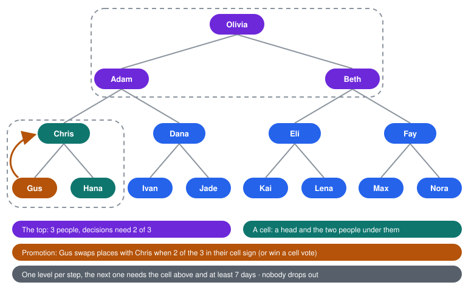
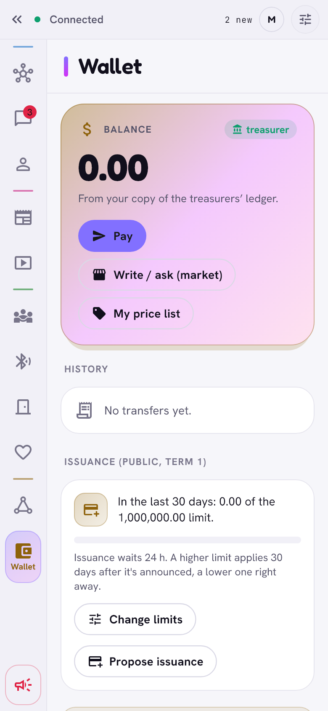
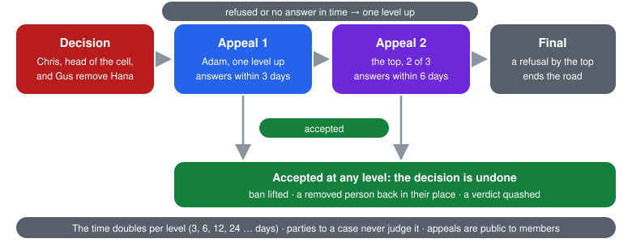
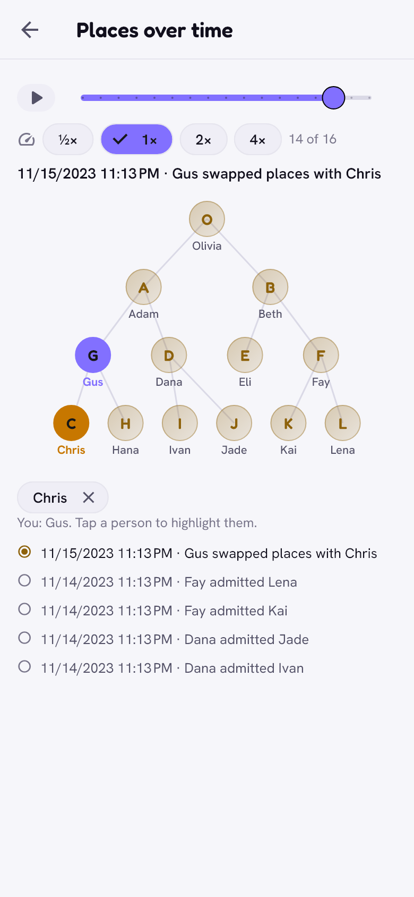

# The pyramid

> A way to decide shared matters without a headquarters: small cells of
> people who know each other in person, stacked into one tree. Trust, votes
> and a common purse flow from the bottom up, and every change is a signed,
> public record.

  <picture>
    <source media="(prefers-color-scheme: dark)" srcset="../images/pyramid-dark.png">
    
  </picture>
  &nbsp;
  <picture>
    <source media="(prefers-color-scheme: dark)" srcset="../images/pyramid-tree-dark.png">
    
  </picture>

## What it is

There is **one** original pyramid. Its first record (the genesis) is pinned
in the app, so nobody can start a rival "official" one. Every member's phone
keeps all its records and computes the same state from them, by the same
rules, in the same order. A record that breaks a rule is rejected
everywhere alike. There is no server that could be bribed or shut down.

## Cells and places

  

- Every place has a **head** above it and two places below. A head and the
  two people under them form a **cell** of three. Most people sit in two
  cells: under their head, and as the head of their own.
- The **top** is the cell at the very top: three people who decide together,
  2 of 3.
- Every cell has its own group chat, made automatically, with everything
  other group chats have (files, voice notes, GIFs, reactions, replies).

## Joining

1. Any member can bring someone in with a **referral**, to a free place in
   their own branch. The newcomer must be at least a *friend* (not a casual
   friend) of the member.
2. The newcomer gives a pseudonym, nationality, birth year (minors are
   accepted) and gender (kept only as a hash unless they choose to show it).
3. The member who referred them, the newcomer, and the head of the chosen
   cell sign.
4. The newcomer **votes** after 14 days, or as soon as a voting member of
   their cells confirms "we've met".

**Not a member yet?** The Pyramid and Wallet tabs stay on the rail and
explain *How to join*: only through a friend who is already a member. Meet;
they open Pyramid → **Invite to the pyramid** and show a code, and you scan
it with the button below. Nobody pays anything to join. Zen also lists *Your
friends in the pyramid* when it knows them ("ask one of them for an
invitation"), or says honestly that it does not know yet or that none of
your friends is a member.

## Moving up, step by step

Every move up is **exactly one level**, and that level must agree:

- a **swap** with the head of your cell, signed by 2 of the 3 in the cell
  (or a won cell vote, below);
- taking a free place directly above you;
- moving to a cell one level higher, with the consent of its head.

After any rise the next one is possible after **7 days** at the earliest.
Nobody falls out: the head simply takes your old place. Moving to another
cell is allowed to the same level, lower, or one level up; with your whole
branch, only to the same level or lower. Someone who left, was removed or
was declared absent comes back at most to the level they left.

## Cell votes

Anyone with a vote in a cell can ask, anonymously, for a vote on who should
be the head.

- The **request** carries a ring signature: it proves that someone in the
  cell asked, not who.
- Each member's phone then makes a **one-time voting card** (a fresh hybrid
  key) and sends it to the other members only. The list of cards (the
  ballot) is signed by the members; it counts only when there are at least
  as many signatures as cards, so nobody can hold two cards.
- Each card votes once. **Two votes for the same person** make them the
  head (a swap); otherwise the head stays.
- A vote cast before the ballot is ready waits on your phone and goes out
  by itself. If someone stays silent, after a third of the voting time the
  cards of two people are enough.

## Referendums

Only the top (2 of 3) calls a referendum: a question with 2 to 6 options,
for the whole pyramid, one branch or one nationality. It is **advisory**.
Your vote goes only to the head of your cell; every head signs the total of
their branch, and the totals are checked against the size of each branch.

## Rules and their hard limits

The top (2 of 3) can change the rules. A change is public at once and applies
24 hours later, never outside the limits built into the app:

| Rule | Allowed range |
|---|---|
| Absence before a place can be declared free | 30 to 3650 days |
| Immunity (the top levels need their own cell's consent for bans) | 1 to 30 levels |
| Transfers one person may order a day (protects the treasurers) | 5 to 200, 30 by default |
| Treasurers (everyone on the top levels) | 3 to 6 levels, at least 15 people |
| Cell vote duration | 24 to 720 hours |
| Report escalation to the next level | 24 to 720 hours |
| Issuance waiting time (veto window) | 24 to 720 hours |

**The issuance limit** (how many points may be created in 30 days), the
issuance waiting time and the **daily transfer limit** have their own,
stricter path:

- **Lower** (or a longer wait, or fewer transfers a day): applies at once.
  You confirm by holding the button for 2 seconds.
- **Higher** (or a shorter wait): it is **announced** to every member at
  once, pinned on the feed, on the *Me* tab and at the top of the wallet,
  and applies only **30 days later**. Until then the top can cancel it. Only
  one such change can wait at a time.

## The wallet

  <picture>
    <source media="(prefers-color-scheme: dark)" srcset="../images/wallet-dark.png">
    
  </picture>

- **Transfers are private.** Only the payer, the person paid and the
  treasurers learn of a transfer (who, to whom, how much, the title). Other
  members do not even learn that it happened: a transfer is never a public
  record. The order is sealed (post-quantum hybrid encryption) to each
  treasurer separately.
- A transfer counts when a **majority of the treasurers** of its time sign
  it. A treasurer signs only an order that is covered, recent, has the next
  number of the account and fits the daily limit, and never two orders with
  one number: two majorities always share an honest treasurer, so nothing
  is spent twice while most treasurers are honest. A treasurer who signs
  two orders with one number leaves proof of it.
- Every treasurer keeps the whole private ledger and syncs it with the
  others; a new treasurer receives it the same way.
- The person paid gets the order with the treasurers' signatures (a
  receipt). Your wallet regularly asks the treasurers for a **signed
  statement** of your balance; it shows the balance most of them agree on.
  A treasurer who states another balance is shown with **Dispute**, which
  files a complaint in the court ("Error in the wallet's accounts").
- **Issuance:** the top (2 of 3) creates points within the 30-day limit.
  The record shows the amount (everybody can check the limit), not who gets
  it: that goes sealed to the treasurers and the recipient. It waits (24
  hours by default), during which the third member of the top can veto it.
- Escrow payments, used by [gates](introductions-and-gates.md) and the
  market, go the same private way: the money is set aside and released by a
  condition, or returned after a deadline.
- After recovering your account (recovery circle or key copy)
  your place and level come back from the records your friends keep, and
  your balance and history from the treasurers' statements.

## Reports, the court and appeals

  

- **Reports** (on a post, comment, profile, message, dating profile) go to
  the narrowest branch around the reporter first and climb a level at a time
  when nobody decides. A decision can ban: permanently, for 24 hours / 7 days
  / 30 days, one piece of content, from dating, or from admitting people. A
  ban never takes away anyone's place or vote. Only your own cell can remove
  you from the pyramid (the head above you and the other member, both).
- **The top's immunity.** Removing or banning a member of the top cell
  (levels 0–1, the head included) takes 2 of 3 of the top **and** a
  majority of the people at level 2. (Removing one piece of their content
  does not.) Appeals go as usual.
- **The court.** Any member can file a complaint against another (a fraud
  warning, *don't lend this person money*, *be careful*, other), up to 3 open
  at a time. The head of the defendant's cell decides within 3 days: a
  verdict (with an optional expiry) or a dismissal with reasons. A verdict is
  a warning that everyone sees on the person's profile in Zen, members and
  non-members alike; the person cannot hide it.
- **Appeals** go one level above whoever decided (from the top: to the top
  again). Refused or unanswered in time, you may go up again, all the way to
  the top, whose refusal is final. The time to answer doubles at each level:
  3, 6, 12, 24 days. Accepted at any level, the decision is undone: a ban is
  lifted, a removed person returns to their place (or the nearest free one in
  their former head's branch), a verdict is quashed. The parties never judge
  their own case. Your cases are under *Decisions about you* on the *Me* tab;
  judges see *To review*.

## National sections and the feed

- Each nationality has a section, led by its highest-placed member. The
  leader pins posts and gives others priority.
- Members write posts to their branch. On the feed: posts to the whole
  pyramid, of your line upwards, your own, and (under *Country*) national
  sections, ordered like the pyramid itself: pinned, then higher authors
  first.
- **Posts to the whole pyramid** are the head's. The head can let specific
  members write them too (a delegation with an end date, which the head
  alone gives and takes back); such a post shows who wrote it and that it
  is "on the head's authority".
- The **Country** chip is always on the feed. Outside the pyramid it shows
  the sections of your profile's nationalities, or of your phone's region
  when the profile shows none; **Choose countries** picks any others
  (several, from a searchable list of flags and names). Friends who are
  members pass on what you ask for, a limited number of countries and not
  more often than every few minutes per friend. Members always see their
  own section and can follow others the same way (they read them, they
  comment only in their own).
- People outside the pyramid also read the posts to the whole pyramid when
  member friends pass them on; a delegated post comes with the head's
  signed delegation.

## History

  <picture>
    <source media="(prefers-color-scheme: dark)" srcset="../images/pyramid-history-dark.png">
    
  </picture>

**History → Places over time** replays the tree from the founding to today:
a slider, play and pause, speeds ½× to 4×. People move between places as
they join, rise, swap with their heads, leave or are removed. Tap people to
highlight them; you are always highlighted. Below the tree: the current step
("Gus swapped places with Chris") and the last five. Large trees show the
top three levels and the part around you and the people you picked. Under it,
*All changes* lists every signed record.

## Privacy

| Public to every member | Private |
|---|---|
| pseudonym, place, level, nationality, birth year, who admitted whom | gender (a hash, unless shown) |
| posts and comments in branches | your referendum vote (only your head knows it) |
| issuance amounts, vetoes, the limits | transfers (only the two sides and the treasurers) |
| bans with reasons, verdicts, appeals and answers | branch statistics (only from 5 people up) |
| cell vote results (not who voted for whom) | gate conditions, who gets an issuance |
| | the content of reports, at their recipients |

Records travel only between friends who are members (or follow the
pyramid).

## Limits

- Until the original genesis is pinned in a release, a release build shows
  that the pyramid has not started; development builds use a test pyramid.
- The treasurers (everyone down to level 3) see every transfer, like a
  bank. A dishonest **majority** of treasurers could sign a spending twice
  or a false statement: it would leave proof, but could not be stopped.
- The anonymous vote request is classical (a ring signature): a future
  quantum computer could forge a request (a nuisance, not a result) or tell
  later who asked. The votes themselves are post-quantum. See the
  [security model](../SECURITY_MODEL.md).
- Readers outside the pyramid trust their member friends that a verdict or
  post came from the right person; they cannot check the records.
- The power key and the one-time voting cards are made from the account
  key, so a recovered head gets the power key back (and a vote in progress
  keeps its card). Only the founder's very first power key, made outside
  the app, does not come back: the next head's key does.
- Readers outside the pyramid cannot see that a delegation to write to the
  whole pyramid was taken back before its end; members can.
- Your phone folds the records into the pyramid once, then adds new
  records as they come; only a record dated into the past makes it fold
  everything again, in the background for a large pyramid.
- **Newer rules.** Every record says which version of the pyramid's rules
  it follows. When a record follows rules newer than your Zen knows, your
  phone stops at that record: it applies nothing from there on (time stops
  too), signs nothing, and the Pyramid tab asks you to update Zen. Nothing
  is lost; after the update the phone goes on from that record.

[Back to the guide](README.md)
