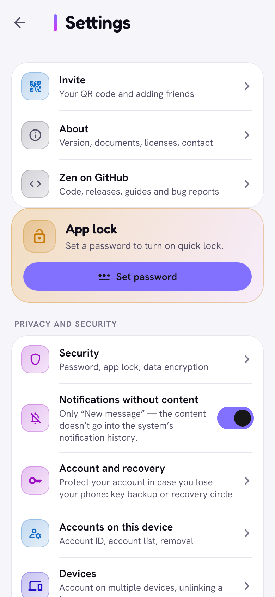

# Settings and public peers

> Where things are, and how Zen reaches the network.

  <picture>
    <source media="(prefers-color-scheme: dark)" srcset="../images/settings-dark.png">
    
  </picture>

## Finding your way

The **rail** on the left holds every section, one tap each, in four groups:

- you and your people: **Graph · Chats · Profile**
- content: **Feed · Videos**
- meeting people: **Meet · Nearby · Neighbors · Dating**
- community: **Pyramid · Wallet**
- and, apart at the bottom, the red **Alarm**.

**Nearby** is on the rail only where it works: not on iPhone, iPad or a
computer without Bluetooth LE. The wallet also opens from your own profile
(the wallet icon in its title bar).

The open tab shows its name under the icon. The **top bar** shows the
connection state (with *Why isn't it working?* when there is no network),
**Lock now**, the account menu (your avatar) and opens **Settings** when
tapped. The first button hides or shows the rail.

## Settings

| Section | What's inside |
|---|---|
| Invite | your QR code, *Copy invitation* and *Copy code only*, scanning someone's code, sending Zen to a friend |
| About | version, about how many people use Zen and how many are in the pyramid, **Zen on GitHub** at the top, what Zen is, security and privacy, licences, documents (with the date you accepted them), contact, support |
| Zen on GitHub | the project page: code, releases, instructions and bug reports |
| Privacy and security | app password, emergency wipe password and app lock, **notification content** (*Sender and content* by default, *Sender only* or *Notice only*; a chat can have its own level in its menu → *Notifications*), account and recovery (key copy, recovery circle, copy with friends, full account copy, second device), accounts on this device (with *Receive in the background*), devices, blocked people, group invitations, *Show when I last opened the app* (on by default), messages from non-friends |
| Messages and calls | call recordings, **GIFs** (the *GIF search* switch), downloading photos and videos (also over mobile data by default; *Media over Wi-Fi only* turns that off), **notifications and sounds** (sounds in the app and of system notifications, and a switch for each kind of news: messages, group messages, calls, mentions, reactions to your posts, friends' posts, posts of further friends (off by default), invitations, updates; a switched-off kind posts no notification and plays no sound but stays in the in-app list, except for posts), storage limits, notifications and background operation (Android) |
| App | permissions and Bluetooth, **Looking around in the background** (Android: how often and how long Bluetooth looks for people nearby), *Why isn't it working?*, appearance, language, data and storage, updates and Pass it on |
| Advanced | network and service (offline mailboxes, [offline links](offline-links.md)), public peers, diagnostics, **delete this account from this device** |

**Looking around in the background** (Android) lets Bluetooth look for
people nearby without the Nearby screen open: by default for 8 seconds
every 5 minutes (choices: every 2, 5, 10, 15 or 30 minutes, for 4, 8 or 15
seconds, or off). The page shows an estimate of what it costs the battery
a day, counting that every look wakes the phone for a few seconds: about
42 mAh (1.4 %) by default, about 174 mAh every 2 minutes for 15 seconds,
about 4 mAh every 30 minutes for 4 seconds, plus about 2.4 mAh for being
visible nearby. These are estimates for a typical phone, and the most it
costs: while Zen is locked and the looks find nobody new, they come less
often (up to three times the chosen gap, at most 30 minutes apart) and go
back to the chosen gap once someone new is seen or the screen is on. It
skips its turn below 15 % battery, in battery saver and while the phone
sleeps, unless it is charging.

**Battery.** After 5 minutes in the background an Android phone only
receives (no presence pings, scans or sync), lock or no lock; *Auto-lock*
says so when it is set to *Never*, on close, on restart or longer than 5
minutes. Presence pings go only to friends and only while Zen is on the
screen. A computer on battery stops being a bridge for others and keeps
only 4 public peers; plugged in, it goes back to normal.

**GIFs.** The GIF button in chats searches KLIPY, an outside company (the
only chat feature that talks to one). Switch off *GIF search* and the GIF button disappears and Zen
sends nothing to KLIPY. GIFs from your phone's keyboard and GIF files keep
working. The same page takes your own KLIPY API key, in case the app's
default key runs out.

Text on these pages can be selected and copied. *Why isn't it working?*
checks the network, background work, notifications, battery, the clock and
free space; on an iPhone it also says that Zen receives at once only while
it is open. **Diagnostics** keeps a technical log (without message content,
names or addresses) to attach to a bug report: it shows the latest entries,
and the save button writes the whole log to a file.

## Public peers

**What they are.** Zen runs on the [Yggdrasil](https://yggdrasil-network.github.io/)
mesh. To join it, a device connects to a few public peers: ordinary
Yggdrasil nodes run by volunteers. They pass encrypted traffic on; they
cannot read it.

**How it works.**

- Zen picks only encrypted links by itself (`tls://`, `quic://`, `wss://`).
  Their TLS 1.3 uses the hybrid post-quantum key exchange X25519MLKEM768.
  On unencrypted `tcp://` and `ws://` links, anyone on the line could see
  which mesh keys your node talks to.
- A phone keeps links to 4 peers at a time (2 while Zen only receives in
  the background): its 16 first picks, then the rest of the list in
  reserve. When a link goes down the phone dials the next two of the list
  at once and keeps whichever comes up first; a peer that does not
  connect within 8 seconds is replaced by the next one. So the links are
  back within seconds, also when the next peer in line is down too. With
  no network at all the phone tries again in waves, less and less often
  (up to every 15 minutes), so a phone whose first picks went quiet moves
  on to peers that still answer without dialling round and round. A
  computer uses about 20, and only 4 while it runs on battery. Computers
  check which peer answers fastest every 6 hours, never on battery.
- Every peer of the built-in list is switched on; most of them simply wait
  in reserve. Each one says what the device does with it now: *In use*,
  *Connecting…*, *Not connecting* (a phone soon tries another one), *In
  reserve*, or *Paused for a while* (a phone keeps a single link for a
  while after too much of other people's mesh traffic passed through it).
- **Settings → Advanced → Public peers:** see the list (the default one or
  your own), add a peer (the address is checked strictly), remove one,
  switch one off (it is then never used), **Check peers** (reachable? latency in ms, does the key
  match?), **Pin key** (adds the `?key=` seen during the check, so a peer
  can't be swapped), **Restore defaults**. Changes apply at once. At least
  one peer must stay on.
- Your own node answers no "who are you" questions (operating system,
  version) and has no admin socket.

**Your own bridge.** Zen on a computer helps others connect when the router
allows it. You can also run a permanent Yggdrasil node yourself; see the
[README](../../README.md#your-own-bridge-for-advanced-users).

## How many people use Zen

**About** shows *About N people in the Zen network (estimate)* and, when
you keep a pyramid, the exact number of its members. Nobody counts people
centrally: every account adds one anonymous number a month to a small
sketch (1.5 KB), friends swap sketches at most once an hour and merge
them, and after a while every phone sees about the same total (give or
take a few percent). The number cannot be traced back to anyone, last
month's count still shows at the start of a month, and people who stopped
using Zen drop out after two months. One friend alone cannot blow the
number up once you have two or more friends; it is still only a rough
guide.

## Privacy

- Public peers see your IP address and your mesh address (that is, your
  invitation code), not what you send.
- Settings, public peers and the language are per account.

## Limits

- Any Yggdrasil node answers debug questions about its direct neighbours.
  This cannot be switched off without a change in Yggdrasil itself; for a
  computer bridge it reveals the keys of friends' phones connected to it.
- Yggdrasil's own local discovery (multicast) stays off, because its beacon
  would carry your identity; Zen's [offline links](offline-links.md) do that
  job privately instead.

[Back to the guide](README.md)
