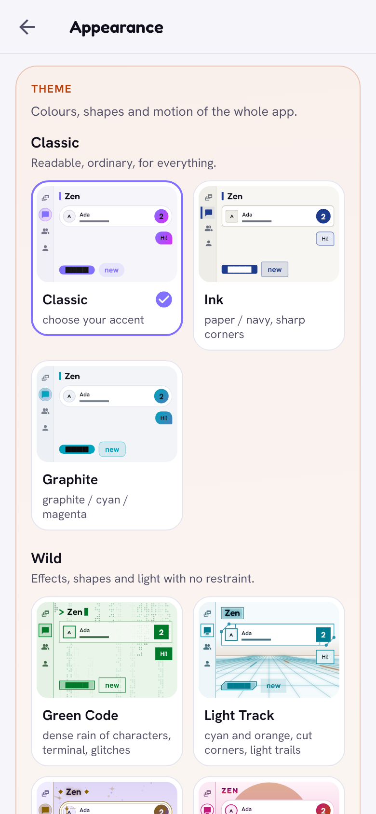

# Themes and appearance

> 27 looks in five groups, each in a light and a dark version. A theme
> changes not only colours but also shapes, lines, buttons, backgrounds and
> motion.

  <picture>
    <source media="(prefers-color-scheme: dark)" srcset="../images/themes-dark.png">
    
  </picture>

## What it is

**Settings → Appearance** shows every theme as a live miniature of the app,
drawn in that theme. One tap switches. Light, dark or *follow the system*:
every theme has both versions and keeps its character in each. The default
is **Classic**.

| Group | Themes |
|---|---|
| Classic: clear, ordinary, for everything | Classic (accent colour of your choice), Ink (paper and navy, nearly sharp corners), Graphite |
| Wild: effects, shapes and light without restraint | Green Code, Light Track, Enchanted Night, Retro Sunset, Neon City, 8-Bit, Deep Space, Pastel Wave, The Deep, Comic, Brass & Steam, Hologram, Volcano |
| Muted: quiet colours, soft shapes | Calm, Forest, Fog (very round, no borders) |
| Cool: glowing lines, screens and machines | Neon, Neon grid (a perspective grid to the horizon), Digital rain (green characters falling behind the text), Player (bevelled panels, LCD digits, a small equaliser on the open tab), Phosphor (an amber monitor with scan lines) |
| Elegant: noble colours, thin lines | Dusk, Onyx (black and gold, double hairlines), Pearl (frosted glass over still colour glows) |

The **Wild** group goes furthest. A few examples:

- **Green Code**: a dense rain of characters behind see-through panels, a
  terminal prompt and glitch transitions.
- **Light Track**: cut corners, circuit-board traces, a HUD header and light
  trails racing over a grid.
- **8-Bit**: stepped pixel borders, hard shadows that buttons press into,
  blinking pixel stars.
- **Comic**: thick ink, halftone dots, a tilted title banner and stamped
  labels.
- **Brass & Steam**: riveted plates, sepia, turning cogs and puffs of steam.
- **Volcano**: charred plates with glowing edges, cracks and rising sparks.

All names and artwork are original.

## How it works

- A theme is a palette plus a **character**: corner roundness, borders
  (none, thin, double, glowing, bevelled, cut, circuit, pixel, ink, filigree,
  rivets, window, iridescent), surfaces (filled, outlined, bevelled, glass,
  flat), shadows, hard shadows or glow, dividers, button and chip shapes,
  the navigation style, field style, headers, section labels, an optional
  animated background, page transitions and the pace of animations.
- **Colours have meanings.** People are always one hue, communication
  another, places, money, media, privacy and safety each their own, in every
  theme. Themes with a narrow palette map these meanings onto their own
  colours, so nothing is drawn in a colour from outside the theme.
- Every text colour is checked to keep a contrast of at least 4.5 : 1 on
  every surface, also over the animated backgrounds, in both versions of
  every theme.
- One font set for every theme: Fredoka, Hanken Grotesk and JetBrains Mono.

## Limits

- Animated backgrounds run at 4 to 20 frames per second, pause when the app
  is in the background and stop when the system asks for reduced motion.
- The alarm stays red in every theme, and QR codes stay black on white, so
  they are always recognised and scannable.
- Icon weight does not change with the theme.

[Back to the guide](README.md)
